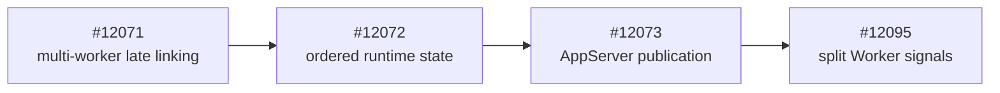
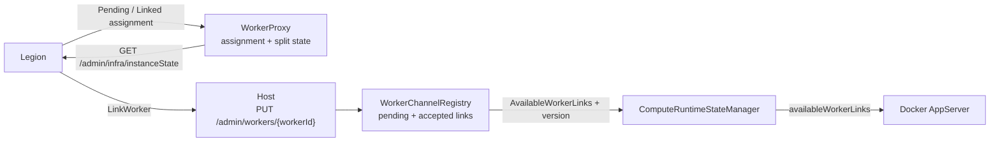
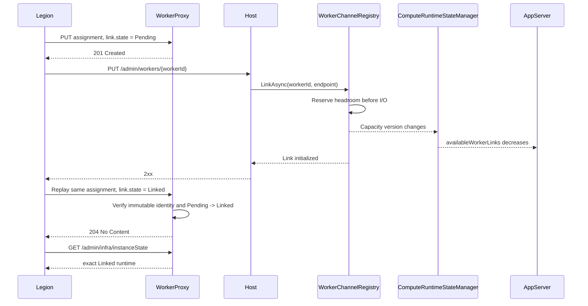

# BYOC split Worker signals

## Context and stack dependency

The Bala-first BYOC model links one app-scoped runtime to multiple Worker pods.
Legion owns orchestration, WorkerProxy owns one Worker's assignment signal, and
Host owns worker-link admission and remaining headroom.

This PR targets #12073 because `dev` does not contain the ordered
`ComputeRuntimeState` to `AppServerHostStateClient` publication path. Targeting
`dev` would either omit wire publication of `availableWorkerLinks` or duplicate
the parent stack. #12071 is still a content dependency even while closed and
unmerged; the stack must land or be superseded before this PR can target `dev`.

## Current vs target behavior

| Area | Current | This PR |
| --- | --- | --- |
| Worker state | `/admin/worker/state` publishes the legacy shape. | The legacy route is unchanged; `/admin/infra/instanceState` publishes the split shape. |
| Link convergence | Host success is not represented in WorkerProxy state. | Legion assigns `Pending`, awaits Host 2xx, then replays the same assignment as `Linked`. |
| Runtime identity | WorkerProxy does not publish the exact linked runtime. | `dynamicState.link.runtime` carries the exact runtime identity when known. |
| Host headroom | `MaxWorkerCount` is not published as scheduler headroom. | Pending and accepted links consume Host-authoritative `AvailableWorkerLinks`. |
| AppServer snapshot | #12073 publishes capacity and linked-worker count. | The same ordered request adds JSON `availableWorkerLinks`. |

## Detailed PR changes

### Component flow

### Pending to Linked

`PUT /admin/worker/assignment` accepts additive `staticState` and `link`
members. WorkerProxy validates complete Worker/runtime identities, preserves
the original assignment identity, and permits only exact replay,
`Unlinked -> Pending`, and `Pending -> Linked`. An initial `Linked` assignment,
identity change, or regression returns `409 AssignmentConflict`.

`GET /admin/infra/instanceState` returns:

- `functionsContainerType: "FunctionsSplitWorkerProxy"`;
- the assigned `staticState`;
- `dynamicState.revisionId`;
- status `Starting`, `ReadyForWork`, or `RemovalRequested`; and
- link state `Unlinked`, `Pending`, or `Linked`, with exact runtime identity
  when known.

`ReadyForWork` requires local Worker readiness and `link.state == "Linked"`.
`Draining` remains in the Bala-compatible enum but is not currently emitted.

`WorkerChannelRegistry` derives the cap from
`WorkerConcurrencyOptions.MaxWorkerCount`. A new link reserves under the
existing registry lock before I/O. Pending and live accepted links consume
headroom; exact retries share the existing attempt; failed attempts and
terminal channels release headroom. Terminal worker IDs remain fenced for the
Host process lifetime.

Pending reservations change headroom before an initialized-channel change, so
the registry keeps one capacity version/wait using the same lock and
`TaskCompletionSource` pattern as initialized-channel signalling.
`ComputeRuntimeStateManager` reads the version before the value and includes
`AvailableWorkerLinks` in snapshot equality. `AppServerHostStateClient`
serializes it as exact JSON member `availableWorkerLinks`.

## Assumptions

- Legion is the trusted caller of the existing platform management endpoints.
- The Worker has established a valid `StartStream` before assignment.
- Legion replays the same Worker and runtime identities for `Pending` and
  `Linked`.
- Legion sends `Linked` only after Host returns 2xx.
- Docker AppServer consumes `availableWorkerLinks` from the #12073 request.
- `MaxWorkerCount` is the Host-owned per-app worker-link budget for this slice.

## Known limitations/non-goals

- No new authentication protocol, durable planner, retry loop, or ownership
  store is introduced.
- Existing management endpoint isolation remains a rollout security gate.
- Host does not promote WorkerProxy state; Legion owns the replay.
- WorkerProxy and Host state remain process-local.
- Host keeps terminal worker IDs fenced until process restart.
- Host-to-AppServer delivery remains bounded and best effort.
- Docker consumer deployment and end-to-end stamp validation are outside this
  PR.

## Failure/conflict behavior

| Condition | Result |
| --- | --- |
| Assignment arrives before valid `StartStream` | `503 WorkerNotReady`; no identity is reserved |
| Initial `Linked`, identity change, second runtime, or link regression | `409 AssignmentConflict` |
| Exact active replay with no state change | `204 No Content` |
| Replay after Worker termination | `409 WorkerTerminated` |
| Split state polled before split assignment | `503 WorkerStateUnavailable` |
| New Host link at zero headroom | `409 LinkConflict` |
| Existing worker retried with another endpoint | `409 LinkConflict` |
| Host link initialization fails | Existing 503 direction; pending headroom is released |
| WorkerProxy is `Pending` and Host linking fails | WorkerProxy remains `Pending`; Legion retries Host |
| Host succeeds and Linked replay fails | Host retains the link; Legion retries the exact replay |
| State tracking or shutdown withdraws capacity | Local HTTP capacity and headroom become zero |

## Compatibility/rollout

- Legacy assignments can omit `staticState` and `link`.
- `/admin/worker/state` is unchanged.
- `/admin/infra/instanceState` and `availableWorkerLinks` are additive.
- Deploy compatible WorkerProxy, Host, Docker/AppServer, and Legion builds
  before using the new signals for convergence or scheduling.
- Verify the pre-existing management endpoints remain platform-only before
  activation.
- Roll back producer and consumers together; do not leave Legion emitting a
  state transition that the deployed WorkerProxy does not understand.

## Validation

The PR adds exactly four behavioral HTTP/API test methods and zero new unit-test
method declarations:

1. `SplitInstanceStateReturnsNestedWorkerStateAfterAssignment`
2. `SplitAssignmentReplayTransitionsPendingLinkToExactLinkedRuntime`
3. `SplitAssignmentRejectsRuntimeChangesAndPreservesLegacyStateContract`
4. `Put_HeadroomCountsPendingAndAcceptedWorkerLinks`

| Command | Result |
| --- | --- |
| `dotnet test test\Functions.WorkerProxy.Tests\Functions.WorkerProxy.Tests.csproj --no-restore --filter "FullyQualifiedName~ManagementApiEndpointTests\|FullyQualifiedName~ManagementApiHandlersTests"` | 216 passed |
| `dotnet test test\Functions.Rpc.Client.Tests\Functions.Rpc.Client.Tests.csproj --no-restore --filter "FullyQualifiedName~WorkerChannelRegistryTests\|FullyQualifiedName~ComputeRuntimeStateManagerTests"` | 106 passed |
| `dotnet test test\Functions.Host.Tests\Functions.Host.Tests.csproj --no-restore --filter "FullyQualifiedName~WorkerLinkControllerTests\|FullyQualifiedName~WorkerLinkEndpointIntegrationTests\|FullyQualifiedName~AppServerHostStateClientTests\|FullyQualifiedName~AppServerHostStatePublisherTests"` | 179 passed |
| `git diff --check 9dd49fc1b915d5e500145ea32fdc40afa56373b4` | Passed |
| Required headings, balanced fences, and three Mermaid blocks | Passed |

Deployed WorkerProxy/Host/Docker validation with Legion remains a merge gate.

## Changed-file review map

| Area | Primary files | Review focus |
| --- | --- | --- |
| Worker assignment | `WorkerAssignRequest.cs`, `WorkerAssignRequestValidator.cs`, `WorkerPodStateManager.cs` | Required identity, immutable replay, monotonic transition |
| Split publication | `SplitWorkerLink.cs`, `ManagementApiHandlers.cs`, `ManagementApiEndpoints.cs` | Additive endpoint and exact JSON shape |
| Host admission | `IWorkerChannelRegistry.cs`, `WorkerChannelRegistry.cs` | Pending plus accepted budget, retry reuse, release |
| Ordered publication | `ComputeRuntimeState.cs`, `ComputeRuntimeStateManager.cs`, `AppServerHostStateClient.cs` | Version-before-value ordering and `availableWorkerLinks` |
| Behavioral tests | `ManagementApiEndpointTests.cs`, `WorkerLinkEndpointIntegrationTests.cs` | Four public HTTP/API scenarios |
