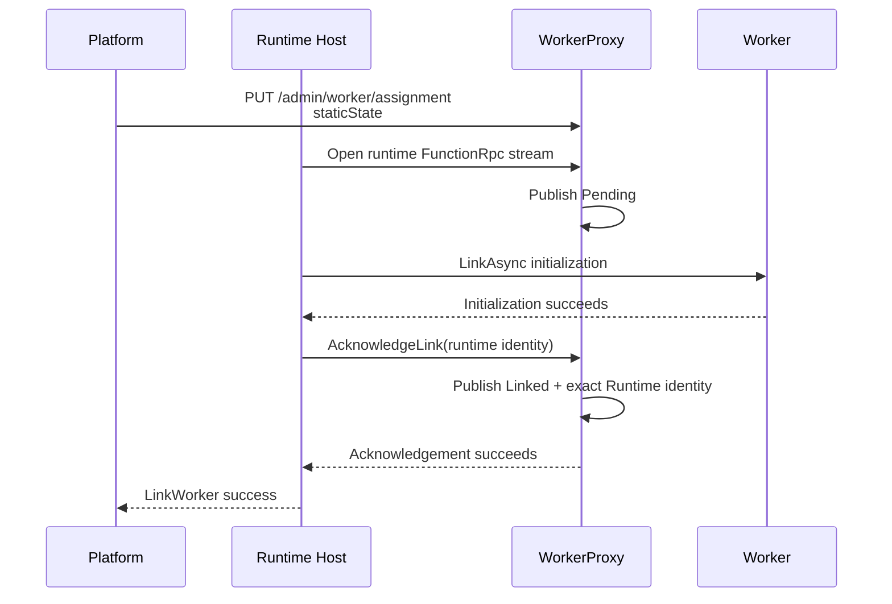

# BYOC split Worker signals

## Contract and ownership

WorkerProxy publishes the state of one split Worker pod. The platform assigns
the Worker, the Runtime Host links to its runtime-facing FunctionRpc listener,
and WorkerProxy exposes the resulting signal through:

```http
POST /admin/infra/instanceState
x-ms-site-token: <NNA site token>
```

The route is available only on WorkerProxy's management listener. The existing
`/admin/worker/state`, readiness, and assignment routes keep their existing
authentication and response behavior.

Runtime capacity, `availableWorkerLinks`, admission budgeting, and link
counting are not owned by this signal.

## Published state

WorkerProxy publishes a complete `FunctionsSplitWorkerProxy` state from
process start. Before assignment, immutable fields that are not yet known use
explicit placeholders:

```json
{
  "functionsContainerType": "FunctionsSplitWorkerProxy",
  "staticState": {
    "self": {
      "resourceNamespace": "unassigned",
      "podName": "worker-pod",
      "podGuid": "00000000-0000-0000-0000-000000000000",
      "legionStampName": "unassigned",
      "podType": "FunctionsSplitWorkerPod",
      "app": {
        "functionAppName": "unassigned",
        "functionAppSiteId": 0,
        "antaresStampName": "unassigned"
      }
    },
    "isDiscoveryPod": false,
    "isAlwaysReady": false,
    "functionGroup": null,
    "configLastModifiedTime": 0,
    "contentLastModifiedTime": 0
  },
  "dynamicState": {
    "revisionId": 0,
    "status": "Starting",
    "link": {
      "state": "Unlinked"
    }
  }
}
```

`PUT /admin/worker/assignment` replaces the placeholder static state with the
required `staticState` from the assignment and increments the shared revision.
The assignment does not own link state.

An empty polling body, or a body different from the current full state,
returns the current state immediately. An equal body waits for the next
revision and returns `204 No Content` when the existing long-poll timeout
expires.

## Poll authentication

Only `POST /admin/infra/instanceState` requires the NNA
`x-ms-site-token` contract:

- signing key: `CONTAINER_ENCRYPTION_KEY`, decoded as a 32-byte hex or base64
  key;
- signing algorithm: `HS256`;
- lifetime: an unexpired token with an `exp` claim;
- audience: the Worker pod name; and
- issuer: `https://appservice.core.azurewebsites.net` or
  `https://legion.core.azurewebsites.net`.

Missing or invalid tokens return `401 Unauthorized` before request-body
binding. Token and key values are not logged.

## Link state transitions



The runtime-facing FunctionRpc attachment changes `Unlinked` to `Pending`.
This transition does not depend on assignment order or Worker readiness.

`WorkerInitResponse` is relayed and capability-finalized as before, but it does
not change split link state.

After `IWorkerChannelRegistry.LinkAsync` succeeds, the Host calls the unary
`WorkerLinkControl.AcknowledgeLink` operation on the same runtime-facing gRPC
listener. The request carries the exact Runtime identity:

```json
{
  "runtime": {
    "resourceNamespace": "runtime-namespace",
    "podName": "runtime-pod",
    "podGuid": "22222222-2222-2222-2222-222222222222",
    "legionStampName": "legion-stamp",
    "podType": "FunctionsSplitRuntimePod",
    "app": {
      "functionAppName": "example-app",
      "functionAppSiteId": 42,
      "antaresStampName": "antares-stamp"
    }
  }
}
```

The acknowledgement is idempotent for the same identity. A different identity
after `Linked` receives gRPC `AlreadyExists`; an acknowledgement without a
pending runtime attachment receives `FailedPrecondition`. Any acknowledgement
failure prevents the Host link API from returning success. No retry loop or
rollback protocol is introduced.

The Host link request therefore requires both the Worker endpoint and Runtime
identity:

```http
PUT /admin/workers/{workerId}
```

```json
{
  "workerGrpcEndpoint": "http://worker-proxy:50053/",
  "runtime": {
    "resourceNamespace": "runtime-namespace",
    "podName": "runtime-pod",
    "podGuid": "22222222-2222-2222-2222-222222222222",
    "legionStampName": "legion-stamp",
    "podType": "FunctionsSplitRuntimePod",
    "app": {
      "functionAppName": "example-app",
      "functionAppSiteId": 42,
      "antaresStampName": "antares-stamp"
    }
  }
}
```

## Readiness and termination

WorkerProxy publishes `ReadyForWork` only when all three conditions are true:

1. the customer Worker has sent a valid `StartStream`;
2. assignment has been accepted; and
3. the Runtime link has been explicitly acknowledged as `Linked`.

All other states currently publish `Starting`.

When the relay terminates, Worker readiness is withdrawn. An unacknowledged
`Pending` link returns to `Unlinked`. An acknowledged link remains `Linked`
with the exact Runtime identity, matching the contract that `Linked` records
accepted ownership and does not by itself prove current health.

## Compatibility and deferred work

- `/admin/worker/state` retains its existing JSON shape and error direction.
- Split transitions use the existing shared revision and can wake legacy state
  polls.
- Every accepted BYOC assignment requires complete Worker `staticState`.
- The platform must include exact Runtime identity in the Host link request.
- Runtime `availableWorkerLinks`, capacity, and link counting are owned by the
  Runtime-side signal work.
- Epoch/restart reconciliation, durable replay state, draining,
  removal-requested transitions, and reconnect ownership are deferred.
- The acknowledgement inherits the existing runtime-listener network trust
  boundary. Independent caller authentication, key rotation, and credential
  replay hardening are deferred beyond the required NNA site-token validation.
- Deployed control-plane convergence and stamp validation remain separate from
  these in-memory behavioral tests.

## Validation

The retained behavioral coverage enters through WorkerProxy's management and
gRPC APIs and the Host's public Worker link HTTP route. It covers:

- authenticated placeholder polling and assignment replacement;
- required assignment static state;
- `Unlinked -> Pending -> Linked` only after explicit acknowledgement;
- acknowledgement replay, conflict, ordering, and failure direction;
- `ReadyForWork` gating; and
- retained `Linked` Runtime identity after relay termination.
