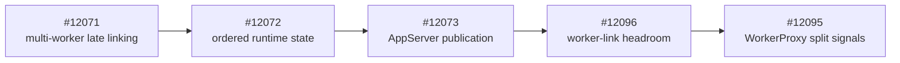
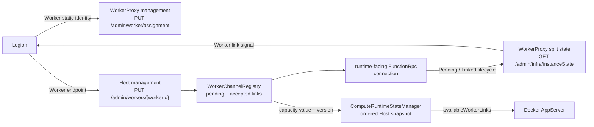
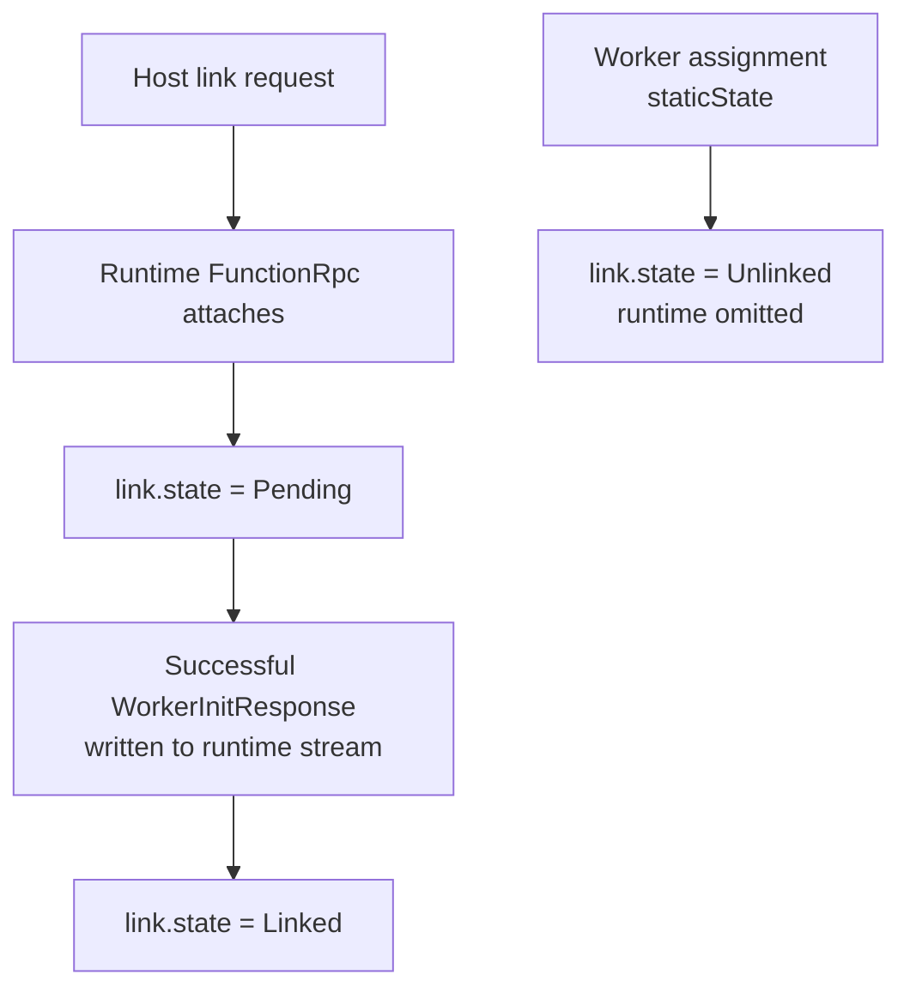

# BYOC split Worker signals

## Context and stack dependency

The Bala-first BYOC model has one app-scoped runtime link to multiple Worker
pods. Legion orchestrates assignment and linking, WorkerProxy publishes one
Worker's state, and Host owns link admission and remaining runtime headroom.



This PR targets #12096, which owns Host worker-link admission and publishes
remaining headroom. #12096 targets #12073 because `dev` does not contain the
ordered `ComputeRuntimeState` to `AppServerHostStateClient` publication path.
The dependency chain must land or be superseded before this PR can target
`dev`.

## Current vs target behavior

| Area | Current | Target |
| --- | --- | --- |
| Worker assignment | Assignment carries legacy app configuration only. | Assignment additively carries immutable split Worker static state; it does not declare runtime link state. |
| Runtime link | WorkerProxy relays FunctionRpc but does not publish the runtime-side connection lifecycle. | The existing Host link opens the runtime-facing FunctionRpc stream; WorkerProxy observes attachment and initialization directly. |
| Worker link signal | WorkerProxy does not expose the runtime-originated connection lifecycle. | WorkerProxy publishes `Unlinked`, then `Pending` on runtime attachment, then `Linked` after successful initialization reaches the runtime stream. |
| Legacy management | `/admin/worker/state` is the only Worker state contract. | `/admin/worker/state` is unchanged; `/admin/infra/instanceState` additively publishes the Bala split shape. |
| Host headroom | The client registry accepts links without an app-scoped admission budget or published remaining capacity. | `WorkerConcurrencyOptions.MaxWorkerCount` is the Host link budget; pending and accepted links consume `AvailableWorkerLinks`. |
| AppServer snapshot | #12073 publishes HTTP capacity and linked Worker count. | The same ordered request adds exact JSON member `availableWorkerLinks`. |

## Detailed PR changes

#12096 owns Host admission, remaining headroom, and AppServer publication.
This PR owns WorkerProxy assignment, runtime-stream lifecycle observation,
link-state transitions, and split-state publication. The boundary keeps the
capacity producer and Worker signal independently reviewable.

### End-to-end component flow



### Assignment and link ownership



`PUT /admin/worker/assignment` owns immutable Worker identity. Its additive
`staticState` contains:

- `self` with the exact Worker pod and app identity;
- `isDiscoveryPod`;
- `isAlwaysReady`;
- `functionGroup`;
- `configLastModifiedTime`; and
- `contentLastModifiedTime`.

Assignment no longer accepts link state as an ownership transition. Exact
assignment replay remains idempotent, but replay cannot manufacture `Pending`
or `Linked`.

`PUT /admin/workers/{workerId}` remains the public Host link seam with its
existing body:

```json
{
  "workerGrpcEndpoint": "http://worker-proxy:50053/"
}
```

#12096 pins the Worker endpoint to the link attempt. An exact retry shares the
existing attempt; the same Worker ID with another endpoint returns
`409 LinkConflict`.

WorkerProxy determines stream ownership from the local listener port. The
runtime listener attachment itself establishes `Pending`; no runtime pod or
Function App identity is carried through FunctionRpc.

### Pending to Linked sequence

```mermaid
sequenceDiagram
    participant Legion
    participant Proxy as WorkerProxy
    participant Host
    participant Registry as WorkerChannelRegistry
    participant RuntimeStream as Runtime FunctionRpc stream
    participant WorkerStream as Worker FunctionRpc stream
    participant Snapshot as Host snapshot
    participant AppServer

    Legion->>Proxy: PUT assignment with staticState
    Proxy-->>Legion: 201 Created; state = Unlinked
    Legion->>Host: PUT /admin/workers/{workerId}<br/>workerGrpcEndpoint
    Host->>Registry: LinkAsync(workerId, endpoint)
    Registry->>Registry: Reserve headroom before I/O
    Registry-->>Snapshot: Capacity version changes
    Snapshot-->>AppServer: availableWorkerLinks decreases
    Registry->>RuntimeStream: Open EventStream
    RuntimeStream->>Proxy: Runtime side attaches
    Proxy->>Proxy: Publish Pending
    RuntimeStream->>WorkerStream: WorkerInitRequest
    WorkerStream-->>RuntimeStream: successful WorkerInitResponse
    Proxy->>Proxy: Write response, then publish Linked
    RuntimeStream-->>Registry: Initialization completes
    Registry-->>Host: Link accepted
    Host-->>Legion: 201 Created or 200 OK
    Legion->>Proxy: GET /admin/infra/instanceState
    Proxy-->>Legion: Linked
```

`FunctionsSplitWorkerDynamicState.Link` is WorkerProxy's authoritative
process-local acknowledgement of the runtime-originated link lifecycle.
Legion can await `Linked` after Host returns 2xx. Host 2xx remains the
authoritative admission and initialization result; `availableWorkerLinks`
remains the authoritative scheduler headroom.

### Published Worker and Host state

`GET /admin/infra/instanceState` returns:

- `functionsContainerType: "FunctionsSplitWorkerProxy"`;
- the assigned `staticState`;
- `dynamicState.revisionId`;
- status `Starting`, `ReadyForWork`, or `RemovalRequested`; and
- `dynamicState.link.state` as `Unlinked`, `Pending`, or `Linked`.

`ReadyForWork` requires local Worker readiness and a `Linked` runtime stream.
`Draining` remains in the Bala-compatible enum but is not emitted in this
change.

In #12096, `WorkerChannelRegistry` reserves a slot under its existing lock
before network I/O. Pending and accepted links both consume headroom. The
capacity-version wait wakes ordered Host-state publication when that value
changes. Publication rechecks both registry versions after collecting Worker
counts so it cannot combine stale headroom with a newer initialized-channel
snapshot. `ComputeRuntimeState.AvailableWorkerLinks` is serialized by
`AppServerHostStateClient.HostStateRequest` as `availableWorkerLinks`.

## Assumptions

- Legion assigns the Worker before invoking the Host link API.
- The Worker has produced a valid `StartStream` before assignment is accepted.
- Activation uses an established deployment boundary that prevents customer
  Worker code from reaching the Host-facing WorkerProxy listeners.
- Docker AppServer consumes `availableWorkerLinks` from the #12096 extension
  to the #12073 request.
- `WorkerConcurrencyOptions.MaxWorkerCount` is the approved Host-owned
  per-app Worker-link budget for this slice; its default is 10.

## Known limitations/non-goals

- No HMAC, shared key, link acknowledgement token, durable planner, retry loop,
  or ownership store is introduced.
- WorkerProxy and Host state are process-local rather than durable.
- A runtime stream opened before split assignment is outside the required
  ordering and cannot establish a split link signal.
- Runtime pod and Function App identity are not carried or published; the
  runtime listener connection is the link signal.
- Host keeps terminal Worker IDs fenced until process restart.
- `Draining` is not produced.
- #12096 reuses `WorkerConcurrencyOptions.MaxWorkerCount` rather than adding a
  BYOC-specific capacity setting.
- Host-to-AppServer delivery remains bounded and best effort.
- Docker consumer deployment, Legion producer deployment, and end-to-end stamp
  validation are outside this PR.
- This PR does not add a new authentication protocol to the pre-existing
  anonymous WorkerProxy listeners. Activation is blocked until deployment
  topology proves customer Worker code cannot reach the management and runtime
  listeners, or an established platform authentication/isolation mechanism is
  supplied. Ordinary network policy cannot isolate containers that share the
  Worker pod's network namespace.

## Failure/conflict behavior

| Condition | Result |
| --- | --- |
| Assignment arrives before valid Worker `StartStream` | `503 WorkerNotReady`; no assignment identity is reserved |
| Exact active assignment replay | `204 No Content`; link state does not change |
| Conflicting assignment replay | `409 AssignmentConflict` |
| Assignment replay after Worker termination | `409 WorkerTerminated` |
| Split state polled before split assignment | `503 WorkerStateUnavailable` |
| A second runtime stream attaches to the active relay session | gRPC `AlreadyExists`; the first connection remains authoritative |
| Existing Host Worker link is retried with another endpoint | `409 LinkConflict` |
| New Host link arrives at zero headroom | `409 LinkConflict` |
| Host link initialization fails | Existing 503 direction; pending headroom is released |
| Relay session terminates after assignment | Link returns to `Unlinked`; status becomes `RemovalRequested` |

## Compatibility/rollout

- Legacy assignment bodies can omit `staticState`.
- The existing Host link request body is unchanged.
- `/admin/worker/state` is unchanged.
- `/admin/infra/instanceState` and `availableWorkerLinks` are additive.
- Deploy #12096 before this PR, then deploy compatible WorkerProxy and Host
  builds before Legion awaits split link state.
- Deploy the #12073 Docker/AppServer consumer before using
  `availableWorkerLinks` for scheduling.
- Confirm the deployed `WorkerConcurrencyOptions.MaxWorkerCount` value is the
  approved per-app BYOC link budget before enabling admission from this signal;
  #12096 makes that value a hard Host link limit.
- **Activation gate:** prove that customer Worker code cannot reach the
  anonymous management and runtime listeners, or provide an established
  platform authentication/isolation mechanism. The current shared network
  namespace does not provide that isolation by itself.

## Validation

This PR adds exactly three behavioral HTTP/gRPC API test methods and zero new
unit-test method declarations:

1. `SplitInstanceStateReturnsUnlinkedWorkerAfterStaticAssignment`
2. `SplitRuntimeLinkTransitionsPendingToLinkedState`
3. `SplitRuntimeLinkRejectsSecondConnectionAndPreservesLegacyState`

#12096 adds the fourth stack-level behavioral method,
`Put_HeadroomCountsPendingAndAcceptedWorkerLinks`, and zero unit-test methods.

| Command | Result |
| --- | --- |
| `dotnet test test\Functions.WorkerProxy.Tests\Functions.WorkerProxy.Tests.csproj --no-restore` | 502 passed |
| #12096: `dotnet test test\Functions.Rpc.Client.Tests\Functions.Rpc.Client.Tests.csproj --no-restore` | 261 passed |
| #12096: `dotnet test test\Functions.Host.Tests\Functions.Host.Tests.csproj --no-restore` | 225 passed |

Deployed WorkerProxy, Host, Legion, and Docker/AppServer validation remains a
merge gate.

## Changed-file review map

| Layer | Area | Primary files | Review focus |
| --- | --- | --- | --- |
| #12095 | Worker static assignment | `WorkerAssignRequest.cs`, `WorkerAssignRequestValidator.cs`, `WorkerAssignment.cs` | Assignment owns immutable Worker state only |
| #12095 | Worker link lifecycle | `FunctionRpcRelayService.cs`, `FunctionRpcRelay.cs`, `FunctionRpcRelay.Session.cs`, `WorkerPodStateManager.cs` | Runtime listener attachment and `Unlinked -> Pending -> Linked` timing |
| #12096 | Host admission | `IWorkerChannelRegistry.cs`, `WorkerChannelRegistry.cs` | Endpoint retry behavior, pending plus accepted headroom |
| #12096 | Ordered publication | `ComputeRuntimeState.cs`, `ComputeRuntimeStateManager.cs`, `AppServerHostStateClient.cs` | Coherent registry-version reads and `availableWorkerLinks` |
| Split | Behavioral tests | `FunctionRpcRelayTests.Management.cs`, `WorkerLinkEndpointIntegrationTests.cs` | Three WorkerProxy scenarios here; one Host scenario in #12096 |
