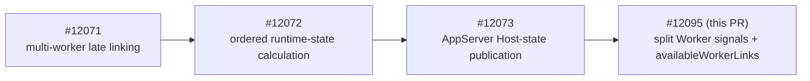
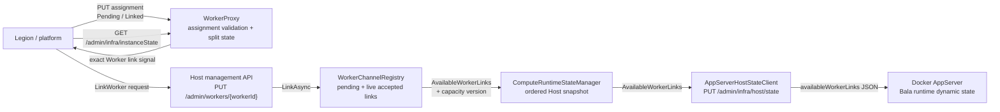
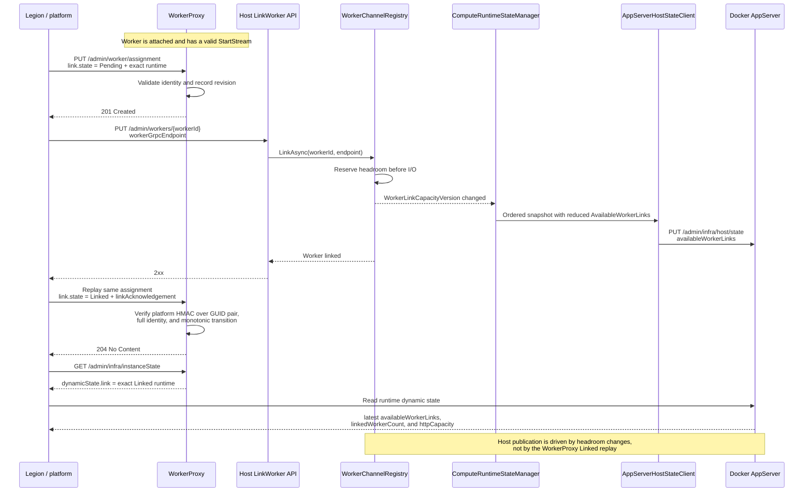

# BYOC split Worker signals

## Context and stack dependency

The Bala-first BYOC model separates one app-scoped Functions Host runtime from
one or more Worker pods. Legion owns orchestration across those components,
WorkerProxy owns one Worker's assignment state, and Host owns admission to its
worker-link budget.

This PR is intentionally stacked instead of targeting `dev`:



`dev` does not contain the ordered `ComputeRuntimeState` and
`AppServerHostStateClient` path introduced by #12072 and #12073. Targeting
`dev` would either leave `availableWorkerLinks` as an in-memory property with
no AppServer wire publication or duplicate the parent publisher chain. Stacking
on #12073 keeps this diff focused and places worker-link headroom in the same
ordered snapshot as `httpCapacity` and `linkedWorkerCount`.

The content dependency on #12071 remains even while that PR is closed and
unmerged. The parent changes must land, be reopened, or be superseded before
this PR can be retargeted to `dev`.

## Current vs target behavior

| Area | Current behavior | Target behavior |
| --- | --- | --- |
| Worker state | `/admin/worker/state` returns the legacy `FunctionsWorkerPod` shape. | The legacy endpoint remains unchanged; `/admin/infra/instanceState` adds the Bala-compatible split Worker shape. |
| Worker identity | Assignment does not publish the complete Worker and runtime identities needed by Legion convergence. | `staticState.self` identifies the Worker exactly; `dynamicState.link.runtime` identifies the exact runtime when known. |
| Link lifecycle | Host link success is not represented in WorkerProxy state. | Legion writes `Pending`, awaits Host 2xx, then replays the same assignment as a signed platform `Linked` assertion. |
| Host admission | `MaxWorkerCount` limits configured workers but is not exposed as scheduler headroom. | Host atomically reserves pending links, counts live accepted links, and exposes remaining `AvailableWorkerLinks`. |
| AppServer publication | #12073 publishes `createdTime`, `httpCapacity`, and `linkedWorkerCount`. | The same request also publishes JSON `availableWorkerLinks`. |
| Change ordering | Worker-channel and ScriptHost changes wake ordered recomputation. | Worker-link capacity changes also have a versioned wait and wake the same recomputation loop. |

## Component flow



Host is authoritative for admission and headroom. WorkerProxy does not infer
Host acceptance from gRPC attachment. Legion is the coordinator that connects
the Host result to the WorkerProxy acknowledgement.

## Pending-to-Linked sequence



## Detailed PR changes

### WorkerProxy assignment and publication

`PUT /admin/worker/assignment` accepts two additive members:

- `staticState` contains the exact Worker identity, discovery and always-ready
  flags, function group, and configuration/content modification times.
- `link` contains `state`, the exact runtime identity when known, and
  `linkAcknowledgement` for `Linked`.

The expected mutation sequence is:

1. Send the complete assignment with `link.state` set to `Pending`.
2. Call Host `PUT /admin/workers/{workerId}` with
   `{"workerGrpcEndpoint":"<URI>"}`.
3. After Host returns 2xx, replay the exact assignment with `link.state` set to
   `Linked` and add `link.linkAcknowledgement`.

The acknowledgement is Base64 HMAC-SHA256 over this UTF-8 payload:

```text
{workerPodGuid:D}
{runtimePodGuid:D}
```

The payload uses lowercase hyphenated GUIDs, one LF byte between them, and no
trailing newline. The HMAC key is the UTF-8 bytes of the literal
`WorkerProxy:WorkerContainerEncryptionKey` configuration value. The HMAC
attests only the Worker/runtime GUID pair supplied by the trusted platform; it
is not a Host-generated receipt and does not cover the worker ID, gRPC
endpoint, or remaining identity fields. WorkerProxy validates the complete
Worker/runtime identity separately, compares the HMAC in constant time, and
does not retain the acknowledgement in published state. A valid split
assignment fails with `503 LinkAcknowledgementUnavailable` before mutation if
the key is unavailable.

`GET /admin/infra/instanceState` returns:

- `functionsContainerType: "FunctionsSplitWorkerProxy"`;
- the assigned `staticState`;
- `dynamicState.revisionId`;
- status `Starting`, `ReadyForWork`, or `RemovalRequested`; and
- `dynamicState.link` with `Unlinked`, `Pending`, or `Linked` plus the exact
  runtime identity when known.

`ReadyForWork` requires both local Worker readiness and a valid
trusted-platform `Linked` assertion. A signed initial `Linked` assignment is
accepted as level-triggered restoration after WorkerProxy restart.

### Host link admission

`WorkerChannelRegistry` derives its cap from
`WorkerConcurrencyOptions.MaxWorkerCount`.

- A new link reserves a slot under the registry lock before connection I/O.
- Pending and live accepted links consume headroom.
- An exact retry reuses the same attempt and does not consume another slot.
- A failed attempt releases its slot.
- A terminal or unlinked channel releases live headroom.
- A terminal worker ID remains fenced and cannot be rebound to another
  endpoint during the Host process lifetime.

At zero headroom, Host returns `409 LinkCapacityExhausted`.

### Ordered Host-state publication

The registry exposes:

- `AvailableWorkerLinks`;
- `WorkerLinkCapacityVersion`; and
- `WaitForWorkerLinkCapacityChangeAsync`.

`ComputeRuntimeStateManager` reads the version before the headroom value,
registers the versioned wait, and includes `AvailableWorkerLinks` in snapshot
deduplication. A concurrent capacity change completes the wait and forces
another ordered pass. Shutdown or an unexpected state-tracking failure sets
both HTTP capacity and worker-link headroom to zero in the local snapshot. The
existing publisher then attempts delivery; AppServer can retain stale positive
values if that bounded publication fails.

`AppServerHostStateClient.HostStateRequest.AvailableWorkerLinks` serializes
with the existing camel-case context as exact JSON member
`availableWorkerLinks`.

## Assumptions

- Legion/platform is the trusted assignment authority and has access to the
  Worker container encryption key; customer or Worker code does not.
- WorkerProxy management endpoints are reachable only on the platform-managed
  network boundary.
- The Worker has attached and established a valid `StartStream` before the
  first assignment; otherwise WorkerProxy returns `503 WorkerNotReady`.
- Legion sends the exact same Worker and runtime identities for `Pending` and
  `Linked`.
- Legion emits `Linked` only after the Host link API returns 2xx.
- Docker AppServer consumes `availableWorkerLinks` from the existing ordered
  Host-state request and combines it with `linkedWorkerCount` and
  `httpCapacity`.
- `WorkerConcurrencyOptions.MaxWorkerCount` is the Host-owned per-app link
  budget for this slice.

## Known limitations/non-goals

- This PR does not add a durable planner, ownership store, retry loop, or
  reconciliation service.
- This PR does not add endpoint-level authentication to the existing
  management routes. Network isolation and secret custody remain rollout
  requirements.
- This PR preserves the #12073 Host-to-AppServer transport and authentication
  behavior.
- Host does not call WorkerProxy to promote `Pending` to `Linked`; Legion owns
  that replay.
- WorkerProxy and Host state are process-local. Signed initial `Linked`
  assignment supports WorkerProxy reconstruction, but this PR does not persist
  assignment history.
- `Draining` remains part of the Bala-compatible wire enum but is not emitted
  by the current WorkerProxy lifecycle.
- Terminal worker identities remain fenced for the Host process lifetime;
  this PR does not add identity garbage collection.
- This PR does not deploy or validate the Docker consumer. Docker draft PR
  17570797 consumes the new member.
- This PR does not change the legacy `/admin/worker/state` contract.

## Failure/conflict behavior

| Condition | Result |
| --- | --- |
| First assignment arrives before the Worker has a valid `StartStream` | `503 WorkerNotReady`; no assignment identity is reserved |
| Split assignment is valid but the acknowledgement key is absent | `503 LinkAcknowledgementUnavailable`; no assignment mutation |
| `Linked` acknowledgement is missing or malformed | `400` field validation error |
| `Linked` acknowledgement does not match the exact Worker/runtime GUID pair | `400 InvalidValue` for `link.linkAcknowledgement` |
| Assignment changes immutable Worker or runtime identity | `409 AssignmentConflict` |
| Link state regresses or skips an invalid transition on an existing assignment | `409 AssignmentConflict` |
| Exact assignment replay has no state change and the assigned Worker is active | `204 No Content` |
| Exact assignment replay arrives after the assigned Worker terminated | `409 WorkerTerminated` |
| Split state is polled before split identity is assigned | `503 WorkerStateUnavailable` |
| Host receives a new worker at zero headroom | `409 LinkCapacityExhausted` |
| Existing worker ID is retried with another gRPC endpoint | `409 LinkConflict` |
| Existing worker ID is retried after its channel terminated | `409 WorkerTerminated` |
| Host is stopping, link initialization is unavailable, or initialization times out | `503 RuntimeStopping`, `503 WorkerUnavailable`, or `503 LinkTimeout`; pending Host slot is released |
| Linked channel terminates | Live headroom is released; worker ID stays fenced |
| WorkerProxy accepted `Pending` and Host linking fails | WorkerProxy remains `Pending`; Legion must retry the Host link |
| Host returns 2xx but the `Linked` replay fails | Host keeps the live link and consumed headroom; WorkerProxy remains `Pending`; Legion must retry the exact `Linked` replay |
| Host state tracking stops unexpectedly | Local HTTP capacity and headroom become zero; AppServer can remain stale if publication fails |

## Compatibility/rollout

- Legacy assignments omit `staticState` and `link`; they retain existing
  behavior and do not require the acknowledgement key.
- `/admin/worker/state` retains its existing discriminator and shape.
- `/admin/infra/instanceState` is additive.
- `availableWorkerLinks` is additive to the #12073 Host-state JSON.
- Provision the acknowledgement key and preserve platform-only management
  network access before enabling split assignments.
- Deploy compatible WorkerProxy, Host, and Docker/AppServer builds before
  Legion begins sending split assignments or using `availableWorkerLinks` as a
  scheduling input.
- Converge Legion producers on the exact Pending -> Host 2xx -> Linked sequence
  before relying on `dynamicState.link.state == "Linked"` as the authoritative
  acknowledgement.
- Rollback must stop new split assignments or move producer, WorkerProxy, Host,
  and Docker consumption back together. Do not roll back only the producer to
  omit the acknowledgement while a strict WorkerProxy is active.

## Validation

The PR adds exactly four new behavioral HTTP/API test methods; no new unit-test
methods were added.

| Command | Result |
| --- | --- |
| `dotnet test test\Functions.WorkerProxy.Tests\Functions.WorkerProxy.Tests.csproj --no-restore --filter "FullyQualifiedName~ManagementApiEndpointTests\|FullyQualifiedName~ManagementApiHandlersTests" --logger "console;verbosity=minimal"` | 216 passed |
| `dotnet test test\Functions.Rpc.Client.Tests\Functions.Rpc.Client.Tests.csproj --no-restore --filter "FullyQualifiedName~WorkerChannelRegistryTests\|FullyQualifiedName~ComputeRuntimeStateManagerTests" --logger "console;verbosity=minimal"` | 106 passed |
| `dotnet test test\Functions.Host.Tests\Functions.Host.Tests.csproj --no-restore --filter "FullyQualifiedName~WorkerLinkControllerTests\|FullyQualifiedName~WorkerLinkEndpointIntegrationTests\|FullyQualifiedName~AppServerHostStateClientTests\|FullyQualifiedName~AppServerHostStatePublisherTests" --logger "console;verbosity=minimal"` | 181 passed |
| `git diff --check 9dd49fc1b915d5e500145ea32fdc40afa56373b4..HEAD` | Passed |

The retained behavioral scenarios cover:

1. nested split Worker state after assignment and fail-closed missing-key
   behavior;
2. signed `Pending` to exact `Linked` transition, terminal status, and
   signed restart restoration;
3. rejection of a second runtime identity while preserving the legacy state
   contract; and
4. Host headroom counting pending plus accepted links and rejecting excess
   admission.

The remaining merge gates are:

- a deployed run of compatible WorkerProxy, stacked Host, and Docker/AppServer
  artifacts with Legion orchestration;
- proof that the management endpoints remain platform-only; and
- proof that the acknowledgement key is provisioned before split assignment
  and is unavailable to customer/Worker code.

## Changed-file review map

| Review area | Primary files | What to verify |
| --- | --- | --- |
| Worker assignment wire contract | `src/Functions.WorkerProxy/Management/WorkerAssignRequest.cs`, `WorkerAssignRequestValidator.cs`, `ManagementApiHandlers.cs`, `src/Functions.WorkerProxy/WorkerProxyOptions.cs` | Required identity fields, key configuration, HMAC boundary, failure direction, immutable replay |
| Worker split publication | `src/Functions.WorkerProxy/State/SplitWorkerLink.cs`, `WorkerAssignment.cs`, `WorkerPodState.cs`, `WorkerPodStateManager.cs` | Exact runtime pinning, revisions, status mapping, restart restoration |
| Public Worker management API | `src/Functions.WorkerProxy/Management/ManagementApiEndpoints.cs`, `WorkerProxyJsonContext.cs`, `WorkerApiErrorCodes.cs` | Additive endpoint and JSON shape; legacy route unchanged |
| Host admission/headroom | `src/Functions.Rpc.Client/Registry/IWorkerChannelRegistry.cs`, `WorkerChannelRegistry.cs`, `WorkerLinkFailureReason.cs`, `src/Functions.Host/Controllers/WorkerLinkController.cs` | Atomic reservation, retry identity, release semantics, HTTP conflict mapping |
| Ordered AppServer publication | `src/Functions.Rpc.Client/RuntimeState/ComputeRuntimeState.cs`, `ComputeRuntimeStateManager.cs`, `src/Functions.Host/HostState/AppServerHostStateClient.cs` | Version-before-value ordering, snapshot deduplication, zero withdrawal, exact JSON member |
| Behavioral coverage | `test/Functions.WorkerProxy.Tests/Management/ManagementApiEndpointTests.cs`, `test/Functions.Host.Tests/WorkerLinkEndpointIntegrationTests.cs` | Four public API scenarios and externally visible behavior |
| Existing focused coverage | `test/Functions.Rpc.Client.Tests/Registry/WorkerChannelRegistryTests.cs`, `test/Functions.Rpc.Client.Tests/RuntimeState/ComputeRuntimeStateManagerTests.cs`, `test/Functions.Host.Tests/HostState/*Tests.cs`, `test/Functions.WorkerProxy.Tests/WorkerProxyWebApplicationFactory.cs` | Existing methods and configuration updated for capacity-version, key, and wire-shape changes |
