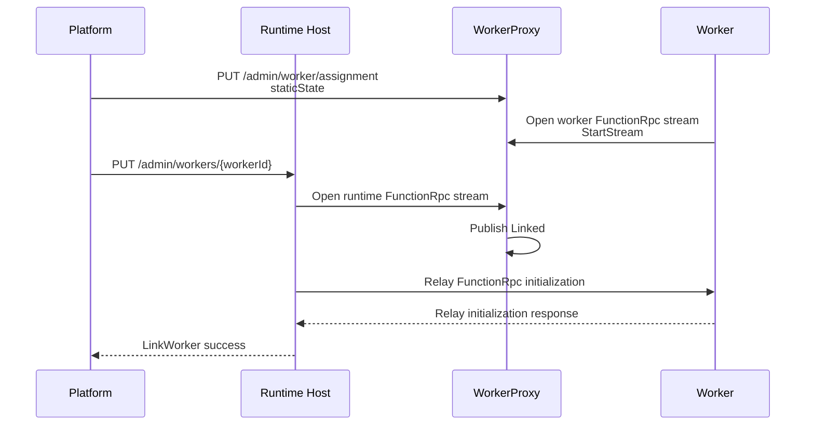

# BYOC split Worker signals

## Contract and ownership

WorkerProxy publishes the state of one split Worker pod. The platform assigns
the Worker, the Runtime Host links to its runtime-facing FunctionRpc listener,
and WorkerProxy exposes the resulting signal through:

```http
POST /admin/infra/instanceState
x-ms-site-token: <NNA site token>
```

The route is available only on WorkerProxy's management listener. The existing
`/admin/worker/state`, readiness, and assignment routes keep their existing
authentication and response behavior.

Runtime capacity, `availableWorkerLinks`, admission budgeting, and link
counting are not owned by this signal.

## Published state

WorkerProxy publishes a complete `FunctionsSplitWorkerProxy` state from
process start. Before assignment, immutable fields that are not yet known use
explicit placeholders:

```json
{
  "functionsContainerType": "FunctionsSplitWorkerProxy",
  "staticState": {
    "self": {
      "resourceNamespace": "unassigned",
      "podName": "worker-pod",
      "podGuid": "00000000-0000-0000-0000-000000000000",
      "legionStampName": "unassigned",
      "podType": "FunctionsSplitWorkerPod",
      "app": {
        "functionAppName": "unassigned",
        "functionAppSiteId": 0,
        "antaresStampName": "unassigned"
      }
    },
    "isDiscoveryPod": false,
    "isAlwaysReady": false,
    "functionGroup": null,
    "configLastModifiedTime": 0,
    "contentLastModifiedTime": 0
  },
  "dynamicState": {
    "revisionId": 0,
    "status": "Starting",
    "link": {
      "state": "Unlinked"
    }
  }
}
```

`PUT /admin/worker/assignment` replaces the placeholder static state with the
required `staticState` from the assignment and increments the shared revision.
The assignment does not own link state.

An empty polling body, or a body different from the current full state,
returns the current state immediately. An equal body waits for the next
revision and returns `204 No Content` when the existing long-poll timeout
expires.

## Poll authentication

Only `POST /admin/infra/instanceState` requires the NNA
`x-ms-site-token` contract:

- signing key: `CONTAINER_ENCRYPTION_KEY`, decoded as a 32-byte hex or base64
  key;
- signing algorithm: `HS256`;
- lifetime: an unexpired token with an `exp` claim;
- audience: the Worker pod name; and
- issuer: `https://appservice.core.azurewebsites.net` or
  `https://legion.core.azurewebsites.net`.

Missing or invalid tokens return `401 Unauthorized` before request-body
binding. Token and key values are not logged.

## Link state transitions



The runtime-facing FunctionRpc attachment changes `Unlinked` directly to
`Linked`. This transition does not depend on assignment order, Worker
readiness, or completion of the Host's `LinkAsync` operation. `Linked` means
that WorkerProxy currently has a Runtime-facing relay attachment; it does not
identify the Runtime pod or independently prove that Host initialization
completed.

`WorkerInitResponse` is relayed and capability-finalized as before, but it does
not change split link state.

The Host link request remains the existing endpoint-only contract:

```http
PUT /admin/workers/{workerId}
```

```json
{
  "workerGrpcEndpoint": "http://worker-proxy:50053/"
}
```

## Readiness and termination

WorkerProxy publishes `ReadyForWork` only when all three conditions are true:

1. the customer Worker has sent a valid `StartStream`;
2. assignment has been accepted; and
3. a Runtime-facing FunctionRpc relay is attached.

All other states currently publish `Starting`.

When the relay terminates, Worker readiness is withdrawn and the link returns
to `Unlinked`.

## Contract boundaries

- `/admin/worker/state` retains its existing JSON shape and error direction.
- Split transitions use the existing shared revision and can wake legacy state
  polls.
- Every accepted BYOC assignment requires complete Worker `staticState`.
- The Host Worker-link request retains its established endpoint contract.
- The Worker link object contains the relay state. Runtime identity is
  published by the Runtime signal.
- `Linked` represents an attached Runtime-facing FunctionRpc relay.
- Runtime `availableWorkerLinks`, capacity, and link counting are owned by the
  Runtime signal.

## Validation

The retained behavioral coverage enters through WorkerProxy's management and
gRPC APIs and the Host's public Worker link HTTP route. It covers:

- authenticated placeholder polling and assignment replacement;
- required assignment static state;
- direct `Unlinked -> Linked` transition on Runtime relay attachment;
- `Linked -> Unlinked` transition on relay termination;
- `ReadyForWork` gating; and
- preservation of the existing Host Worker link request contract.
