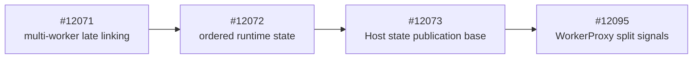
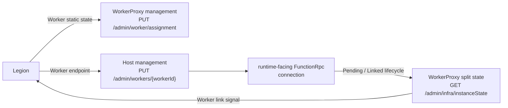

# BYOC split Worker signals

## Context and dependency

The Bala-first BYOC model has one app-scoped runtime that can connect to
multiple Worker pods. Legion owns orchestration, the existing Host link API
opens the runtime-facing FunctionRpc stream, and WorkerProxy publishes one
Worker's connection lifecycle.



This PR targets `shkr-microsoft-http-capacity-publication`, the current
#12073 branch. It does not define Host dynamic scale-out, link admission
budgeting, or scheduler headroom. Those contracts are deferred until their
ownership and scaling semantics are defined.

## Current vs target behavior

| Area | Current | Target |
| --- | --- | --- |
| Worker assignment | Assignment carries legacy app configuration only. | Assignment additively carries immutable split Worker static state; it does not declare runtime link state. |
| Runtime link | WorkerProxy relays FunctionRpc but does not publish the runtime-side connection lifecycle. | The existing Host link opens the runtime-facing FunctionRpc stream; WorkerProxy observes attachment and initialization directly. |
| Worker link signal | WorkerProxy does not expose the runtime-originated connection lifecycle. | WorkerProxy publishes `Unlinked`, then `Pending` on runtime attachment, then `Linked` after successful initialization reaches the runtime stream. |
| Legacy management | `/admin/worker/state` is the only Worker state contract. | Its JSON shape and status semantics are unchanged; `/admin/infra/instanceState` additively publishes the Bala split shape. Split-only transitions share the existing revision and can wake legacy long polls. |

## Detailed PR changes

This PR changes only WorkerProxy assignment, runtime-stream lifecycle
observation, link-state transitions, and split-state publication. It reuses
the existing assignment, Host link, FunctionRpc relay, and management seams.

### End-to-end component flow



### Assignment and link ownership


`PUT /admin/worker/assignment` owns immutable Worker static state. Its
additive `staticState` contains:

- `self` with the exact Worker pod and app identity;
- `isDiscoveryPod`;
- `isAlwaysReady`;
- `functionGroup`;
- `configLastModifiedTime`; and
- `contentLastModifiedTime`.

Assignment does not accept link state as an ownership transition. Exact
assignment replay remains idempotent, but replay cannot manufacture `Pending`
or `Linked`.

The existing Host link seam remains unchanged:

```http
PUT /admin/workers/{workerId}
```

```json
{
  "workerGrpcEndpoint": "http://worker-proxy:50053/"
}
```

This PR does not change that request or define its future admission budget.
WorkerProxy determines stream ownership from the local listener port. The
runtime listener attachment itself establishes `Pending`; no runtime pod or
Function App identity is carried through FunctionRpc.

### Pending to Linked sequence

```mermaid
sequenceDiagram
    participant Legion
    participant Proxy as WorkerProxy
    participant Host
    participant RuntimeStream as Runtime FunctionRpc stream
    participant WorkerStream as Worker FunctionRpc stream

    Legion->>Proxy: PUT assignment with staticState
    Proxy-->>Legion: 201 Created; state = Unlinked
    Legion->>Host: PUT /admin/workers/{workerId}<br/>workerGrpcEndpoint
    Host->>RuntimeStream: Open existing EventStream
    RuntimeStream->>Proxy: Runtime side attaches
    Proxy->>Proxy: Publish Pending
    RuntimeStream->>WorkerStream: WorkerInitRequest
    WorkerStream-->>RuntimeStream: successful WorkerInitResponse
    Proxy->>Proxy: Write response, then publish Linked
    Host-->>Legion: Existing link result
    Legion->>Proxy: GET /admin/infra/instanceState
    Proxy-->>Legion: Linked
```

`FunctionsSplitWorkerDynamicState.Link` is WorkerProxy's authoritative
process-local acknowledgement of the runtime-originated connection lifecycle.
Legion can await `Linked` after the existing Host link succeeds. Host dynamic
scale-out, admission, and link-budget ownership are outside this PR.

### Published Worker state

`GET /admin/infra/instanceState` returns:

- `functionsContainerType: "FunctionsSplitWorkerProxy"`;
- the assigned `staticState`;
- `dynamicState.revisionId`;
- status `Starting`, `ReadyForWork`, or `RemovalRequested`; and
- `dynamicState.link.state` as `Unlinked`, `Pending`, or `Linked`.

`ReadyForWork` requires local Worker readiness and a `Linked` runtime stream.
`Draining` remains in the Bala-compatible enum but is not emitted in this
change.

## Assumptions

- Legion assigns the Worker before invoking the existing Host link API.
- The Worker has produced a valid `StartStream` before assignment is accepted.
- The existing Host link opens the runtime-facing FunctionRpc stream to the
  assigned WorkerProxy endpoint.
- Activation uses an established deployment boundary that prevents customer
  Worker code from reaching the Host-facing WorkerProxy listeners.

## Known limitations/non-goals

- Host dynamic scale-out, link admission budgeting, and scheduler headroom are
  explicitly deferred.
- No HMAC, shared key, link acknowledgement token, durable planner, retry loop,
  or ownership store is introduced.
- WorkerProxy state is process-local rather than durable.
- A runtime stream opened before split assignment is outside the required
  ordering and cannot establish a split link signal.
- Split link transitions use the existing Worker state revision, so they can
  wake `/admin/worker/state` long polls even though its JSON shape is unchanged.
- Runtime pod and Function App identity are not carried or published; the
  runtime listener connection is the link signal.
- `Draining` is not produced.
- Legion producer deployment and end-to-end stamp validation are outside this
  PR.
- This PR does not add a new authentication protocol to the pre-existing
  anonymous WorkerProxy listeners. Activation is blocked until deployment
  topology proves customer Worker code cannot reach the management and runtime
  listeners, or an established platform authentication/isolation mechanism is
  supplied. Ordinary network policy cannot isolate containers that share the
  Worker pod's network namespace.

## Failure/conflict behavior

| Condition | Result |
| --- | --- |
| Assignment arrives before valid Worker `StartStream` | `503 WorkerNotReady`; no assignment state is reserved |
| Exact active assignment replay | `204 No Content`; link state does not change |
| Conflicting assignment replay | `409 AssignmentConflict` |
| Assignment replay after Worker termination | `409 WorkerTerminated` |
| Split state polled before split assignment | `503 WorkerStateUnavailable` |
| A second runtime stream attaches to the active relay session | gRPC `AlreadyExists`; the first connection remains authoritative |
| Relay session terminates after assignment | Link returns to `Unlinked`; status becomes `RemovalRequested` |

## Compatibility/rollout

- Legacy assignment bodies can omit `staticState`.
- An accepted assignment without `staticState` cannot be upgraded in place
  because assignment identity is immutable. Recycle that WorkerProxy and make
  the first assignment include `staticState` before Legion polls or links it.
- The existing Host link request body is unchanged.
- `/admin/worker/state` keeps its existing JSON shape and status semantics;
  split link transitions can advance its shared revision.
- `/admin/infra/instanceState` is additive.
- Deploy compatible WorkerProxy and Host builds before Legion awaits split
  Worker state.
- Define and validate the separate Host dynamic scale-out and link-budget
  contract before using this signal for scheduler admission.
- **Activation gate:** prove that customer Worker code cannot reach the
  anonymous management and runtime listeners, or provide an established
  platform authentication/isolation mechanism. The current shared network
  namespace does not provide that isolation by itself.

## Validation

This PR adds exactly three behavioral HTTP/gRPC API test methods and zero new
unit-test method declarations:

1. `SplitInstanceStateReturnsUnlinkedWorkerAfterStaticAssignment`
2. `SplitRuntimeLinkTransitionsPendingToLinkedState`
3. `SplitRuntimeLinkRejectsSecondConnectionAndPreservesLegacyState`

| Command | Result |
| --- | --- |
| `dotnet test test\Functions.WorkerProxy.Tests\Functions.WorkerProxy.Tests.csproj --configuration Release --nologo --logger 'console;verbosity=minimal'` | 502 passed |
| `git diff --check 9dd49fc1b915d5e500145ea32fdc40afa56373b4..HEAD --` | Passed |

Deployed WorkerProxy, Host, and Legion validation remains a merge gate.

## Changed-file review map

| Area | Primary files | Review focus |
| --- | --- | --- |
| Worker static assignment | `WorkerAssignRequest.cs`, `WorkerAssignRequestValidator.cs`, `WorkerAssignment.cs` | Assignment owns immutable Worker static state only |
| Worker link lifecycle | `FunctionRpcRelay.cs`, `FunctionRpcRelay.Session.cs`, `WorkerPodStateManager.cs` | Runtime listener attachment and `Unlinked -> Pending -> Linked` timing |
| Public state | `ManagementApiEndpoints.cs`, `ManagementApiHandlers.cs`, `SplitWorkerLink.cs` | Additive split shape and preserved legacy JSON shape |
| Behavioral tests | `FunctionRpcRelayTests.Management.cs` | Static state, connection lifecycle, duplicate rejection, terminal unlink, and legacy compatibility |
