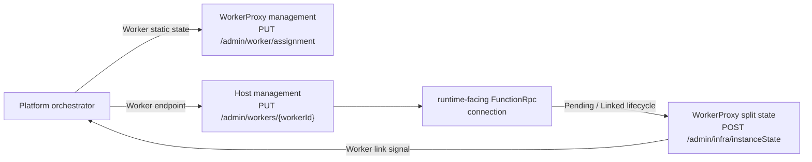
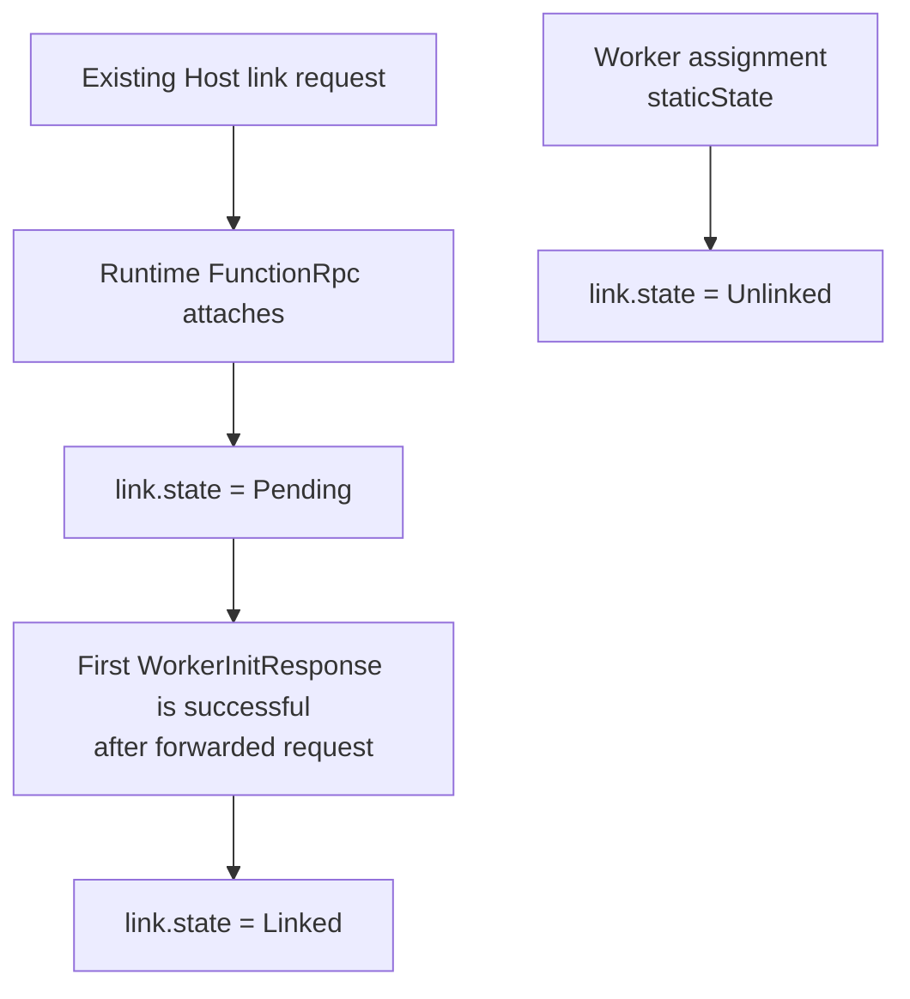
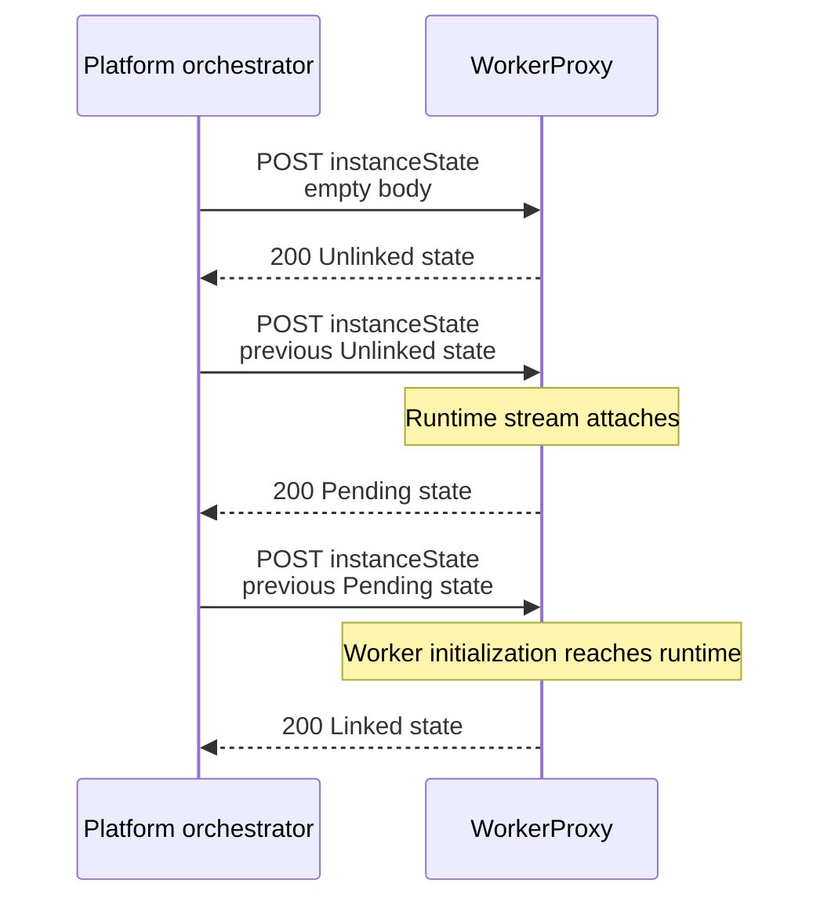

# BYOC split Worker signals

## Contract and ownership

The BYOC split Worker model has one app-scoped runtime that can connect to
multiple Worker pods. The platform orchestrator owns assignment and link
initiation, the existing Host link API opens the runtime-facing FunctionRpc
stream, and WorkerProxy publishes each Worker's connection lifecycle.

The implementation extends the existing assignment, Host link, FunctionRpc,
and management paths. Host dynamic scale-out, link admission budgeting, and
scheduler headroom remain separate contracts.

## Current vs target behavior

| Area | Current | Target |
| --- | --- | --- |
| Worker assignment | Assignment carries legacy app configuration only. | Assignment additively carries immutable split Worker static state; it does not declare runtime link state. |
| Runtime link | WorkerProxy relays FunctionRpc but does not publish the runtime-side connection lifecycle. | The existing Host link opens the runtime-facing FunctionRpc stream; WorkerProxy observes attachment and initialization directly. |
| Worker link signal | WorkerProxy does not expose the runtime-originated connection lifecycle. | WorkerProxy publishes `Unlinked`, then `Pending` on runtime attachment, then `Linked` when the first initialization response following the forwarded runtime initialization request is successful. |
| Legacy management | `/admin/worker/state` is the only Worker state contract. | Its JSON shape and status semantics are unchanged; `/admin/infra/instanceState` additively publishes the split Worker shape. Split-only transitions share the existing revision and can wake legacy long polls. |

## WorkerProxy changes

The implementation changes only WorkerProxy assignment, runtime-stream lifecycle
observation, link-state transitions, and split-state publication. It reuses
the existing assignment, Host link, FunctionRpc relay, and management seams.

### End-to-end component flow



### Assignment and link ownership



`PUT /admin/worker/assignment` owns immutable Worker static state. Its
additive `staticState` contains:

- `self` with the exact Worker pod and app identity;
- `isDiscoveryPod`;
- `isAlwaysReady`;
- `functionGroup`;
- `configLastModifiedTime`; and
- `contentLastModifiedTime`.

Assignment does not accept link state as an ownership transition. Exact
assignment replay remains idempotent, but replay cannot manufacture `Pending`
or `Linked`.

The existing Host link seam remains unchanged:

```http
PUT /admin/workers/{workerId}
```

```json
{
  "workerGrpcEndpoint": "http://worker-proxy:50053/"
}
```

The link request is unchanged and does not define its future admission budget.
WorkerProxy determines stream ownership from the local listener port. The
runtime listener attachment itself establishes `Pending`; no runtime pod or
Function App identity is carried through FunctionRpc.

### Pending to Linked sequence

```mermaid
sequenceDiagram
    participant Platform as Platform orchestrator
    participant Proxy as WorkerProxy
    participant Host
    participant RuntimeStream as Runtime FunctionRpc stream
    participant WorkerStream as Worker FunctionRpc stream

    Platform->>Proxy: PUT assignment with staticState
    Proxy-->>Platform: 201 Created; state = Unlinked
    Platform->>Host: PUT /admin/workers/{workerId}<br/>workerGrpcEndpoint
    Host->>RuntimeStream: Open existing EventStream
    RuntimeStream->>Proxy: Runtime side attaches
    Proxy->>Proxy: Publish Pending
    RuntimeStream->>WorkerStream: WorkerInitRequest
    WorkerStream-->>RuntimeStream: first successful WorkerInitResponse
    Proxy->>Proxy: Write response, then publish Linked
    Host-->>Platform: Existing link result
    Platform->>Proxy: POST /admin/infra/instanceState<br/>previous full Worker state
    Proxy-->>Platform: Linked
```

WorkerProxy expects a `WorkerInitResponse` only after forwarding a runtime
`WorkerInitRequest`. The first response written back consumes that expectation
and publishes `Linked` only when it is successful. A response arriving before
the initialization request is still relayed for legacy compatibility but does
not change the split link signal. This follows the Host's message-type
correlation and does not introduce a new request-ID contract.

`FunctionsSplitWorkerDynamicState.Link` is WorkerProxy's authoritative
process-local acknowledgement of the runtime-originated connection lifecycle.
The platform orchestrator can await `Linked` after the existing Host link
succeeds. Host dynamic scale-out, admission, and link-budget ownership are
outside this component's scope.

### Published Worker state

`POST /admin/infra/instanceState` follows the existing AppServer polling
protocol. The caller posts its previous full Worker origin state:

```json
{
  "functionsContainerType": "FunctionsSplitWorkerProxy",
  "staticState": {
    "self": {
      "resourceNamespace": "worker-namespace",
      "podName": "worker-pod",
      "podGuid": "11111111-1111-1111-1111-111111111111",
      "legionStampName": "legion-stamp",
      "podType": "FunctionsSplitWorkerPod",
      "app": {
        "functionAppName": "example-app",
        "functionAppSiteId": 42,
        "antaresStampName": "antares-stamp"
      }
    },
    "isDiscoveryPod": false,
    "isAlwaysReady": false,
    "functionGroup": "group-0",
    "configLastModifiedTime": 100,
    "contentLastModifiedTime": 200
  },
  "dynamicState": {
    "revisionId": 4,
    "status": "Starting",
    "link": {
      "state": "Pending"
    }
  }
}
```

WorkerProxy returns:

- `functionsContainerType: "FunctionsSplitWorkerProxy"`;
- the assigned `staticState`;
- `dynamicState.revisionId`;
- status `Starting`, `ReadyForWork`, or `RemovalRequested`; and
- `dynamicState.link.state` as `Unlinked`, `Pending`, or `Linked`.

An empty request body or a body different from the current full state returns
the current state immediately. An equal body waits for the next revision and
returns `204 No Content` if the existing long-poll timeout expires.



`ReadyForWork` requires local Worker readiness and a `Linked` runtime stream.
`Draining` is part of the split Worker status contract but is not emitted by
this implementation.

### Why WorkerProxy owns this endpoint

The runtime image needs a Go AppServer because it independently owns Host
assignment proxying, nginx specialization, persisted restart fencing,
request-slot admission, drain, Host monitoring, and several platform APIs.
The Worker signal does not need those responsibilities.

WorkerProxy already owns the management listener, immutable Worker assignment,
both FunctionRpc streams, and the exact transitions that produce `Pending`,
`Linked`, and terminal `Unlinked`. A Go process beside WorkerProxy could not
derive those transitions on its own; it would require a new cross-process event
contract, ordering and recovery semantics, image supervision, and a separate
Docker-repository change. Keeping the compatible endpoint in WorkerProxy is the
smaller end-to-end implementation. Revisit a sidecar only if the Worker later
gets an independent lifecycle or API owner.

## Assumptions

- The platform orchestrator assigns the Worker before invoking the existing
  Host link API.
- The Worker has produced a valid `StartStream` before assignment is accepted.
- The existing Host link opens the runtime-facing FunctionRpc stream to the
  assigned WorkerProxy endpoint.
- Deployments preserve the established trust boundary for Host-facing
  WorkerProxy listeners.

## Known limitations/non-goals

- Host dynamic scale-out, link admission budgeting, and scheduler headroom are
  explicitly deferred.
- No HMAC, shared key, link acknowledgement token, durable planner, retry loop,
  or ownership store is introduced.
- WorkerProxy state is process-local rather than durable.
- A runtime stream opened before split assignment is outside the required
  ordering and cannot establish a split link signal.
- Split link transitions use the existing Worker state revision, so they can
  wake `/admin/worker/state` long polls even though its JSON shape is unchanged.
- Runtime pod and Function App identity are not carried or published; the
  runtime listener connection is the link signal.
- `Draining` is not produced.
- Control-plane deployment and target-stamp validation are outside this
  component.
- Listener authentication and transport hardening are tracked separately by
  #12052. This implementation preserves the existing WorkerProxy listener
  trust boundary.

## Failure/conflict behavior

| Condition | Result |
| --- | --- |
| Assignment arrives before valid Worker `StartStream` | `503 WorkerNotReady`; no assignment state is reserved |
| Exact active assignment replay | `204 No Content`; link state does not change |
| Conflicting assignment replay | `409 AssignmentConflict` |
| Assignment replay after Worker termination | `409 WorkerTerminated` |
| Split state polled before split assignment | `503 WorkerStateUnavailable` |
| A second runtime stream attaches to the active relay session | gRPC `AlreadyExists`; the first connection remains authoritative |
| Relay session terminates after assignment | Link returns to `Unlinked`; status becomes `RemovalRequested` |

## Compatibility/rollout

- Legacy assignment bodies can omit `staticState`.
- An accepted assignment without `staticState` cannot be upgraded in place
  because assignment identity is immutable. Recycle that WorkerProxy and make
  the first assignment include `staticState` before Legion polls or links it.
- The existing Host link request body is unchanged.
- `/admin/worker/state` keeps its existing JSON shape and status semantics;
  split link transitions can advance its shared revision.
- `POST /admin/infra/instanceState` is additive and uses the existing
  full-origin-state polling protocol.
- Deploy compatible WorkerProxy and Host builds before the platform
  orchestrator awaits split Worker state.
- Define and validate the separate Host dynamic scale-out and link-budget
  contract before using this signal for scheduler admission.
- Apply the existing WorkerProxy listener security requirements; #12052 owns
  additional authentication and transport hardening.

## Validation

The change adds exactly three behavioral HTTP/gRPC API test methods and zero
new unit-test method declarations:

1. `SplitInstanceStateReturnsUnlinkedWorkerAfterStaticAssignment`
2. `SplitRuntimeLinkTransitionsPendingToLinkedState`
3. `SplitRuntimeLinkRejectsSecondConnectionAndPreservesLegacyState`

| Command | Result |
| --- | --- |
| `dotnet test test\Functions.WorkerProxy.Tests\Functions.WorkerProxy.Tests.csproj --configuration Release --nologo --logger 'console;verbosity=minimal'` | 502 passed |
| `git diff --check 9dd49fc1b915d5e500145ea32fdc40afa56373b4..HEAD --` | Passed |

Validate WorkerProxy, Host, and control-plane convergence in the target
environment before production rollout.

## Changed-file review map

| Area | Primary files | Review focus |
| --- | --- | --- |
| Worker static assignment | `WorkerAssignRequest.cs`, `WorkerAssignRequestValidator.cs`, `WorkerAssignment.cs` | Assignment owns immutable Worker static state only |
| Worker link lifecycle | `FunctionRpcRelay.cs`, `FunctionRpcRelay.Session.cs`, `WorkerPodStateManager.cs` | Runtime listener attachment and `Unlinked -> Pending -> Linked` timing |
| Public state | `ManagementApiEndpoints.cs`, `ManagementApiHandlers.cs`, `SplitWorkerLink.cs` | Additive split shape and preserved legacy JSON shape |
| Behavioral tests | `FunctionRpcRelayTests.Management.cs` | Static state, connection lifecycle, duplicate rejection, terminal unlink, and legacy compatibility |
