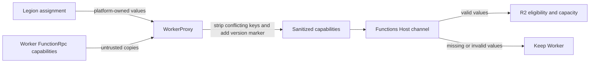
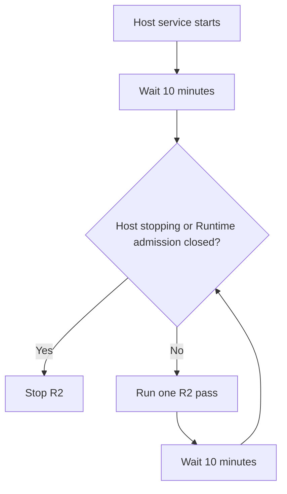
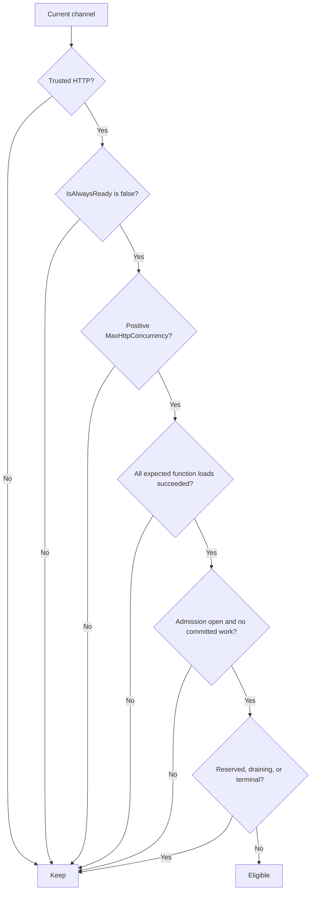
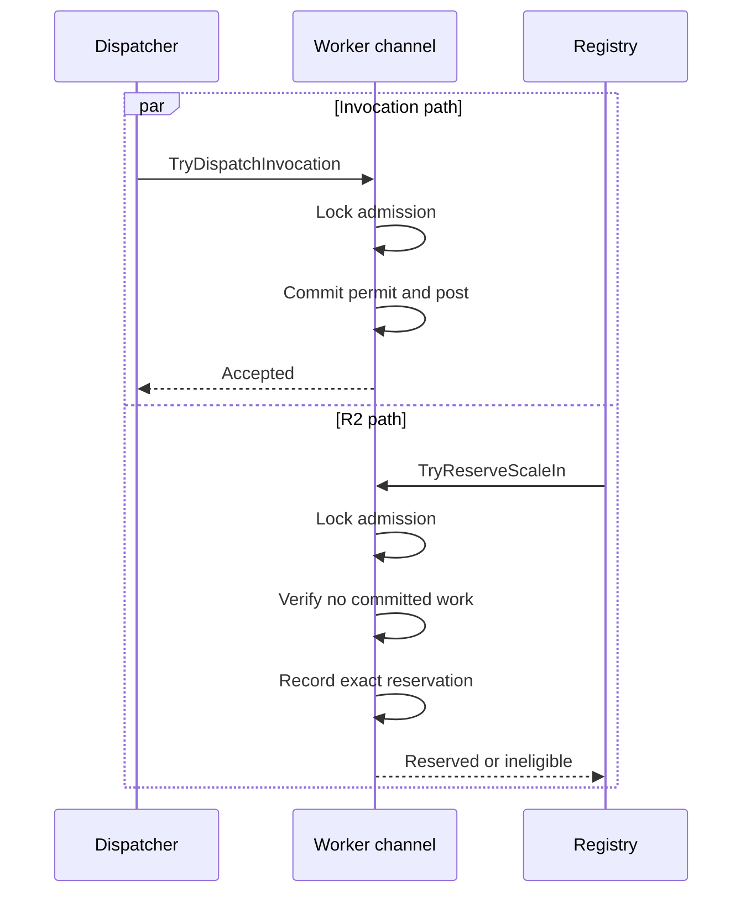
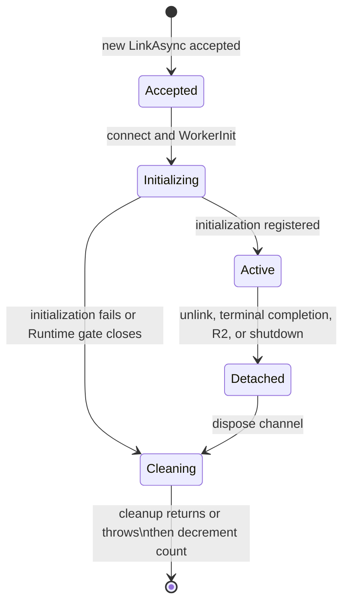
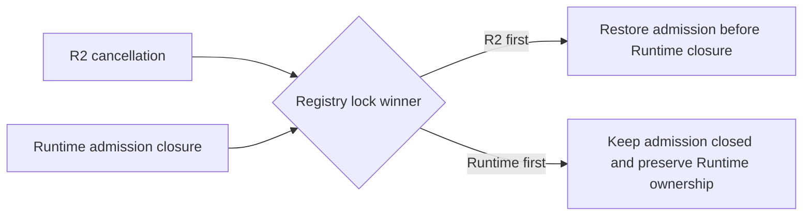

# BYOC HTTP on-demand Worker scale-in

## Context

The split Functions Host can keep more HTTP on-demand Workers linked than current Frontend allocations require. Before this change, the Host has no autonomous path that safely removes one of those Workers.

This PR adds the smallest R2 Host flow:

- WorkerProxy relays trusted Legion assignment metadata.
- The Host runs one R2 attempt every ten minutes. The first attempt is delayed by ten minutes after Host startup.
- Each attempt looks only at current channel state. It keeps no idle timestamps, pool history, or candidate cursor.
- The Host selects the eligible Worker with the lexicographically lowest Worker ID using ordinal comparison.
- The exact Worker is reserved against invocation admission.
- AppServer must explicitly apply a projected-capacity fence before the Host commits the drain.
- The Host waits for committed work, gracefully closes the Runtime-facing FunctionRpc link, and leaves WorkerProxy cleanup to W2.

Here, **idle** means that the Worker has no committed RPC or proxied HTTP work at the selection instant. It does not mean that the Worker has remained idle for a historical duration.

## Before and after

| Area | Before | After |
|---|---|---|
| Assignment metadata | Host receives trusted `FunctionGroupName` | WorkerProxy marks one sanitized assignment-metadata version and the Host also receives trusted `IsAlwaysReady` and positive `MaxHttpConcurrency` when Legion supplies them |
| R2 cadence | No autonomous R2 attempt | One attempt every ten minutes, with no startup attempt |
| Candidate state | No R2 candidate policy | Current state only; no idle or selection history |
| Candidate order | Not applicable | Lowest eligible Worker ID using `StringComparer.Ordinal` |
| Invocation race | Dispatch and removal are not coordinated | Invocation commitment and exact reservation use the same channel lock |
| Capacity safety | No R2 capacity transaction | Current and projected capacity use one authoritative Host snapshot generation |
| AppServer safety | No R2 fence | Projected capacity requires an explicit applied acknowledgement |
| Physical link count | Registry presence can fall before disposal finishes | Accepted links remain counted through initialization and detached disposal |
| Runtime retirement | No shared R2 suppression gate | Runtime admission closure prevents new R2 reservation, commit, rollback restoration, and restored-capacity publication |
| Worker removal | External lifecycle only | One acknowledged Worker per attempt can drain and unlink |

## Ownership

| Component | Owns | Does not own |
|---|---|---|
| Legion assignment producer | `IsAlwaysReady` and authoritative `MaxHttpConcurrency` | Host invocation admission or AppServer allocations |
| WorkerProxy | Removes worker-supplied trusted keys and version marker, then publishes one sanitized assignment-metadata version with Legion-owned values | Candidate selection or Host capacity |
| Functions Host channel | Function-load readiness, invocation permits, exact reservation, committed-work drain | Frontend slot allocations |
| Functions Host registry | Ordinal selection, aggregate capacity, physical link ownership, reservation commit/cancel, graceful unlink, Runtime admission gate | P2/P3 scheduling |
| `IHostStateCoordinator` | One `CreatedTime`, version, snapshot, and change notification stream | AppServer HTTP transport |
| `HostStatePublicationCoordinator` | The single serialized `/admin/infra/host/state` publisher | Host-local channel transitions |
| Functions Host R2 service | Ten-minute cadence and two-phase capacity-fence orchestration | Runtime retirement scheduling |
| AppServer companion | Atomic Frontend-allocation comparison and applied fence acknowledgement | Host invocation state |
| WorkerProxy W2 | Expected cleanup after FunctionRpc unlink | R2 fence decision |
| Ordinary R1 | Runtime-empty cleanup after the last Worker disappears | Selecting an R2 Worker |

## Trusted metadata

WorkerProxy treats the existing Legion assignment contract as the platform trust boundary.

For each FunctionRpc initialization:

1. Remove worker-supplied `WorkerAssignmentMetadataVersion`, `FunctionGroupName`, `IsAlwaysReady`, and `MaxHttpConcurrency`.
2. Add `WorkerAssignmentMetadataVersion=1` only for the live assigned relay session.
3. Relay assignment-owned `FunctionGroupName`.
4. Relay assignment-owned `IsAlwaysReady`.
5. Relay `MaxHttpConcurrency` only when the assignment value is positive.

The Host trusts the three assignment values only when the protected version marker is present. A revised Host paired with a legacy WorkerProxy therefore ignores worker-supplied copies and fails closed for R2. Missing, invalid, or legacy metadata does not break ordinary linking or invocation. It only makes the Worker ineligible for autonomous R2 and excludes unknown capacity from the R2 capacity model.



## Stateless periodic policy

The hosted service delays for ten minutes before its first pass. After each pass, it delays for another ten minutes.

Channel changes do not wake R2 early. The generic Host-state change notification remains available for Runtime-drain publication, but R2 does not use it as a scheduling trigger.

At each pass:

1. Stop if Host shutdown or Runtime admission closure has started.
2. Publish the current authoritative Host snapshot with capacity-fence semantics.
3. Inspect current channel state.
4. Reserve the lowest ordinal eligible Worker ID.
5. Publish the projected lower capacity and require an explicit applied fence acknowledgement.
6. Recheck shutdown, Runtime admission ownership, exact reservation, and exact Host-state generation.
7. Commit the drain or cancel safely.

No per-Worker idle timestamp, pool timestamp, last-activity state, candidate cursor, fairness rotation, creation-time ranking, or random selection is retained.



## Current-state eligibility

A Worker is eligible only when all conditions are true at reservation time:

1. Trusted `FunctionGroupName` classifies it as HTTP.
2. Trusted `IsAlwaysReady` is explicitly `false`.
3. Trusted `MaxHttpConcurrency` is positive.
4. The channel initialized successfully.
5. Every expected function load for the active ScriptHost setup completed successfully.
6. Invocation admission is open.
7. No RPC or proxied HTTP invocation is committed.
8. The Worker is not reserved, draining, terminal, or terminated.
9. Host shutdown has not started.
10. Runtime admission closure has not started.

`MaxHttpConcurrency` affects current and projected aggregate capacity only. It never affects candidate order.



## Lowest ordinal Worker selection

The registry sorts current Worker IDs with `StringComparer.Ordinal` and tries them in that order.

The channel rechecks eligibility while holding the same lock used by invocation admission. If the lowest ID loses eligibility before reservation, the registry continues to the next current eligible ID in the same pass.

Selection does not use:

- `MaxHttpConcurrency`
- creation time
- link or admission order
- prior fence failures
- candidate rotation
- randomness

If a fence fails, retrying the same lowest Worker on the next ten-minute pass is expected.

## Invocation versus reservation

Invocation commitment and R2 reservation share `_invocationAdmissionLock`.

An invocation winner:

1. verifies admission;
2. creates the committed-work permit;
3. posts the invocation while still holding the lock.

A reservation winner:

1. rechecks all current eligibility;
2. verifies there is no committed work;
3. records the exact reservation identifier while holding the same lock;
4. immediately disappears from ready-channel selection and usable HTTP capacity.

Only one side can win.



## One authoritative Host snapshot

`IHostStateCoordinator` is the shared Host-local snapshot contract for R2 and P2/P3:

- `Current` returns one immutable `HostStateSnapshot`.
- `Version` is the exact Host-local generation.
- `CreatedTime` is generated by one monotonic UTC clock contract.
- `WaitForChangeAsync` exposes changes for the shared publication path without changing R2 cadence.
- Final function-load readiness and every physical link transition wake existing waiters.

The snapshot contains:

- usable HTTP capacity;
- physical linked-Worker count;
- `CreatedTime`;
- Host-local version.

Every relevant state transition advances the same generation. PR #19 must consume this coordinator instead of generating another timestamp or snapshot.

## Physical linked-Worker count

`LinkedWorkerCount` represents accepted physical link ownership, not only channels currently present in invocation selection.

The count increments exactly once when a new `LinkAsync` request is accepted. Exact retries do not increment it.

The count remains present while:

- transport connection or Worker initialization is in progress;
- a channel is active;
- a channel has detached from admission and registry selection;
- graceful or forced disposal is still running.

It decrements only after failed initialization or channel disposal returns or throws.



This prevents a premature zero-link snapshot while an accepted or detached link still owns physical cleanup.

## Shared Runtime admission gate

`IRuntimeWorkerAdmissionGate` is the narrow landing contract shared with PR #19.

Closing it is irreversible and:

- rejects new Worker links;
- rejects a link that finishes initialization after closure;
- publishes zero authoritative usable HTTP capacity while retaining physical linked-count ownership;
- prevents new R2 reservation;
- prevents R2 commit;
- causes R2 cancellation to clear its reservation without restoring invocation admission;
- prevents restored usable-capacity publication after Runtime retirement won the registry lock.

The ordering is lock-linearized:



This PR does not import the P2/P3 phased or immediate schedule.

## Shared AppServer publication

`HostStatePublicationCoordinator` is the single serialized publisher for `/admin/infra/host/state`. It supports two explicit operation modes over one client:

| Mode | Request/response contract | Consumer |
|---|---|---|
| Authoritative publication | Existing Host-state request; successful 2xx means applied | Runtime-drain state publication |
| Capacity fence | Request includes `x-ms-functions-host-state-capacity-fence: required`; success also requires response `...: applied` | R2 current/projected capacity transaction |

R2 never treats an ordinary 2xx as fence success.

The required Docker/AppServer companion must:

1. take the AppServer-owned slot-ledger lock;
2. compare projected Host capacity with current Frontend allocations;
3. return HTTP 412 when projected capacity is unsafe;
4. commit the lower capacity under the same ledger lock when safe;
5. return `x-ms-functions-host-state-capacity-fence: applied` only after that commit.

This PR does not implement that companion.

## Exact two-phase R2 flow

```mermaid
sequenceDiagram
    participant S as R2 service
    participant P as Shared publication coordinator
    participant R as Registry
    participant C as Exact Worker channel
    participant A as AppServer
    participant X as Runtime FunctionRpc peer

    S->>P: Publish current snapshot, fence required
    P->>A: PUT current state
    A-->>P: applied
    S->>R: Reserve lowest ordinal eligible Worker
    R->>C: Reserve under invocation lock
    C-->>R: Exact reservation
    R-->>S: Reservation + projected snapshot
    S->>P: Publish projected snapshot, fence required
    P->>A: PUT projected lower capacity
    alt unsafe, missing acknowledgement, timeout, cancellation, stale state, or Runtime closure
        A-->>P: 412, no applied header, or failure
        S->>R: Cancel exact reservation
        alt Runtime admission remains open
            R->>C: Restore invocation admission
            S->>P: Republish current capacity best effort
        else Runtime admission closed first
            R->>C: Clear R2 reservation; keep admission closed
        end
    else applied and exact state still current
        A-->>P: applied
        S->>R: Commit exact reservation and version
        R->>C: Begin irreversible drain
        C->>C: Wait for committed RPC and HTTP forwarding completion
        R->>X: Gracefully close FunctionRpc requests
        R->>R: Dispose link; decrement physical count after completion
    end
```

## Proxied HTTP drain

For a proxied HTTP invocation, the committed-work permit is released only after both:

1. the FunctionRpc invocation result completes; and
2. HTTP response forwarding completes.

Either completion order is valid. R2 cannot unlink while either side still owns work.

## Failure behavior

The Worker is retained when:

- the current Host snapshot cannot be published with fence acknowledgement;
- AppServer returns HTTP 412;
- AppServer returns 2xx without the explicit fence-applied header;
- publication times out, is canceled, or fails;
- Host state changes after projected publication;
- the reservation identity or projected generation is stale;
- shutdown starts;
- Runtime admission closure starts;
- trusted classification or capacity is missing or invalid;
- expected function loads are pending or failed;
- the Worker is currently busy.

Rollback restores invocation admission only when the Runtime gate remains open. Restored-capacity publication is best effort and is skipped when Runtime retirement owns the gate.

## Assumptions

- The existing Legion WorkerProxy assignment contract is the trusted platform boundary.
- `WorkerAssignmentMetadataVersion=1` proves the revised WorkerProxy sanitized the assignment-owned values before the Host consumes them.
- Legion supplies a protected positive `MaxHttpConcurrency`.
- Worker IDs are stable strings and ordinal comparison is the required deterministic order.
- AppServer rejects stale `CreatedTime` generations.
- AppServer implements the capacity-fence companion contract above.
- W2 observes the graceful FunctionRpc unlink and performs WorkerProxy cleanup.
- P2/P3 PR #19 consumes the shared coordinator, publisher, physical count, and Runtime gate.

## Known limitations and landing dependency

- The AppServer capacity-fence companion is required but is not implemented here.
- The upstream producer of `MaxHttpConcurrency` may be outside this repository.
- R2 retries only on the next ten-minute pass.
- Repeated 412 responses can retain the same lowest Worker indefinitely.
- R2 removes at most one Worker per pass.
- Host shutdown remains the local shutdown suppression signal.
- This PR does not delete the Runtime or kill the customer process.
- PR #19 must rebase or stack on this PR and remove any temporary parallel Host-state publisher, timestamp generator, physical-link counter, or Runtime admission owner.
- The required landing order is PR #18 first, then PR #19 after integration with these shared contracts.

## Non-goals

- utilization percentages;
- 25% batches;
- a probation pool;
- non-HTTP autonomous scale-in;
- P2/P3 phased or immediate scheduling;
- stale-grant cleanup;
- scale-out or replenishment;
- Runtime deletion;
- customer-process kill;
- replay or migration;
- a removal outbox;
- a new scale-in endpoint.

## File map

| File | Review purpose |
|---|---|
| `src/Functions.WorkerProxy/Rpc/FunctionRpcRelay.Session.cs` | Removes worker-supplied trusted values/version and relays one versioned assignment-owned capability set |
| `src/Functions.Rpc.Client/WorkerChannel/RpcClientWorkerChannel.cs` | Versioned trusted metadata parsing, capacity-change notification, current eligibility, invocation permits, reservation, and drain |
| `src/Functions.Rpc.Client/Dispatcher/RpcClientFunctionInvocationDispatcher.cs` | Atomic dispatch and shutdown drain behavior |
| `src/Functions.Rpc.Client/Registry/WorkerChannelRegistry.cs` | Lowest-ID selection, physical link ownership, Host snapshots, Runtime gate, commit/cancel, and unlink |
| `src/Functions.Rpc.Client/HostState/IHostStateCoordinator.cs` | Shared snapshot, generation, clock, and change-notification contract |
| `src/Functions.Rpc.Client/Retirement/IRuntimeWorkerAdmissionGate.cs` | Shared irreversible Runtime admission fence |
| `src/Functions.Rpc.Client/ScaleIn/IHttpWorkerScaleInManager.cs` | Narrow R2 reservation transaction |
| `src/Functions.Host/HostState/AppServerHostStateClient.cs` | One HTTP client with authoritative and capacity-fence modes |
| `src/Functions.Host/HostState/HostStatePublicationCoordinator.cs` | Single serialized Host-state publisher |
| `src/Functions.Host/HostState/HttpOnDemandWorkerScaleInService.cs` | Delayed ten-minute, one-Worker-per-pass orchestration |

## Behavioral test matrix

The PR keeps exactly five public R2 behavioral test methods.

| # | Test method | Behavior covered |
|---|---|---|
| 1 | `Relay_Initialization_AdvertisesOnlyTrustedAssignmentCapabilities` | WorkerProxy overwrites spoofed metadata/version, marks the sanitized assignment, relays Legion values, and omits invalid or missing assignment capacity |
| 2 | `ExecuteAsync_TenMinuteCadenceSelectsLowestOrdinalWorkerAndWaitsForHttpCompletion` | No startup pass, ten-minute cadence, lowest ordinal selection independent of insertion/capacity, one Worker per pass, physical post-disposal count, and both proxied HTTP completion orders |
| 3 | `RunScaleInPassAsync_UnappliedOrStaleFence_RestoresCapacityAndInvocationAdmission` | Missing acknowledgement, 412, stale generation, same-lowest retry, Runtime-closure rollback, accepted initializing-link count, post-disposal notification, and real invocation after ordinary rollback |
| 4 | `InvocationAdmissionAndScaleInReservation_RaceHasOneSafeWinner` | Invocation commitment and reservation have one lock-linearized winner |
| 5 | `ScaleIn_IneligibleUnreadyOrBusyWorkerIsRetained` | Always-ready, non-HTTP, missing/legacy trust, invalid capacity, pending/failed loads, and current committed work are retained; final function-load readiness wakes Host-state waiters |
