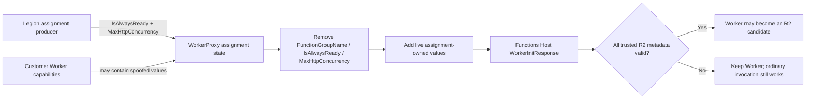
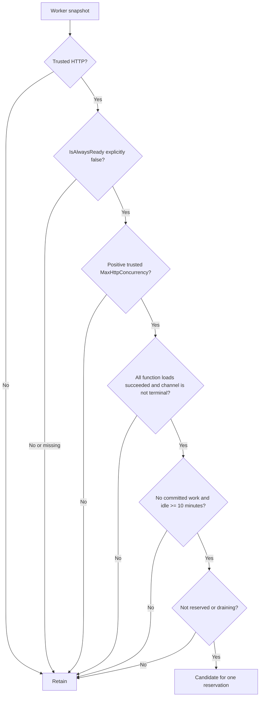
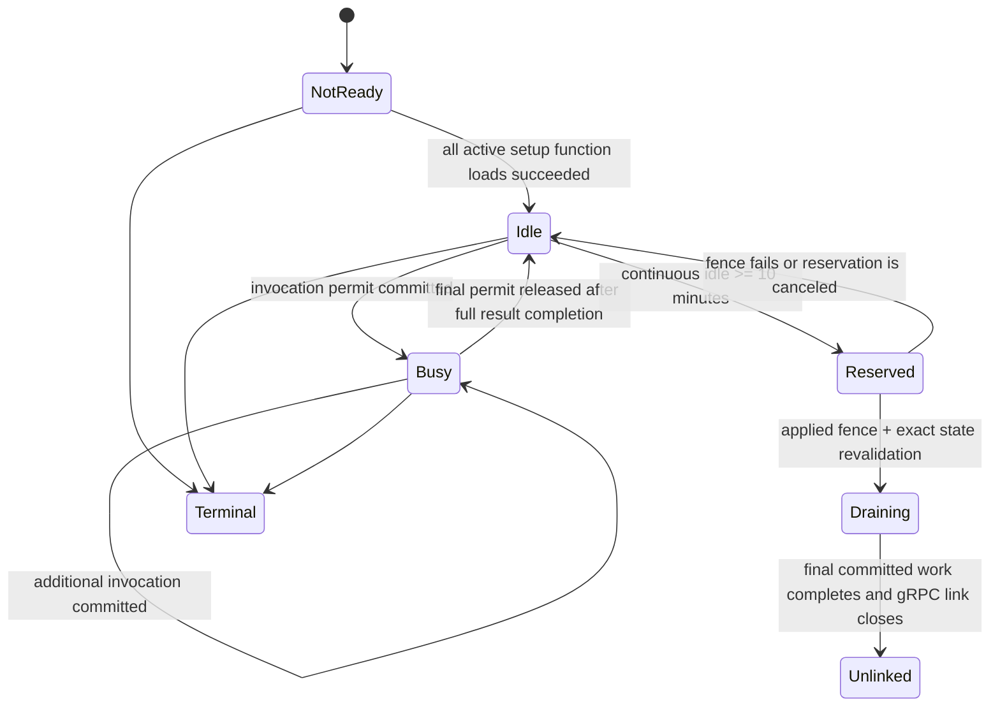
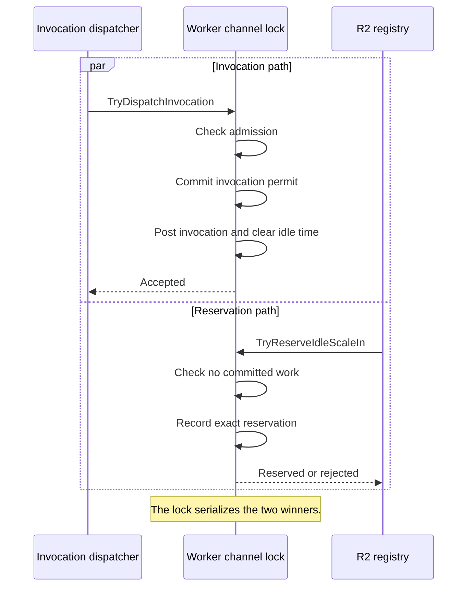
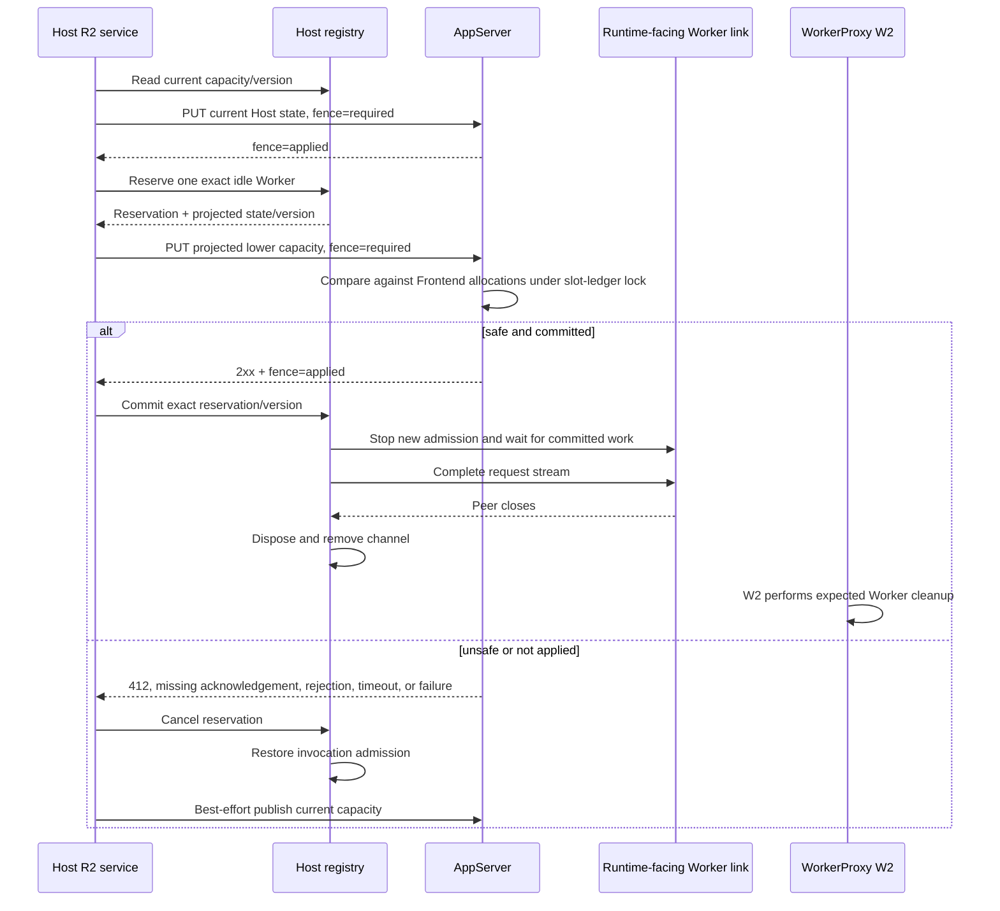
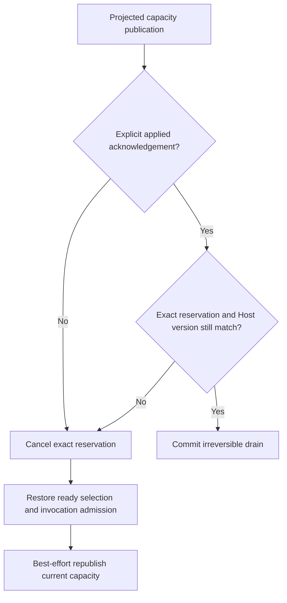

# BYOC HTTP on-demand idle Worker scale-in

## Context

The split Functions Host can link more HTTP Workers than current Frontend allocations require. Before this change, the Host keeps every linked Worker until another lifecycle flow removes it. That leaves an on-demand Worker running even after it has been continuously idle.

This change adds the smallest Host-side R2 flow:

- WorkerProxy relays trusted Legion assignment metadata to the Host.
- The Host measures continuous idle time with a monotonic clock.
- Once per minute, the Host may select one eligible Worker that has been idle for ten minutes.
- The Host first reserves that exact Worker locally.
- AppServer must explicitly apply a capacity fence before the Host commits the drain.
- The Host waits for committed work, gracefully closes the Runtime-facing Worker link, and leaves WorkerProxy cleanup to W2.

The implementation does not delete a Runtime, kill a customer process, or add a new scale-in endpoint.

## Before and after

| Area | Before | After |
|---|---|---|
| Worker assignment metadata | Host receives trusted `FunctionGroupName` only | Host also receives trusted `IsAlwaysReady` and optional positive `MaxHttpConcurrency` |
| Idle tracking | No autonomous idle interval | Each ready channel tracks a continuous monotonic idle interval |
| Invocation race | Ready-channel selection and posting are separate from scale-in | Invocation admission and exact Worker reservation use the same channel lock |
| Capacity safety | No R2 capacity transaction | Host publishes current capacity, then requires explicit acknowledgement of projected lower capacity |
| Failure behavior | Not applicable | Every missing, stale, rejected, timed-out, or failed fence retains the Worker |
| Worker removal | External lifecycle only | One acknowledged idle Worker can gracefully drain and unlink |

## Ownership

| Component | Owns | Does not own |
|---|---|---|
| Legion assignment producer | Supplies `IsAlwaysReady` and authoritative `MaxHttpConcurrency` | Host admission or AppServer allocation decisions |
| WorkerProxy | Removes worker-supplied values and publishes Legion assignment-owned capabilities | Choosing an idle Worker or calculating aggregate Host capacity |
| Functions Host channel | Invocation admission, committed-work permits, monotonic idle interval, reversible reservation | Frontend slot allocations |
| Functions Host registry | Aggregate usable HTTP capacity, Host-local version, exact reservation commit, graceful unlink | Runtime deletion or customer-process termination |
| Functions Host R2 service | One-minute checks and two-phase capacity-fence orchestration | AppServer slot-ledger mutation |
| AppServer companion | Atomic Frontend-allocation comparison and applied acknowledgement | Host-local invocation state |
| WorkerProxy W2 | Expected post-unlink Worker cleanup | R2 fence decision |
| Ordinary R1 | Runtime-empty cleanup after the last Worker disappears | Selecting an idle Worker in this PR |

## Trusted metadata

WorkerProxy treats the following FunctionRpc capabilities as platform-owned:

| Capability | Source | Host use |
|---|---|---|
| `FunctionGroupName` | Existing assignment state | Only trusted HTTP Workers are candidates |
| `IsAlwaysReady` | Existing assignment/prelaunch state | Only explicit `false` is eligible |
| `MaxHttpConcurrency` | New optional assignment receiver field | Authoritative per-Worker contribution to Host HTTP capacity |

WorkerProxy removes conflicting worker-supplied values before adding Legion assignment-owned values. It follows the existing trusted `FunctionGroupName` boundary rather than trusting customer Worker capabilities.

Missing or invalid values do not break assignment, linking, initialization, or invocation. They only make the Worker ineligible for autonomous R2. The Host does not infer a default and does not use a hard-coded concurrency value.



## Eligibility

A Worker is eligible only when every condition below is true:

1. `FunctionGroupName` is trusted HTTP classification.
2. `IsAlwaysReady` is explicitly `false`.
3. `MaxHttpConcurrency` is a trusted positive integer.
4. The Worker is initialized and every expected function-load response for the active ScriptHost setup has completed successfully.
5. It has no committed invocation.
6. It has been continuously idle for at least ten monotonic minutes.
7. It is not already reserved, draining, terminal, or excluded from invocation admission.
8. The Host is not stopping.

The check runs every minute and handles at most one Worker per pass.



## Continuous idle interval

The interval uses `TimeProvider.GetTimestamp()` and `GetElapsedTime`; wall-clock changes cannot make a Worker appear older.

- It starts after every expected function-load response succeeds and the eligible channel has no committed work.
- A newly committed invocation clears it immediately.
- It restarts only after the final committed invocation fully completes.
- For proxied HTTP, completion means both the Function RPC result and HTTP forwarding completion.



## Invocation admission versus reservation

The channel uses one lock for both operations.

An invocation winner:

1. verifies admission remains open;
2. creates a committed-work permit;
3. posts the invocation while still holding the admission lock;
4. clears the idle interval.

A reservation winner:

1. verifies all eligibility and idle conditions;
2. records the exact reservation identifier while holding the same lock;
3. immediately prevents new invocation admission;
4. disappears from ready-channel selection and usable HTTP capacity.

There is no state where the same Worker is both newly reserved and newly assigned the racing invocation.
Disabling admission during replacement setup does not discard committed work; Host shutdown drains every initialized client channel.



## Capacity model

Usable Host HTTP capacity is the sum of each trusted HTTP Worker's positive assignment-owned `MaxHttpConcurrency` only after initialization and every expected function-load response succeed.

```text
Host HTTP capacity = Σ ready trusted HTTP Worker MaxHttpConcurrency
```

A reservation immediately removes the exact Worker from the usable sum. The Worker remains linked until the reservation commits and the graceful drain finishes.

Always-ready HTTP Workers contribute usable capacity after successful function loading but are never autonomous R2 candidates. Pending or failed function loading, missing classification, or missing capacity contributes no capacity and cannot be selected.

## Two-phase scale-in flow

### Phase 1: reversible reservation

1. Read and publish a stable Host capacity/version snapshot, bounded to three attempts under concurrent state changes.
2. Publish current capacity to AppServer.
3. Require explicit `applied` capacity-fence acknowledgement.
4. Reserve one eligible Worker locally, starting after the prior candidate so a repeatedly blocked Worker cannot starve another safe candidate.
5. Publish the projected lower capacity.
6. Require explicit `applied` acknowledgement for that exact projected state.

### Phase 2: irreversible drain

1. Revalidate the exact reservation.
2. Revalidate the Host-local state version, linked count, and projected capacity.
3. Commit the channel drain.
4. Wait for all committed invocation permits.
5. Complete the Host-to-Worker FunctionRpc request stream.
6. Wait for peer closure, then dispose the channel.



## AppServer capacity-fence contract

This PR uses the existing `PUT admin/infra/host/state` endpoint.

Request requirements:

- Header `x-ms-functions-host-state-capacity-fence: required`
- Body fields:
  - `createdTime`
  - `linkedWorkerCount`
  - `httpCapacity`

Applied response requirement:

- successful HTTP status; and
- header `x-ms-functions-host-state-capacity-fence: applied`

Every other response is non-applied.

The required Docker/AppServer companion must:

1. atomically compare the projected Host capacity against AppServer-owned Frontend allocations;
2. perform that comparison while holding the AppServer slot-ledger lock;
3. return HTTP 412 when the projected capacity cannot cover existing allocations;
4. commit the lower Host capacity under the same slot-ledger lock when safe; and
5. return the explicit `applied` acknowledgement only after the lower capacity is committed.

The Host must not treat a generic 2xx response as fence success.

## Failure behavior

| Failure | Host behavior |
|---|---|
| Missing current-state acknowledgement | Do not reserve a Worker |
| HTTP 412 for projected capacity | Cancel reservation and retain Worker |
| Projected 2xx without `applied` | Cancel reservation and retain Worker |
| Rejection, timeout, cancellation, or publication exception | Cancel reservation and retain Worker |
| Host-local version/state changed after publication | Reject commit and retain Worker |
| Exact reservation no longer exists | Reject commit |
| Replacement setup disables admission | Keep draining already committed invocations during Host shutdown |
| Graceful peer close times out | Log incomplete drain; do not kill the process |
| Pending or failed function loading | Contribute no R2 capacity and retain Worker |
| Missing/invalid trusted metadata | Keep Worker eligible for ordinary invocation, but not R2 |
| Host stopping | Do not begin or commit a new R2 drain |

After any reversible failure, the Host restores invocation admission and republishes current capacity best effort with an uncanceled token. Stable publication is bounded to three attempts so perpetual Host-local churn cannot prevent shutdown. It never substitutes a success-shaped fallback.



## Assumptions

1. `MaxHttpConcurrency` is assigned by the platform and represents the protected per-Worker HTTP concurrency limit used for Frontend capacity decisions.
2. WorkerProxy receives Legion assignment before forwarding the successful Worker initialization response.
3. Host application stopping is the available retirement signal on this independent foundation; the hosted service checks it before reservation and before commit.
4. Completing the Runtime-facing FunctionRpc request stream is the correct graceful unlink signal.
5. WorkerProxy W2 observes the closed link and performs its existing cleanup.
6. Ordinary R1 observes an empty Runtime later and owns Runtime-empty cleanup.

## Known limitations and deployment companions

1. **AppServer companion is required.** Until AppServer implements the atomic slot-ledger comparison and explicit acknowledgement contract, the Host fails closed and retains Workers.
2. **Legion assignment producer is required.** The producer outside this repository must populate optional `maxHttpConcurrency` with the authoritative value. Missing or nonpositive values disable R2 for that Worker.
3. **Retirement signal scope is Host application stopping.** This foundation does not expose PR #13's broader runtime-retirement manager. If a future deployment retires a Runtime without stopping this Host process, that lifecycle must expose a narrow suppression signal before enabling R2 there.
4. **Mixed-version logging.** An AppServer without the explicit fence acknowledgement keeps every Worker, but the hosted service may log a publication warning on each pass until the companion is deployed.
5. **No forced unlink fallback.** A peer-close timeout is logged; this PR does not kill a customer process, delete a Runtime, or add an outbox/removal fallback.
6. **One Worker per pass.** The service intentionally does not batch or use utilization percentages.
7. **No scale-out.** Replenishment and stale-grant cleanup remain outside this PR.

## Non-goals

- Runtime retirement implementation
- Runtime deletion
- customer-process termination
- utilization percentages
- 25% scale-in batches
- a separate probation pool
- non-HTTP autonomous idle scale-in
- scale-out or replenishment
- stale-grant cleanup
- replay or migration
- a new scale-in endpoint
- count-based scale-in
- WorkerProxy lifecycle changes beyond trusted metadata relay

## File map

| File | Review purpose |
|---|---|
| `src/Functions.WorkerProxy/Management/WorkerAssignRequest.cs` | Optional assignment receiver for authoritative `MaxHttpConcurrency` |
| `src/Functions.WorkerProxy/State/WorkerAssignment.cs` | Immutable normalized assignment identity |
| `src/Functions.WorkerProxy/State/WorkerPodState.cs` | Live relay state for trusted metadata |
| `src/Functions.WorkerProxy/Rpc/FunctionRpcRelay.Session.cs` | Removes spoofed values and publishes assignment-owned capabilities |
| `src/Functions.Rpc.Client/WorkerChannel/RpcClientWorkerChannel.cs` | Metadata parsing, successful function-load gating, candidate-only invocation permits, monotonic idle tracking, reservation, and drain state |
| `src/Functions.Rpc.Client/Dispatcher/RpcClientFunctionInvocationDispatcher.cs` | Atomic channel admission with safe retry |
| `src/Functions.Rpc.Client/Registry/WorkerChannelRegistry.cs` | Capacity snapshots, versioning, fair candidate rotation, exact reservation commit, and graceful unlink |
| `src/Functions.Rpc.Client/ScaleIn/IHttpWorkerScaleInManager.cs` | Narrow Host-local transaction contract |
| `src/Functions.Host/HostState/AppServerHostStateClient.cs` | Explicit AppServer fence protocol |
| `src/Functions.Host/HostState/HttpOnDemandWorkerScaleInService.cs` | One-minute, one-Worker two-phase orchestration |
| `test/Functions.WorkerProxy.Tests/Rpc/FunctionRpcRelayTests.CapabilityFinalization.cs` | Trusted metadata replacement behavior |
| `test/Functions.Rpc.Client.Tests/Registry/WorkerChannelRegistryTests.ScaleIn.cs` | Public/hosted R2 behavior coverage |

## Behavioral test matrix

Exactly five behavior-level test methods cover this change. Theory rows exercise multiple public outcomes without adding implementation-detail tests.

| # | Behavior method | What it proves |
|---|---|---|
| 1 | `Relay_Initialization_AdvertisesOnlyTrustedAssignmentCapabilities` | WorkerProxy overwrites spoofed metadata, relays Legion assignment values, and omits invalid/missing assignment capacity |
| 2 | `RunScaleInPassAsync_AppliedFence_WaitsForHttpCompletionAndDrainsOneWorkerExactlyOnce` | Authoritative capacity is summed, the applied fence commits one drain, and proxied HTTP waits for RPC and forwarding completion in both orders |
| 3 | `RunScaleInPassAsync_UnappliedOrStaleFence_RestoresCapacityAndInvocationAdmission` | Missing acknowledgement and HTTP 412 roll back, candidate rotation prevents starvation, stale Host state rejects commit, and a real invocation remains dispatchable |
| 4 | `InvocationAdmissionAndIdleReservation_RaceHasOneSafeWinner` | The shared admission lock permits only one winner and preserves the losing operation safely |
| 5 | `IdleScaleIn_IneligibleOrUnreadyWorkerIsRetained` | Always-ready, non-HTTP, missing-trust, invalid-capacity, pending-load, and failed-load Workers are retained without breaking ordinary invocation |

No isolated scale-in unit tests were added.
