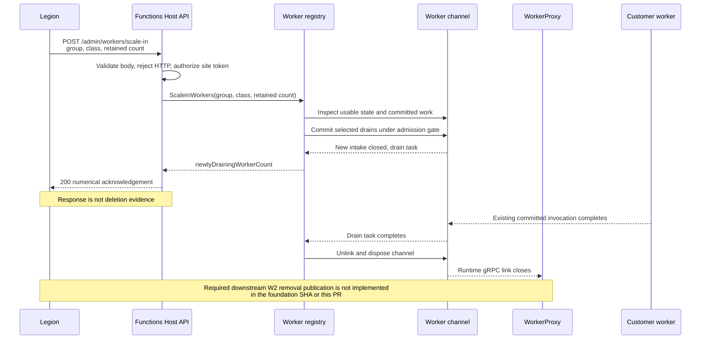
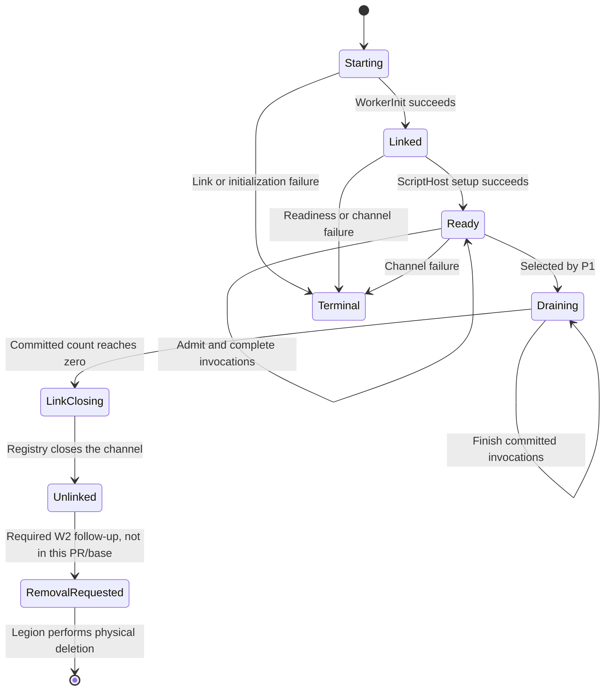

# BYOC non-HTTP worker scale-in

## Context

Legion already decides app-level demand and creates workers. P1 adds the missing runtime-local action for a
reduced non-HTTP retained count: Legion tells one Runtime how many usable workers to keep for one function
group and capacity class, and Functions Host chooses the exact workers to drain.

This is deliberately not an HTTP scale-in mechanism. HTTP autonomous scale-in still needs AppServer slot
fencing and remains outside this PR.

## Before and after

| Before | After |
| --- | --- |
| A Runtime can link and dispatch to multiple split workers, but Legion cannot reduce a local non-HTTP worker count through Host. | Legion can call one protected Host endpoint with an absolute retained count. |
| WorkerProxy supplies the trusted function group during worker initialization. | WorkerProxy also supplies the trusted always-ready class and removes worker-supplied classification values. |
| Dispatch reads a ready-channel snapshot and posts directly to a worker buffer. | Dispatch rechecks admission through the existing per-worker gate before posting. |
| Closing a worker link is an explicit unlink operation. | A selected worker stops new intake immediately, drains committed work asynchronously, and then closes the existing link. |

## API contract

```http
POST /admin/workers/scale-in
x-ms-site-token: <pod-bound platform token>
Content-Type: application/json
```

```json
{
  "functionGroup": "durable",
  "isAlwaysReady": false,
  "desiredWorkerCount": 1
}
```

Success is always HTTP `200` with a numerical count:

```json
{
  "newlyDrainingWorkerCount": 2
}
```

The request is a one-shot absolute retained-count instruction. It does not contain worker, app, or Runtime
identity. The response counts only workers newly committed to drain by this request. It does not wait for
drain completion, WorkerProxy removal publication, or physical deletion.

Validation fails closed:

- Missing, malformed, or negative fields return the existing validation error envelope with HTTP `400`.
- Any case variation of the `http` function group returns HTTP `400`.
- Missing or invalid admin authentication is rejected by the normal Host authorization policy.

## End-to-end sequence



## Selection population and order

Host evaluates only workers that are usable at the instant of the request:

- The channel completed initialization.
- The current ScriptHost setup completed for that channel.
- The channel is invocation-ready and not terminal.
- The WorkerProxy-supplied function group exactly matches the request.
- The WorkerProxy-supplied always-ready class matches the request.
- The worker has not already been committed to drain.

Starting, unlinked, setup/readiness-pending, already-draining, and terminal workers are outside this
population. A future W2 removal-requested worker is also outside the population because P1 has already closed
its Runtime link.

```mermaid
flowchart TD
    A[Receive protected request] --> B{Function group is HTTP?}
    B -- Yes --> C[400 InvalidValue]
    B -- No --> D[Filter current matching usable workers]
    D --> E[removeCount = max(0, usable - desired)]
    E --> F{removeCount is zero?}
    F -- Yes --> G[Return 200 with count 0]
    F -- No --> H[Sort by Worker ID using ordinal comparison]
    H --> I[Commit the lowest IDs while removal is needed]
    I --> J[Recount after a failed commitment]
    J --> K[Publish new ready snapshot]
    K --> L[Start asynchronous drain and unlink]
    L --> M[Return 200 with newly committed count]
```

Selection uses only Worker ID. Busy state, creation time, link order, and capacity do not affect selection.
A selected busy worker stops new intake and waits for its already committed work through the normal drain
contract.

## Locking and race behavior

Each client worker channel has one invocation-admission gate. Both dispatch and scale-in commitment use that
gate:

1. Dispatch checks usability, records the invocation as committed, and posts it to the worker buffer while
   holding the gate.
2. The registry serializes count calculation and selection with its existing state lock.
3. Each selected channel rechecks group, class, readiness, and drain state while holding its own admission
   gate, then becomes permanently draining before releasing that gate.
4. A dispatcher using an older ready-channel snapshot rechecks the channel gate, observes draining, and tries
   another worker.
5. If a candidate cannot be committed, the registry recounts the remaining usable matches before continuing.

Registry state still owns the multi-worker selection and ready-channel publication. The per-channel gate is
the final admission fence, so invocation admission and retirement have one winner without adding a parallel
worker state machine. No lock is held across I/O or an `await`.

## Worker state and drain lifecycle



Selected drains never reopen. A repeated request naturally excludes those workers and reports zero for them.
Later workers are not canceled or automatically selected; a later Legion evaluation must issue a new
instruction.

## Ownership

| Responsibility | Owner |
| --- | --- |
| App-level demand and per-Runtime retained count | Legion |
| Request authentication and validation | Functions Host API |
| Exact local worker selection | Functions Host worker registry |
| Invocation admission fence and committed-work tracking | Client worker channel |
| Worker drain completion and Runtime link close | Functions Host |
| Worker removal publication after link close | Required W2 follow-up |
| Physical worker deletion | Legion |

## Assumptions

- WorkerProxy assignment is the trusted source for `functionGroup` and `isAlwaysReady`. Worker-supplied values
  are removed before Host receives the initialization capabilities.
- Production deletion requires W2 to translate Runtime link closure into `RemovalRequested`. That transition
  is not present at foundation SHA `639da523aaa9fe8c1625659849a3c72b30d5f84b` and is intentionally outside
  this PR.
- An ordinary later scale evaluation may create replacement capacity if demand rises after a delayed
  instruction.

## Known limitations

- Long-running or stuck committed work can delay link closure because P1 adds no new drain deadline.
- The acknowledgement is not proof of WorkerProxy publication, Legion acceptance, resource release, billing
  closure, or physical deletion.
- Lost responses are uncertain outcomes. Host does not replay, roll back, or cache a prior result.
- Host does not retain the count as a standing target, cancel future creates, or redistribute workers across
  Runtimes.
- Matching is exact and case-sensitive for non-HTTP function groups. HTTP rejection is case-insensitive.
- This PR has hosted in-memory behavioral coverage; it does not include deployed Legion-to-Runtime validation.
- This P1 PR is not independently deployable for physical scale-in until the W2 removal-publication dependency
  is available in the deployed stack.

## Rollout and compatibility

- The controller is discovered through the compute-separation Host application part, so the standard
  non-compute Host does not expose the route.
- Existing Worker startup, linking, metadata, and WorkerProxy management contracts are unchanged.
- Existing server-backed worker composition is unchanged.
- Client-backed dispatch keeps the existing round-robin start point and now retries another ready channel if
  the selected channel loses its admission race.
- Production rollout must include the separate W2 removal-publication implementation. This PR deliberately
  stops at Runtime link closure.
- Rollback removes the additive endpoint and admission fence; no durable target or new persisted state needs
  cleanup.

## File map

| Area | Files | Review purpose |
| --- | --- | --- |
| API | `src/Functions.Host/Controllers/WorkerScaleInController.cs`, `src/Functions.Host/Models/WorkerScaleInRequest.cs` | Contract, validation, authentication, and numerical response |
| Trusted classification | `src/Functions.WorkerProxy/Rpc/FunctionRpcRelay.Session.cs`, `src/WebJobs.Script.Grpc/Channel/WorkerChannel.cs` | Adds trusted always-ready capability beside the existing group capability and lets derived channels use existing capability state |
| Selection | `src/Functions.Rpc.Client/Registry/IWorkerChannelRegistry.cs`, `src/Functions.Rpc.Client/Registry/WorkerChannelRegistry.cs` | One-shot count calculation, ordinal Worker ID selection, and asynchronous unlink |
| Admission and drain | `src/Functions.Rpc.Client/WorkerChannel/RpcClientWorkerChannel.cs`, `src/Functions.Rpc.Client/Dispatcher/RpcClientFunctionInvocationDispatcher.cs` | Shared dispatch/scale-in fence and committed-work tracking |
| Behavioral coverage | `test/Functions.Rpc.Client.Tests/Registry/WorkerChannelRegistryTests.ScaleInApi.cs` | Five hosted public API methods |

## Behavioral test matrix

| Test method | Observable behavior |
| --- | --- |
| `PostScaleIn_AbsoluteRetainedCount_SelectsLowestWorkerIdAndRepeatIsNoOp` | Absolute retained count, lowest ordinal Worker ID selection, numerical response, and repeat no-op |
| `PostScaleIn_ExactGroupClassAndUsablePopulation_ExcludesOtherAndDrainingWorkers` | Exact group/class isolation plus starting, readiness-pending, and already-draining exclusions |
| `PostScaleIn_SelectedBusyWorkerWithdrawsIntakeAndClosesAfterCommittedWork` | Busy selection by Worker ID, immediate intake withdrawal, non-blocking response, committed completion, and later link close |
| `PostScaleIn_ScaleInWinsStaleSnapshotRaceAndDispatcherUsesRetainedWorker` | Atomic dispatch-versus-drain winner and dispatcher fallback from a stale ready snapshot |
| `PostScaleIn_InvalidHttpAndAuthenticationFailuresFailClosed` | Missing authentication, HTTP rejection, malformed body, missing count, and negative count |

## Explicit non-goals

- HTTP idle scale-in or AppServer fencing
- Runtime retirement or empty-Runtime deletion
- Legion, AppServer, Docker, protobuf, W1, W2, W3, R1, or R2 protocol changes
- WorkerProxy physical deletion
- Cross-Runtime redistribution or app-level scale decisions
- Idle/busy preference, worker age, capacity ranking, or cross-request selection history
- Result persistence, automatic retry, or exactly-once delivery
