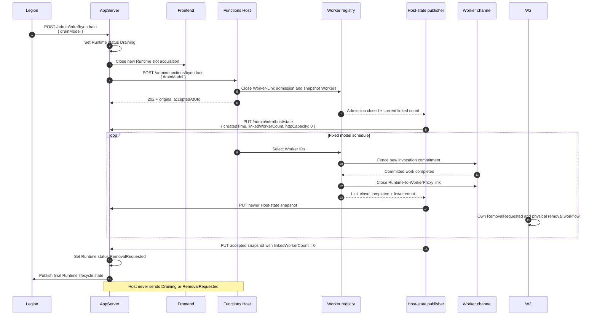
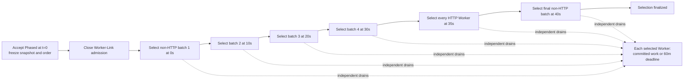
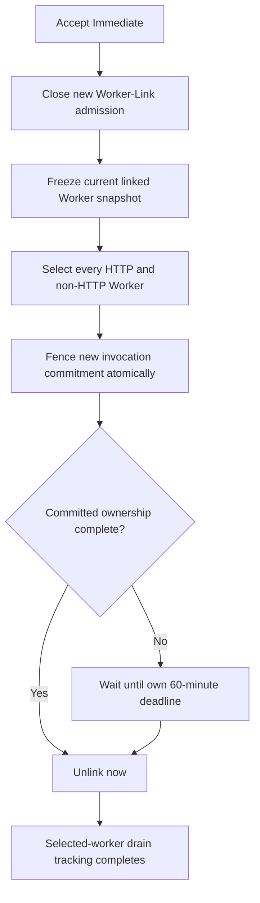
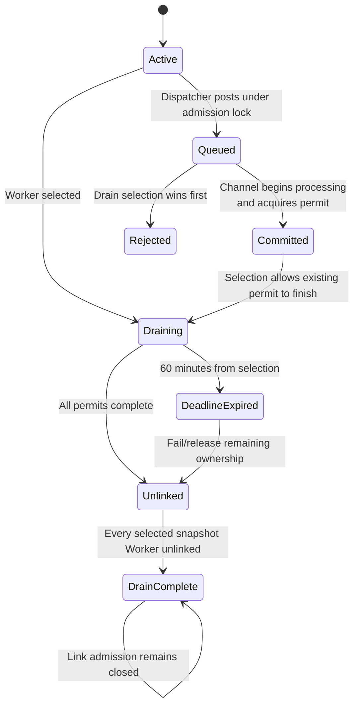
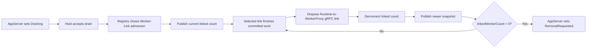

# BYOC Runtime worker drain

> **Status:** Implementation review for P2/P3 BYOC drain
>
> **Component:** Functions Host compute process / client-owned Worker channels
>
> **Original Worker-Link foundation:** `mnallagatla-microsoft-byoc-worker-signal` at
> `639da523aaa9fe8c1625659849a3c72b30d5f84b`
>
> **Shared Host-state foundation:** `mnallagatla-microsoft-r2-idle-http-worker` at
> `3ca8293f50bb01010e3f7504270f747866ebfc80`

## 1. Context

BYOC workers are linked to a long-lived Functions Runtime through WorkerProxy. Replacing an
image/configuration or removing a Runtime must stop new work without dropping work that the
Runtime already committed to a Worker.

This change adds the Host-owned part of that drain:

| Responsibility | Owner |
|---|---|
| Select `Phased` or `Immediate` | Legion / AppServer |
| Set Runtime `Draining` and stop new Frontend slot acquisition | AppServer before relay |
| Authenticate and relay the drain once | AppServer |
| Close new Worker-Link admission | Functions Host |
| Select Workers and fence invocation intake | Functions Host |
| Wait for committed work or the per-Worker deadline | Functions Host |
| Close the Runtime-to-WorkerProxy gRPC link | Functions Host |
| Push `createdTime`, `linkedWorkerCount`, and zero `httpCapacity` | Functions Host through the existing Host-state transaction |
| Set Runtime `RemovalRequested` after accepted final zero links | AppServer |
| Set WorkerProxy `RemovalRequested` | W2 |

The Host-state payload contains no Runtime lifecycle status. AppServer remains the only owner of
the `Draining` to `RemovalRequested` transition.

## 2. Before and after

| Area | Before | After |
|---|---|---|
| Management API | No dedicated BYOC Runtime drain endpoint | Authenticated `POST /admin/functions/byocdrain` |
| Worker-Link admission | New Workers can link while the Runtime is active | First accepted drain permanently closes new identities |
| Worker selection | Only generic Host shutdown/drain behavior | Fixed `Phased` schedule or all-at-once `Immediate` selection |
| Invocation intake | Dispatcher posts directly to a ready Worker buffer | Posting and drain selection share the channel admission lock |
| Committed work | Existing invocation lifecycle only | Drain waits for committed Function RPC and HTTP forwarding ownership |
| Link closure | Generic unlink/shutdown | Selected link closes after committed work or its 60-minute deadline |
| Host-state publication | No drain-specific authoritative final-zero update | Admission closure and every completed link close create a monotonic snapshot pushed through `PUT /admin/infra/host/state` |
| Runtime reuse | Existing normal lifecycle applies | Explicit retirement has no R1 five-minute empty-reuse grace |

Existing non-BYOC startup, routing, shutdown, and generic drain behavior remain unchanged.

## 3. Exact API contract

### 3.1 Endpoint

```http
POST /admin/functions/byocdrain
Authorization: <existing admin authentication>
Content-Type: application/json
```

Accepted request bodies are exactly:

```json
{ "drainModel": "Phased" }
```

```json
{ "drainModel": "Immediate" }
```

No other property is accepted. In particular, the request does not contain `reason`,
`operationId`, Worker identity, app identity, or scheduling details.

### 3.2 Validation

| Input | Result |
|---|---|
| Missing authentication | `401 Unauthorized` |
| Missing, empty, `null`, or malformed body | `400 InvalidBody` |
| Missing or blank `drainModel` | `400 Required` |
| Non-string `drainModel` | `400 InvalidBody` |
| Unknown or incorrectly cased model | `400 InvalidValue` |
| Duplicate `drainModel` | `400 InvalidBody` |
| Any extra property | `400 InvalidBody` |
| First valid request | `202 Accepted` |
| Equivalent retry | Same original acceptance time and active model |
| `Phased` followed by `Immediate` | `202 Accepted`; remaining Workers accelerate now |
| `Immediate` followed by `Phased` | `409 DrainConflict`; no downgrade |

The accepted response reports the active model and immutable first acceptance time:

```json
{
  "drainModel": "Phased",
  "acceptedAtUtc": "2026-10-31T07:00:00+00:00"
}
```

## 4. End-to-end sequence and repository boundaries



## 5. Frozen drain operation

The first accepted request creates one irreversible operation.

| Frozen value | Source |
|---|---|
| Acceptance UTC | `TimeProvider.GetUtcNow()` |
| Monotonic start | `TimeProvider.GetTimestamp()` |
| Initial linked Worker order | Existing registry insertion order |
| Initial non-HTTP population `N` | Linked, non-terminated Workers excluding HTTP group |
| Initial HTTP population | Linked, non-terminated HTTP group Workers |
| Non-HTTP batch size | `max(1, ceil(N * 0.20))` for `N > 0` |
| Schedule offsets | Non-HTTP `0/10/20/30/40s`; HTTP `35s` |
| Per-Worker deadline | 60 minutes from that Worker's own selection |

Equivalent retries return the frozen acceptance time. They do not resnapshot Workers, reorder the
snapshot, reset a timer, or extend a deadline.

Worker classification uses WorkerProxy's existing `FunctionGroupName` WorkerInit capability.
Unknown groups are conservatively included in the non-HTTP population. Always-ready Workers are
not filtered and therefore remain part of the non-HTTP snapshot.

## 6. Phased model

For `N = 21`, the batch size is `ceil(21 * 0.20) = 5`.

| Time from first acceptance | Selection |
|---|---|
| `0s` | Non-HTTP snapshot positions `0..4` |
| `10s` | Positions `5..9` |
| `20s` | Positions `10..14` |
| `30s` | Positions `15..19` |
| `35s` | All HTTP snapshot Workers |
| `40s` | Remaining non-HTTP Worker at position `20` |

Later batches do not wait for an earlier Worker to finish or be replaced.



Until `35s`, an HTTP Worker may finish and serve work already committed through an existing
Frontend slot. AppServer is responsible for closing new Runtime slot acquisition before relaying
the request; Host separately closes new Worker-Link admission at acceptance and publishes a fresh
Host-state timestamp without changing lifecycle ownership.

## 7. Immediate model and escalation

`Immediate` selects every Worker in the frozen HTTP and non-HTTP snapshot at `t=0`.



When `Immediate` escalates an existing `Phased` operation:

1. The original monotonic start, UTC acceptance time, snapshot, and order remain unchanged.
2. The future phased schedule is canceled.
3. Every not-yet-selected snapshot Worker is selected immediately.
4. An already-selected Worker's existing drain task and deadline remain unchanged.
5. A later `Phased` request is rejected because retirement cannot be downgraded.

## 8. Admission, locking, and committed work

### 8.1 Worker-Link admission

The worker registry owns the existing link identity and channel lifecycle. The first accepted
drain sets a permanent admission fence under the registry state lock.

| Link case after acceptance | Behavior |
|---|---|
| New Worker identity | Rejected with `RuntimeStopping` |
| Link initialization started before acceptance but publishes after it | Rejected |
| Exact retry for an existing accepted identity | Existing idempotent semantics remain |
| Replacement after all links close | Rejected; explicit retirement is irreversible |

### 8.2 Invocation intake

Selection and invocation commitment use the same per-channel lock:



Posting to a dataflow buffer is not commitment. The channel first records the accepted post as
pending under the admission lock, then promotes it to a committed permit when processing starts.
R2 reservations and normal shutdown treat pending posts as owned work. BYOC selection may instead
withdraw and fail them under the same lock, so a selected Worker cannot receive new work.

An HTTP Worker already committed to R2 scale-in keeps that existing drain instead of starting a
second unlink operation. R2 can commit only while pending and committed ownership are both zero,
and its 10-second peer-close timeout is stricter than BYOC's 60-minute committed-work budget.
Transport disposal remains conservatively represented in the physical linked count either way.

This distinction prevents queued/uncommitted requests from extending a drain:

| Race | Outcome |
|---|---|
| Channel commits first | Drain waits for the permit |
| Drain selects first | Channel rejects/fails the uncommitted request |
| R2 reservation races an accepted post | Pending ownership blocks the reservation |
| Normal shutdown starts after an accepted post | The pending post may commit and shutdown waits |
| Dispatcher read an older ready snapshot | Channel-level admission still rejects after selection |

### 8.3 HTTP completion ownership

A committed non-HTTP invocation owns one completion: the Function RPC result.

A committed HTTP invocation owns two completions:

1. Function RPC completion.
2. HTTP forwarding completion.

Either completion may happen first. The permit releases exactly once only after both complete.
At the hard per-Worker deadline, remaining ownership is failed and force-released before unlink.

### 8.4 Authoritative Host-state updates

The existing AppServer transaction is:

```http
PUT /admin/infra/host/state
fx-current-instance: <immutable container identity>
Content-Type: application/json
```

```json
{
  "createdTime": "2026-10-31T07:00:00.0000001+00:00",
  "linkedWorkerCount": 2,
  "httpCapacity": 0
}
```

The Worker registry is the shared `IHostStateCoordinator` and the only source of the Host-local
version and `createdTime`. `HostStatePublicationCoordinator` is the only component that sends the
existing AppServer transaction. Admission closure and every physical link cleanup advance the
shared generation. Runtime drain observes that generation and publishes the newest authoritative
snapshot until it is stable. Closely spaced intermediate counts may coalesce, but the latest count,
especially final zero, is retried. The local version is not sent, and `createdTime` increases
strictly because AppServer rejects stale snapshots by timestamp.

The shared `IRuntimeWorkerAdmissionGate` also forces `httpCapacity` to zero permanently. This keeps
R2 cancellation from republishing restored capacity after Runtime retirement owns admission.



The count includes every accepted link attempt until its transport cleanup completes. This covers
both a link still running its initialization handshake and a registered link already detached from
dispatch but still disposing. Clearing the registry slot is not enough, so AppServer cannot
observe final zero while the last Runtime-facing gRPC link is still initializing or closing.
Publication retries use the newest snapshot and do not block the `202` response.

## 9. Completion and W2 interaction

Each selected Worker gets up to 60 minutes from its own selection.

| Event | Host behavior |
|---|---|
| Committed ownership finishes early | Cancel unused deadline timer and unlink immediately |
| Worker disconnects while draining | Fail remaining ownership and complete link cleanup |
| 60-minute committed-work deadline expires | Fail/release remaining ownership and start unlink |
| Link disposal completes | Decrement authoritative linked count and publish a newer Host-state snapshot |
| All selected snapshot links close | Complete Host-local selected-worker drain tracking; this is not a Runtime lifecycle transition |
| All physical links close | Publish final zero immediately, with no five-minute reuse grace |
| AppServer accepts final zero while status is `Draining` | AppServer advances the Runtime to `RemovalRequested` |

W2 remains the only owner of WorkerProxy `RemovalRequested`. This change does not add a W4 trailer,
WorkerTerminate dependency, fallback deletion outbox, process kill, or physical deletion path.

## 10. Assumptions

1. AppServer persists `Draining` and closes new Frontend Runtime slot acquisition before it relays
   the Host request.
2. AppServer accepts the established authenticated
   `PUT /admin/infra/host/state` body with required `createdTime`, `linkedWorkerCount`, and
   `httpCapacity`.
3. AppServer remains the single owner of the Runtime lifecycle transition and advances to
   `RemovalRequested` only after accepting `linkedWorkerCount == 0`.
4. The relay uses the existing Host admin authentication policy.
5. WorkerProxy continues to supply `FunctionGroupName`; an omitted/unknown value is safe to drain
   as non-HTTP.
6. Worker registry insertion order is deterministic for the lifetime of the Runtime and is the
   required frozen selection order.
7. W2 observes Runtime-to-WorkerProxy link closure and owns Worker removal.

## 11. Known limitations

| Limitation | Effect |
|---|---|
| No persisted replay record | A Host process restart loses in-memory drain progress; P2 replaces/restarts the Runtime and P3 removes it |
| Host-state publication is process-local | A Host crash can lose the last unpublished snapshot; AppServer must not infer zero without an accepted Host update |
| Persistent Host-state rejection or unavailability | The observer retries with bounded backoff, but AppServer remains `Draining` until it accepts the newest snapshot; monitor Host publication warnings and repair the AppServer transaction |
| Transport cleanup stalls | The 60-minute deadline bounds committed work, not an unresponsive transport disposal; physical count remains nonzero conservatively until cleanup completes or infrastructure terminates the Runtime |
| Shared surface with R2 | Runtime drain depends on R2's shared coordinator, admission gate, and publisher; the PR must remain stacked until that dependency lands |
| Initial snapshot only | Workers that did not finish linking before acceptance are rejected rather than added to a later batch |
| Unknown group drains as non-HTTP | Safe/conservative, but it may select an incorrectly identified HTTP Worker before `35s` |
| Hard deadline ends ownership | Work still incomplete at 60 minutes fails; harder infrastructure deadlines may end it sooner |
| Reserved management route | In compute mode, `/admin/functions/byocdrain` is the drain endpoint, so a function named `byocdrain` cannot use that legacy admin-invocation path |
| No physical deletion fallback | Link closure is the Host boundary; W2 must perform removal |

## 12. Rollout and compatibility

The change is additive to the compute Host surface:

1. Ship the updated Host image with the dedicated internal endpoint.
2. Deploy the AppServer `Draining` owner, relay, existing Host-state receiver, and Frontend
   slot-acquisition closure in the coordinated Legion change.
3. Use `Phased` for P2 configuration/image/restart replacement.
4. Use `Immediate` for P3 stop/delete/remove-all.

Older AppServer versions do not call the endpoint, so normal Host behavior is unchanged. The body
has only one exact property, which avoids cross-version ambiguity. Rolling back AppServer stops new
drain requests; an already accepted Runtime drain remains irreversible by design. The Host-state
wire body remains the established three-field contract and contains no new lifecycle field.

## 13. File map

| Concern | File |
|---|---|
| Public model and manager contract | `src/Functions.Rpc.Client/Retirement/IByocRuntimeDrainManager.cs` |
| Shared monotonic Host state | `src/Functions.Rpc.Client/HostState/IHostStateCoordinator.cs`, `src/Functions.Rpc.Client/Registry/WorkerChannelRegistry.cs` |
| Shared irreversible admission gate | `src/Functions.Rpc.Client/Retirement/IRuntimeWorkerAdmissionGate.cs`, `src/Functions.Rpc.Client/Registry/WorkerChannelRegistry.cs` |
| Frozen schedule, retry, and escalation | `src/Functions.Rpc.Client/Retirement/ByocRuntimeDrainManager.cs` |
| Link fence, snapshot, selection, deadline, unlink | `src/Functions.Rpc.Client/Registry/WorkerChannelRegistry.cs` |
| Atomic intake and committed ownership | `src/Functions.Rpc.Client/WorkerChannel/RpcClientWorkerChannel.cs` |
| Base invocation lifecycle hooks | `src/WebJobs.Script.Grpc/Channel/WorkerChannel.cs` |
| Ready-snapshot-safe dispatch | `src/Functions.Rpc.Client/Dispatcher/RpcClientFunctionInvocationDispatcher.cs` |
| Runtime drain dependency injection | `src/Functions.Rpc.Client/Extensions/RpcClientServiceCollectionExtensions.cs` |
| Existing AppServer Host-state transaction | `src/Functions.Host/HostState/AppServerHostStateClient.cs`, `src/Functions.Host/HostState/HostStatePublicationCoordinator.cs` |
| Drain-triggered publication observer | `src/Functions.Host/HostState/ByocRuntimeDrainHostStateObserver.cs` |
| Strict JSON models | `src/Functions.Host/Models/ByocRuntimeDrainRequest.cs` |
| Authenticated internal endpoint | `src/Functions.Host/Controllers/ByocRuntimeDrainController.cs` |

## 14. Behavioral test matrix

Exactly five public/hosted behavioral test methods cover the contract.

| # | Public method | Behavior covered |
|---|---|---|
| 1 | `Post_EnforcesAdminContractAndPublishesSharedHostState` | Auth, strict body/model validation, valid models, compute-only route exposure, transient publication retry, and exact lifecycle-free Host-state wire body |
| 2 | `ByocDrain_PhasedUsesFrozenFiveBatchScheduleAndHttpCutoff` | Fixed `0/10/20/30/40s` non-HTTP schedule, frozen 20% batch, `35s` HTTP cutoff |
| 3 | `ByocDrain_ImmediateSelectsEveryWorkerAndClosesNewLinks` | All-at-once selection, permanent admission closure, pre-accept initialization/disposal races, one monotonic state update per completed cleanup, and final zero only after disposal |
| 4 | `ByocDrain_SelectionFencesIntakeAndWaitsForRpcAndHttpCompletion` | Atomic intake withdrawal plus RPC/HTTP committed ownership and link close |
| 5 | `ByocDrain_RetryAndEscalationKeepOriginalDeadlineAndRetireWithoutReuseGrace` | Replay, escalation, no deadline reset, no downgrade, no R1 grace, public link outcome |

The tests use a deterministic `TimeProvider`; they do not sleep for schedule seconds or minutes.
The existing shared R2 admission-race behavior also forces the post-before-commit ordering and
proves that pending ownership blocks scale-in while normal shutdown still waits for the invocation.

## 15. Explicit non-goals

- P1 or count-based scale-in.
- R1 empty-Runtime reuse grace or R2 behavior.
- Runtime lifecycle status ownership or `Draining` / `RemovalRequested` fields inside Functions Host.
- A second AppServer endpoint, callback, or long-held drain request.
- Operation IDs, replay caches, or durable drain persistence.
- Discovery cleanup.
- W4 handoff or a WorkerTerminate dependency.
- Worker deletion outbox, fallback deletion, process kill, or physical deletion.
- Broad dispatcher, registry, or shutdown refactoring.
- Changes to consolidated PR #13.
