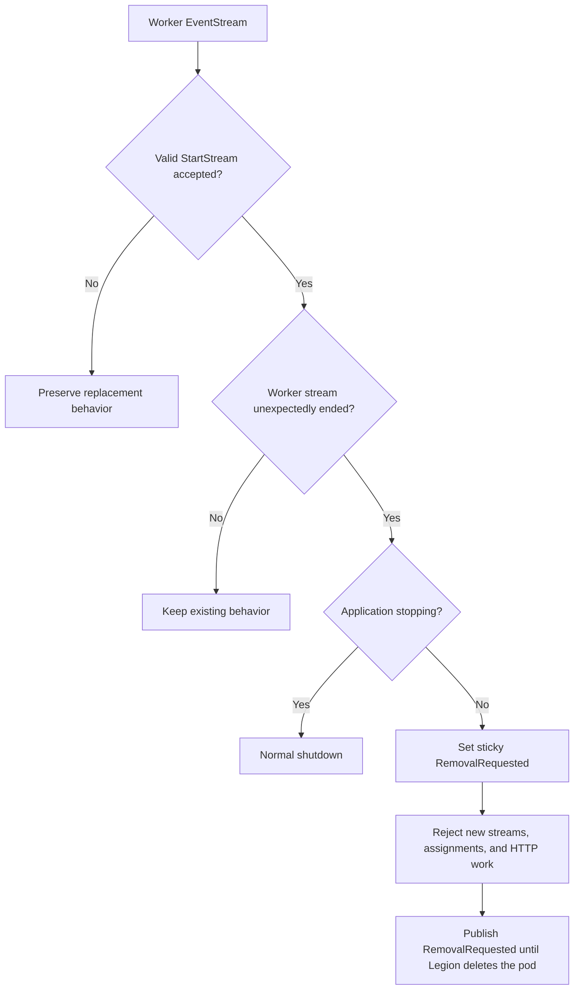

# BYOC W3 customer Worker gRPC loss cleanup

## Stack relationship

This W3 change is stacked on PR #14's W2 Runtime-link-loss behavior. W2 owns unexpected Runtime EventStream loss; this PR adds the equivalent ownership rule only for the established customer Worker EventStream.

## Contract

A customer Worker EventStream owns W3 only after its existing first-message callback accepts a nonempty `StartStream(workerId)`. If that same Worker-facing stream later ends through EOF, cancellation, read failure, or write failure, WorkerProxy requests sticky pod removal.

Pre-`StartStream`, rejected, stale, Runtime-facing, and planned application-shutdown handlers do not request W3. The existing session ID and Worker ID are the ownership record; this change adds no second establishment state or monitor.

## Flow

## Observable behavior

| Scenario | Result |
|---|---|
| No Worker or pre-`StartStream` failure | The handler can be replaced. |
| Established Worker EOF, cancellation, read failure, or write failure | `RemovalRequested` becomes sticky. |
| Runtime-facing stream failure | The W2 base continues to request removal; this PR does not change it. |
| Planned WorkerProxy shutdown | No removal request is published. |

After removal, Worker readiness and HTTP forwarding return 503, new Runtime and Worker EventStreams return the existing gRPC `Unavailable` response, and assignment uses the existing `WorkerTerminated` result. The management endpoint stays available and repeatedly publishes the same unhealthy `RemovalRequested` state.

## Implementation

- `FunctionRpcRelay.Session` reuses first-message and terminal callbacks to classify Worker-side stream failure.
- `WorkerPodStateManager` atomically verifies the current session has a Worker ID, excludes shutdown, and commits sticky removal.
- `FunctionRpcRelay`, assignment, and HTTP forwarding reuse the central state gate to close later admissions.
- `WorkerOriginState` and the existing long-poll endpoint publish the deletion request.

## Behavioral coverage

Four hosted test methods cover pre-establishment replacement, established EOF with all admission gates, established cancellation, and application shutdown. The existing relay termination theory adds deterministic Worker read- and write-failure coverage.

The established EOF theory covers the mapped HTTP proxy origin and default and explicit HTTP concurrency in both startup modes. W3 retains the failed assignment and its capacity for the terminal assignment contract without admitting new work or exposing the failed session's origin; W2 removal continues to clear assignment identity and capacity. Both paths preserve the pod startup time. Terminal logs retain the accepted Worker ID and session correlation, and rejected replacement streams still emit rejection diagnostics.

Worker completion while HTTP initialization waits for assignment requests sticky W3 removal and releases the pending waiter, with or without messages queued behind initialization. An accepted `StartStream` already establishes the customer Worker even when assignment is pending; only pre-establishment failures allow replacement.

The tests are in-memory hosted WorkerProxy validation. They do not prove deployed Legion polling or physical pod deletion.

## Non-goals

W1 Runtime Link timing, changes to W2 Runtime-side removal, W4 drain behavior, restart protocols, `AcknowledgeLink`, authentication, TLS, Docker, and Legion implementation changes remain outside this PR.
