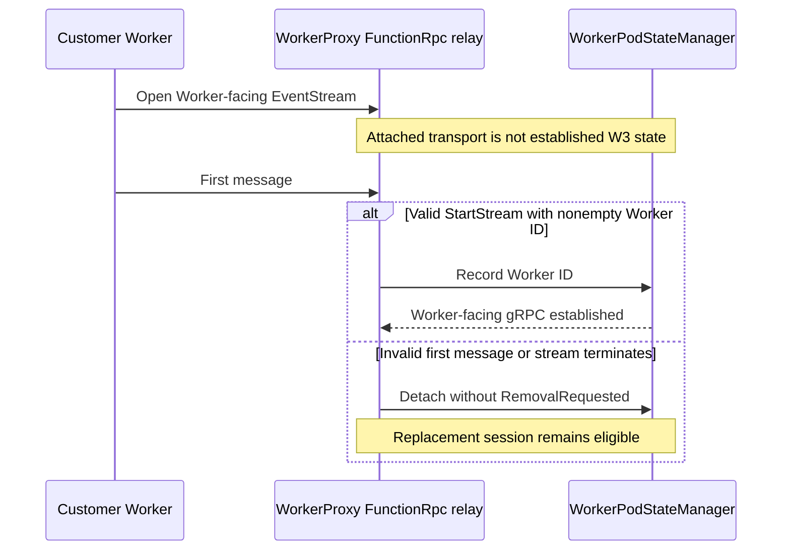
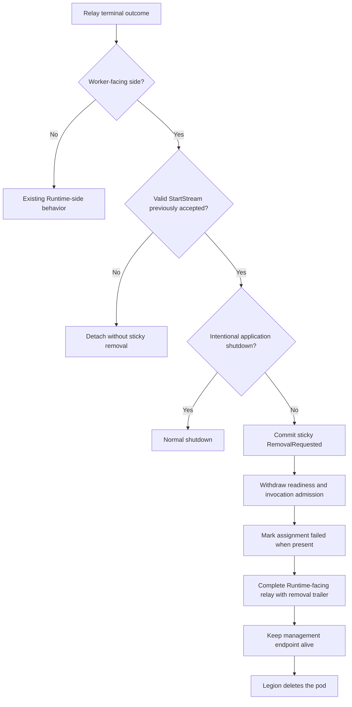
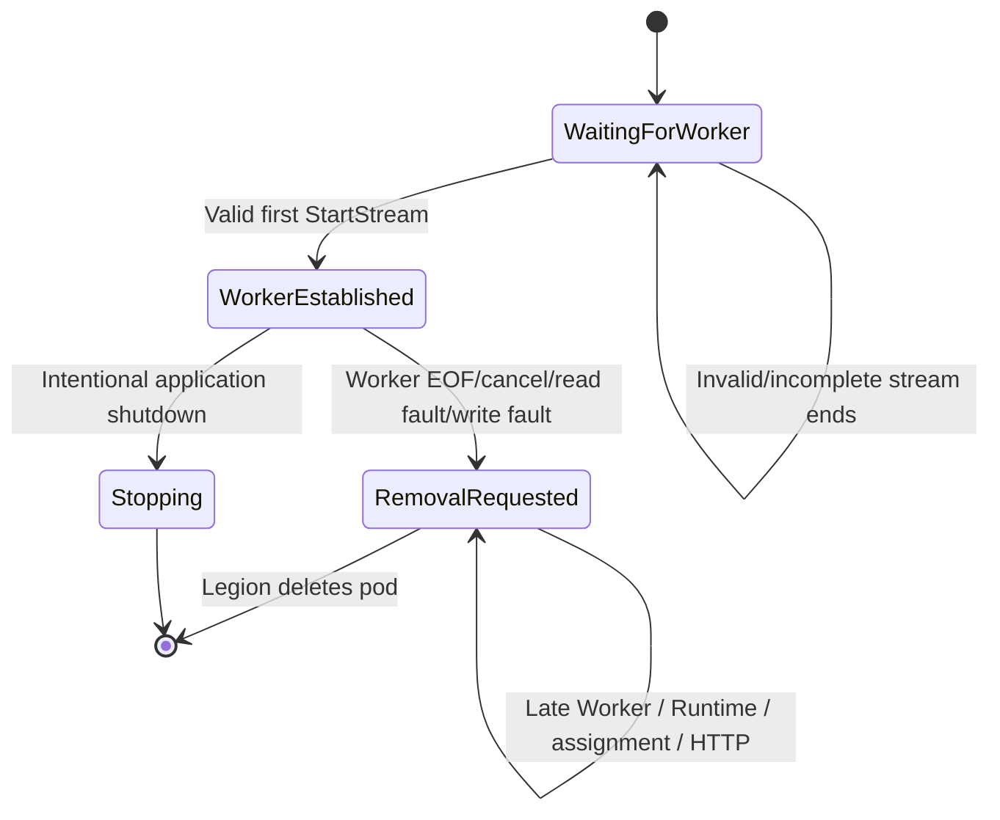

# BYOC W3 established customer Worker gRPC loss cleanup

## Context

WorkerProxy has separate Runtime-facing and customer Worker-facing FunctionRpc listeners. This change covers one W3 rule only:

> After the customer Worker sends a valid first `StartStream` with a nonempty Worker ID, terminal loss of that established Worker-facing stream requests sticky pod removal.

There is no Worker establishment deadline. No Worker connection, a connection that never sends `StartStream`, an invalid first message, and any pre-establishment EOF, cancellation, read fault, or write fault retain the existing replacement behavior.

W1 authenticated Runtime Link timing, W2 Runtime-side loss handling, W4 graceful removal, HTTP health thresholds, customer invocation failures, `WorkerTerminate`, invocation drain/replay/retry, Docker, and Legion are outside this change.

## Before and after

| Scenario | Before | After |
|---|---|---|
| No customer Worker connection | WorkerProxy waits for a Worker. | Unchanged; no deadline or removal decision. |
| Invalid or incomplete pre-establishment Worker stream | The relay ends and a replacement session can establish. | Unchanged; no sticky removal is selected. |
| Established Worker stream reaches EOF, cancellation, read fault, or write fault | Readiness was withdrawn, but replacement could remain possible in some states. | WorkerProxy commits sticky `RemovalRequested` and permanently closes pod admission. |
| Runtime-facing stream terminates | Existing Runtime-side behavior applies. | Unchanged; Runtime loss is not W3. |
| WorkerProxy intentionally stops | The relay closes as application shutdown. | Shutdown remains non-W3 and does not publish `RemovalRequested`. |

## Establishment boundary

W3 begins only after `WorkerPodStateManager` has accepted the Worker ID from a valid first `StartStream`.

## Established Worker loss

EOF/peer close, cancellation, read fault, and write fault all use the same established-Worker terminal rule.

## Sticky lifecycle state

Once removal is committed:

- `/admin/worker/ready` returns HTTP 503.
- New Worker-facing and Runtime-facing EventStreams return gRPC `Unavailable`.
- Worker assignment returns HTTP 409 with `RemovalRequested`.
- New HTTP invocation forwarding returns HTTP 503.
- The split instance-state projection repeatedly reports `RemovalRequested` and unhealthy.
- The active Runtime-facing EventStream receives `x-ms-functions-worker-removal-requested: true`.
- WorkerProxy and its management endpoint stay alive until pod deletion.

## Implementation map

| Area | Files | Purpose |
|---|---|---|
| Sticky state | `WorkerPodState.cs`, `WorkerPodStateManager.cs`, `SplitWorkerOriginState.cs` | Requires an accepted Worker ID before Worker terminal loss can commit sticky removal. |
| Relay classification | `FunctionRpcRelay.cs`, `FunctionRpcRelay.Session.cs` | Distinguishes established Worker loss from pre-establishment and Runtime-side outcomes. |
| Runtime indication | `FunctionRpcRelayService.cs`, `FunctionRpcRelayConstants.cs`, terminal-state types | Completes the Runtime-facing relay with the removal trailer after sticky removal is committed. |
| Admission closure | management and HTTP forwarding handlers | Rejects assignment, streams, and HTTP forwarding while preserving management availability. |

No deadline option, timer, lifecycle watcher, `WorkerTerminate`, process/container kill, invocation drain, replay, or retry behavior is added.

## Behavioral scenarios

Five hosted public-surface methods cover the contract:

1. `WorkerGrpc_PreEstablishmentTerminalOutcomesAllowReplacement`
   - Covers invalid first message, pre-`StartStream` EOF, and pre-`StartStream` cancellation.
   - Verifies no removal trailer/state, assignment remains not-ready rather than terminal, and a replacement Worker can establish.
2. `WorkerGrpc_EstablishedEofRequestsStickyRemovalAndClosesAdmissions`
   - Establishes and assigns the Worker, then closes the Worker request stream.
   - Verifies repeated removal publication, Runtime trailer, readiness/assignment/HTTP closure, and late stream rejection.
3. `WorkerGrpc_EstablishedCancellationRequestsStickyRemoval`
   - Cancels an established Worker EventStream and verifies sticky removal.
4. `Relay_EstablishedReadFaultRequestsStickyRemovalWithoutForwardingResponse`
   - Forces a read-path capability-finalization fault after valid `StartStream` and verifies sticky removal without forwarding a partial response.
5. `WorkerGrpc_ApplicationShutdownDoesNotPublishRemoval`
   - Stops WorkerProxy with established Worker and Runtime EventStreams and verifies shutdown is not W3.

The existing relay termination scenario also exercises an established Worker write fault and verifies the same sticky removal transition.

These are in-memory hosted public-surface scenarios except the existing focused write-fault relay scenario. They do not claim deployed Legion validation.

## Assumptions

- A valid first `StartStream` with a nonempty Worker ID is the authoritative establishment boundary.
- Legion treats `RemovalRequested` as the request to delete the Worker pod.
- Existing Runtime channel completion removes Worker capacity and fails unresolved committed invocations according to current Host behavior.
- Source-specific invocation retry behavior remains outside WorkerProxy.

## Known limitations

- This independent base has no public split-state field for historical Runtime identity. The projection remains `Unlinked`; this change does not widen that protocol.
- Worker and assignment identity remain historical attribution after removal and do not imply a live Worker or Runtime Link.
- The removal trailer is emitted by WorkerProxy. This PR adds no new Host-side W2 handling.
- The tests do not exercise a deployed Legion stamp or physical pod deletion.
