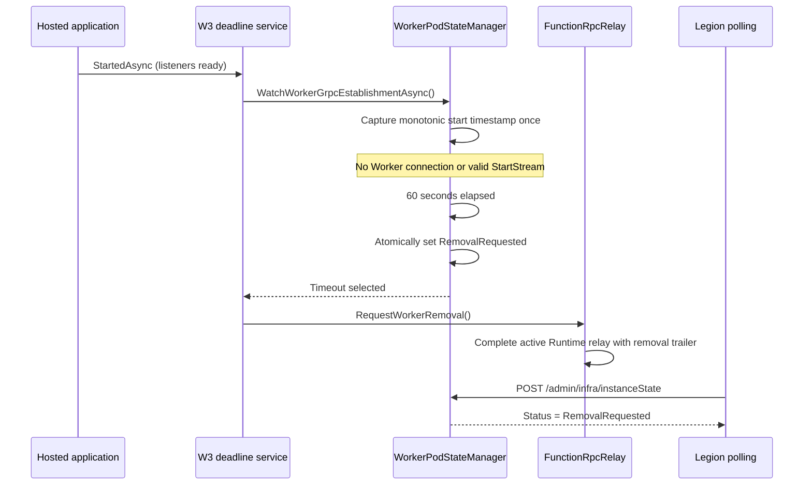
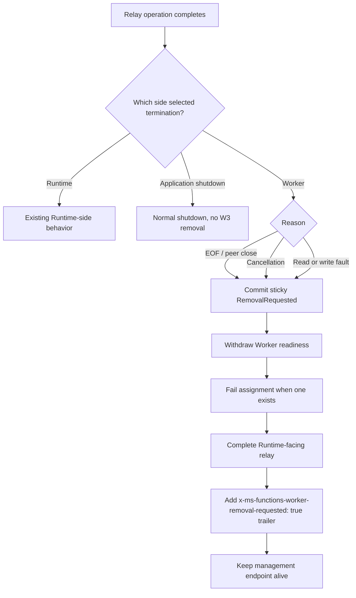
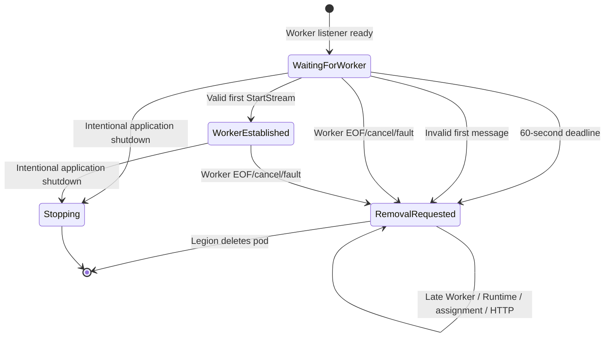

# BYOC W3 customer Worker gRPC failure cleanup

## Context

WorkerProxy has two FunctionRpc listeners:

- The Runtime-facing listener relays Host traffic.
- The Worker-facing listener accepts the customer Worker EventStream.

This change covers only W3: the customer Worker-facing gRPC stream never establishes, or an established customer Worker stream terminates. WorkerProxy then publishes sticky `RemovalRequested` state and waits for Legion to delete the pod.

W1 authenticated Runtime Link timing, W2 Runtime-side loss handling, W4 graceful removal, HTTP health thresholds, customer invocation failures, Docker, and Legion are intentionally outside this change.

## Before and after

| Scenario | Before | After |
|---|---|---|
| No valid Worker `StartStream` after the listener is ready | The pod could remain available indefinitely. | A fixed 60-second monotonic deadline commits `RemovalRequested`. |
| Worker stream closes before valid `StartStream` | The relay ended, but a replacement Worker could reconnect. | The first terminal Worker outcome commits sticky removal immediately. |
| Valid Worker stream later reaches EOF, cancellation, or a read/write fault | Readiness was withdrawn, but replacement was still possible in some states. | Removal is sticky and every late admission surface rejects the pod. |
| WorkerProxy application intentionally stops | Relay shutdown could look similar to a transport failure. | Shutdown disables the W3 deadline and never creates a W3 removal decision. |
| WorkerProxy after W3 | Relay teardown completed, but management state did not carry removal ownership. | Management stays alive and continues reporting `RemovalRequested` until pod deletion. |

## Establishment deadline

The deadline starts once from the hosted `StartedAsync` lifecycle phase, after the application listeners are started. It uses `TimeProvider` and a captured timestamp, so wall-clock changes do not extend or shorten the window.

Connection attempts, invalid messages, disconnects, and replacement attempts do not reset the timestamp. If a valid first `StartStream` wins the lifecycle lock before expiry, the establishment waiter completes and its timer is disposed.

## Worker-side terminal cleanup

Only the Worker-facing side selects W3. Runtime-side terminal outcomes remain their existing behavior and do not request W3 removal.

An invalid first Worker message is a Worker read fault. A Worker stream that reaches EOF before valid `StartStream` is a Worker peer-close. Both are immediate W3 failures; neither receives another deadline or replacement opportunity.

## Sticky lifecycle state

The `RemovalRequested` transition and valid `StartStream` transition share the lifecycle state lock. Exactly one wins. Once removal wins:

- `/admin/worker/ready` returns HTTP 503.
- New Worker-facing and Runtime-facing EventStreams return gRPC `Unavailable`.
- Worker assignment returns HTTP 409 with `RemovalRequested`.
- New HTTP invocation forwarding returns HTTP 503.
- The split instance-state projection reports `RemovalRequested` and unhealthy.
- The WorkerProxy process and management endpoint remain available.

## Implementation map

| Area | Files | Purpose |
|---|---|---|
| Configuration | `WorkerProxyOptions.cs`, `WorkerProxyOptionsValidator.cs` | Adds the validated 60-second `WorkerGrpcEstablishmentTimeout`. |
| Listener-ready deadline | `WorkerGrpcEstablishmentDeadlineService.cs`, `WorkerProxyApplication.cs` | Starts the one-shot W3 watcher from hosted listener readiness and disables it during shutdown. |
| Sticky state | `WorkerPodState.cs`, `WorkerPodStateManager.cs`, `SplitWorkerOriginState.cs` | Serializes deadline, valid `StartStream`, terminal Worker outcomes, readiness, assignment, and removal publication. |
| Relay classification | `FunctionRpcRelay.cs`, `FunctionRpcRelay.Session.cs` | Classifies Worker-side EOF/cancellation/fault as W3 and keeps Runtime-side outcomes outside W3. |
| Runtime indication | `FunctionRpcRelayService.cs`, `FunctionRpcRelayConstants.cs`, terminal-state types | Completes the Runtime-facing relay with the removal trailer after sticky removal is committed. |
| Admission closure | management and HTTP forwarding handlers | Rejects assignment and HTTP forwarding after removal while preserving management availability. |

No `WorkerTerminate`, process kill, container kill, invocation drain, replay, or retry behavior is added.

## Behavioral scenarios

The change adds five test methods that use the hosted WorkerProxy and public gRPC, HTTP, readiness, assignment, and management surfaces:

1. `WorkerGrpcDeadline_NoConnectionRequestsStickyRemovalAndClosesAdmissions`
   - Starts a Runtime EventStream with no Worker connection.
   - Advances the exact 60-second timer.
   - Verifies the Runtime removal trailer, repeated `RemovalRequested` publication, readiness 503, assignment rejection, HTTP rejection, late Runtime rejection, and late Worker rejection.
2. `WorkerGrpcDeadline_AttachedStreamWithoutStartStreamExpiresAndCannotReconnect`
   - Opens the Worker EventStream without sending a first message.
   - Verifies deadline removal and permanent reconnect rejection.
3. `WorkerGrpcDeadline_ValidStartStreamCancelsEstablishmentTimeout`
   - Sends valid `StartStream` before expiry.
   - Verifies the deadline timer is disposed, readiness and assignment remain available, and Runtime relay traffic is admitted.
4. `WorkerGrpcTerminalOutcome_RequestsStickyRemoval`
   - Covers invalid first message, pre-`StartStream` EOF, established EOF, and established cancellation.
   - Verifies sticky removal, Runtime trailer signaling, identity attribution, readiness withdrawal, assignment rejection, and reconnect rejection.
5. `WorkerGrpcDeadline_ApplicationShutdownDoesNotPublishRemoval`
   - Stops the hosted application with established Worker and Runtime EventStreams.
   - Verifies the timer is disposed and shutdown does not publish `RemovalRequested`.

These are in-memory hosted public-surface scenarios. They do not claim deployed Legion validation.

## Assumptions

- `IHostedLifecycleService.StartedAsync` runs after Kestrel has started the configured listeners.
- Legion treats `RemovalRequested` as the authoritative request to delete the Worker pod.
- Existing Runtime channel completion removes Worker capacity and fails unresolved committed invocations according to current Host behavior.
- Source-specific invocation retry behavior remains outside WorkerProxy.

## Known limitations

- This independent base has no public split-state field for historical Runtime identity. The projection remains `Unlinked`; the change does not widen that protocol.
- Worker and assignment identity remain internally available as historical attribution, but they do not imply a live Worker or Runtime Link after removal.
- The removal trailer is emitted by WorkerProxy. This PR does not add new Host-side W2 handling; existing channel completion behavior remains authoritative.
- The tests do not exercise a deployed Legion stamp or physical pod deletion.
