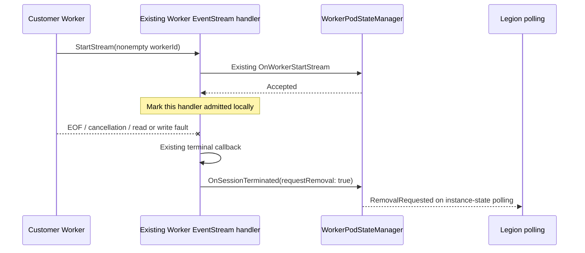
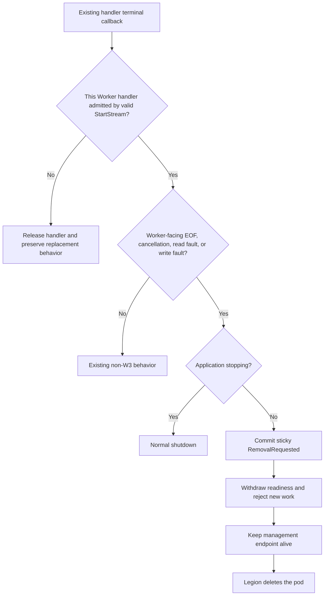
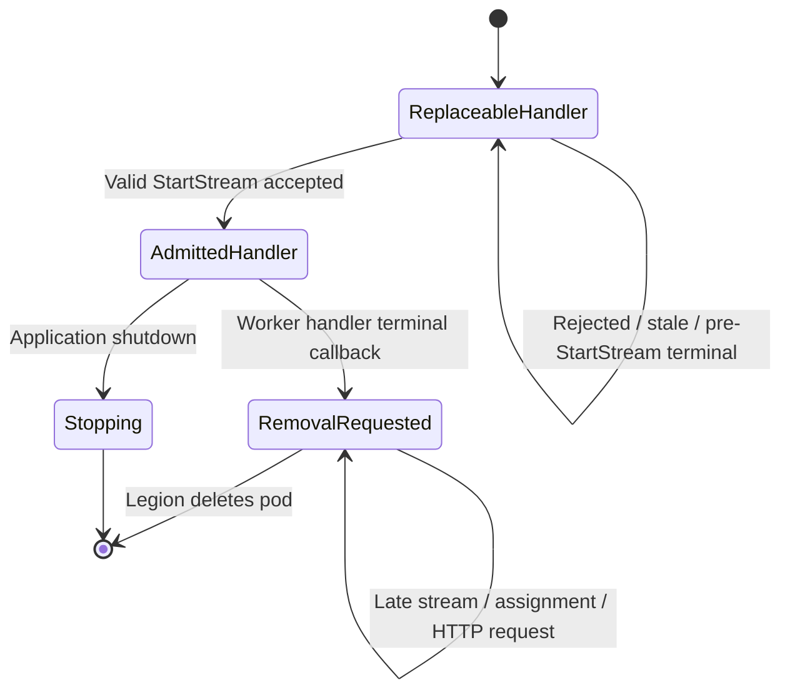

# BYOC W3 customer Worker gRPC loss cleanup

## Context

WorkerProxy has separate Runtime-facing and customer Worker-facing FunctionRpc listeners. This change adds one rule:

> A valid `StartStream(workerId)` admits the customer Worker handler. If that same handler later ends through EOF, cancellation, read fault, or write fault outside application shutdown, its existing terminal callback requests sticky pod removal.

There is no establishment deadline and no separate Worker-establishment state machine. A handler that ends before valid `StartStream`, is rejected, or is stale keeps the existing replacement behavior.

W1 Runtime Link timing, W2 Runtime-side loss handling, W4 graceful removal, HTTP health thresholds, customer invocation failures, `WorkerTerminate`, invocation drain/replay/retry, Docker, and Legion are outside this change.

## Before and after

| Scenario | Before | After |
|---|---|---|
| No customer Worker connection | WorkerProxy waits for a Worker. | Unchanged. |
| Worker handler ends before valid `StartStream` | The relay releases the handler and permits replacement. | Unchanged. |
| Admitted Worker handler ends | Readiness is withdrawn, but another session can be accepted in some states. | Sticky `RemovalRequested` closes new pod work. |
| Runtime-facing handler ends | Existing Runtime-side behavior applies. | Unchanged; Runtime loss is not W3. |
| WorkerProxy intentionally stops | The relay closes as application shutdown. | Unchanged; shutdown is not W3. |

## Callback flow

The local admitted result belongs only to that EventStream handler. It does not add a public status, history field, or independent lifecycle abstraction.

## Decision flow

## Sticky removal

After removal is committed:

- `/admin/worker/ready` returns HTTP 503.
- New Worker-facing and Runtime-facing EventStreams return the existing gRPC `Unavailable` response.
- Worker assignment returns the existing `WorkerTerminated` result.
- New HTTP invocation forwarding returns HTTP 503.
- Split instance-state polling repeatedly returns `RemovalRequested` and unhealthy.
- WorkerProxy and its management endpoint remain available until pod deletion.
- The Runtime-facing relay observes normal relay termination; no new trailer or wire contract is added.

## Implementation map

Every changed production file is required for one of the four W3 responsibilities:

| File | Why it changes |
|---|---|
| `src/Functions.WorkerProxy/Rpc/FunctionRpcRelay.Session.cs` | Records the existing `StartStream` admission result locally and lets the existing terminal callback request W3 only for that admitted Worker handler. |
| `src/Functions.WorkerProxy/State/WorkerPodState.cs` | Stores the one sticky `RemovalRequested` gate and makes readiness false after removal. |
| `src/Functions.WorkerProxy/State/WorkerPodStateManager.cs` | Atomically commits removal, excludes application shutdown, and rejects later Worker attachment, `StartStream`, and assignment. |
| `src/Functions.WorkerProxy/Rpc/FunctionRpcRelay.cs` | Rejects new Runtime and Worker EventStreams after sticky removal and marks intentional shutdown before relay cancellation. |
| `src/Functions.WorkerProxy/Http/WorkerHttpForwardingMiddleware.cs` | Applies the central removal gate before configured or learned HTTP destination fallback can admit new invocations. |
| `src/Functions.WorkerProxy/State/SplitWorkerOriginState.cs` | Projects sticky removal through the existing Legion instance-state contract. |
| `src/Functions.WorkerProxy/Management/ManagementApiHandlers.cs` | Returns the same removal projection on every long-poll so Legion continues seeing the deletion request. |

The four new hosted scenario methods are in `FunctionRpcRelayTests.WorkerGrpcFailure.cs`. One existing management scenario updates its public status expectation to `RemovalRequested`; low-level capability and relay-state coverage is not expanded.

## Behavioral scenarios

Four new hosted public-surface methods cover the focused contract:

1. `WorkerGrpc_PreEstablishmentTerminalOutcomesAllowReplacement`
   - Covers invalid first message, pre-`StartStream` EOF, and pre-`StartStream` cancellation.
   - Verifies no removal state and successful replacement.
2. `WorkerGrpc_EstablishedEofRequestsStickyRemovalAndClosesAdmissions`
   - Verifies repeated instance-state publication plus readiness, assignment, Runtime stream, and Worker stream admission closure.
3. `WorkerGrpc_EstablishedCancellationRequestsStickyRemoval`
   - Verifies an admitted handler cancellation uses the same sticky removal path.
4. `WorkerGrpc_ApplicationShutdownDoesNotPublishRemoval`
   - Verifies intentional shutdown does not become W3.

These are hosted public gRPC and management surfaces, not isolated state-manager unit tests.

## Assumptions

- Existing first-message processing remains the authority for accepting `StartStream` with a nonempty Worker ID.
- Legion treats `RemovalRequested` as the request to delete the Worker pod.
- Existing Runtime relay completion removes Worker capacity and preserves current unresolved-invocation behavior.
- Source-specific invocation retry behavior remains outside WorkerProxy.

## Known limitations

- This PR does not add a Runtime removal trailer or any new wire signal.
- The split-state contract remains `Unlinked`; it does not expose historical Runtime identity.
- The tests do not exercise a deployed Legion stamp or physical pod deletion.
