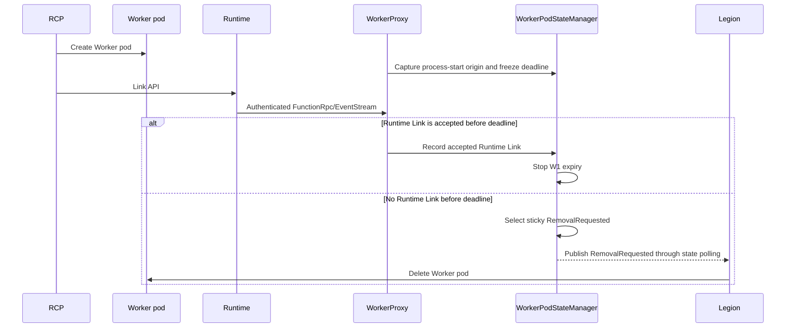
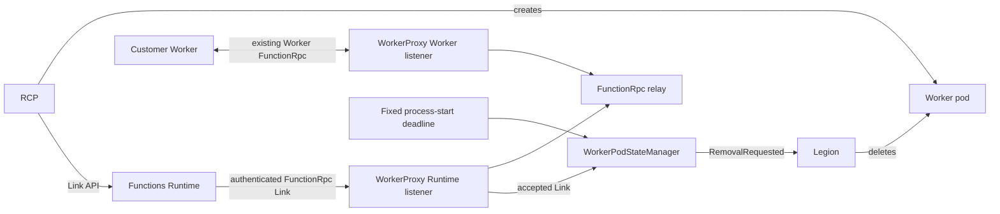
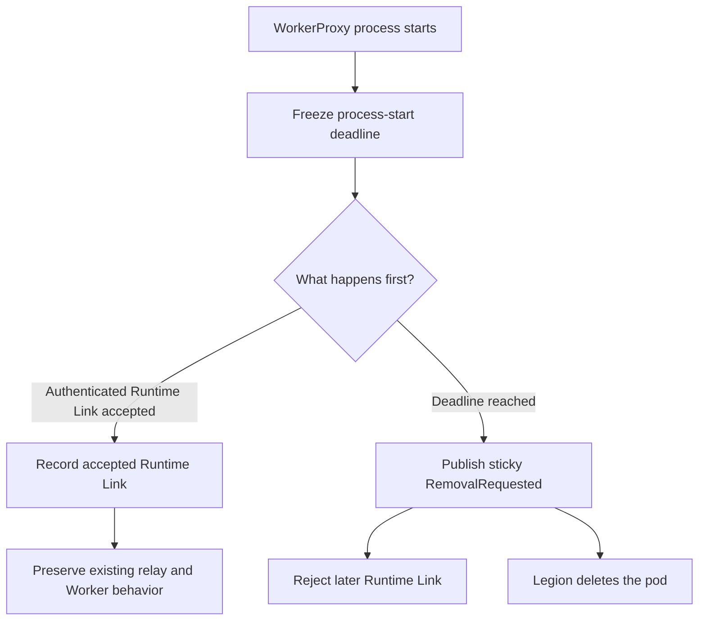
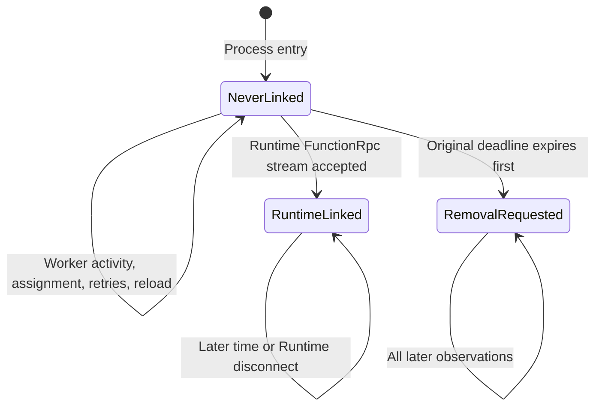

# BYOC WorkerProxy never-linked cleanup

> **Scope:** W1 only: remove a Worker pod when Runtime never establishes its first authenticated
> FunctionRpc Link to WorkerProxy.
>
> **Authentication dependency:** [Azure/azure-functions-host#12103](https://github.com/Azure/azure-functions-host/pull/12103)
> is still open. This PR does not copy that work. The platform must provide equivalent authentication
> before the Runtime-facing FunctionRpc request reaches WorkerProxy.
>
> **Deployment gate:** Do not deploy this cleanup until both authenticated Runtime-facing FunctionRpc
> and the RCP-to-Runtime Link flow are active in the target environment.

## Context

RCP creates a BYOC Worker pod and then calls the Runtime Link API. Runtime uses that request to open
the Runtime-facing FunctionRpc gRPC stream to WorkerProxy. That accepted Runtime connection is the W1
completion signal.

The customer Worker has a separate Worker-facing FunctionRpc connection to WorkerProxy. W1 does not
wait for, inspect, reject, or otherwise change that connection. Worker initialization messages such as
`StartStream` and `WorkerInitResponse` are not W1 signals.

## Before and after

| Scenario | Before | With W1 |
| --- | --- | --- |
| WorkerProxy starts but Runtime never Links | The pod can remain in `Starting`. | The process-start deadline publishes `RemovalRequested`. |
| Runtime Links before the deadline | No W1 history is retained. | WorkerProxy records the accepted Runtime Link and stops W1 expiry. |
| Worker connects or initializes | Worker lifecycle follows existing behavior. | Worker lifecycle still follows existing behavior and does not complete W1. |
| Assignment or configuration reload occurs | Existing behavior applies. | Existing behavior still applies and does not move or complete the W1 deadline. |
| Runtime Links after expiry | The stream can be admitted. | The Runtime-facing stream is rejected with gRPC `Unavailable`. |
| Pod needs physical deletion | WorkerProxy has no deletion ownership. | WorkerProxy reports `RemovalRequested`; Legion still deletes the pod. |

## Exact W1 rule

Each WorkerProxy process has one fixed window to accept its first authenticated Runtime-facing
FunctionRpc Link.

- The window starts at the first process-entry statement.
- The default duration is five minutes.
- `WorkerProxy:NeverLinkedTimeout` can configure the duration before process startup.
- The duration and monotonic deadline are frozen for the process.
- The first accepted Runtime-facing FunctionRpc stream ends W1.
- If the deadline wins, `RemovalRequested` is sticky and later Runtime Links are rejected.

Assignment, customer-Worker connection, worker initialization, retries, token/bootstrap work, and
configuration reload do not complete or reset W1.

## End-to-end sequence

The Runtime-facing request is authoritative because it is the connection Runtime creates after RCP
issues the Link API. No customer-Worker message participates in this decision.

## Component ownership

| Component | W1 responsibility | Not owned by W1 |
| --- | --- | --- |
| Process entry | Capture immutable UTC and monotonic startup origins before host construction. | Platform process-start recovery. |
| Runtime FunctionRpc listener | Admit the authenticated Runtime Link before expiry or reject it after expiry. | Customer-Worker initialization. |
| `WorkerPodStateManager` | Freeze the duration and atomically select accepted Runtime Link or removal. | Assignment and worker readiness semantics. |
| Management state | Publish sticky `RemovalRequested` to Legion. | Physical deletion. |
| Legion | Observe `RemovalRequested` and delete the pod. | WorkerProxy relay internals. |

## Decision flow

## State transitions

An accepted Runtime Link ends W1; only timeout publishes a public state change. The public Link
projection remains `Unlinked` because this PR does not publish Runtime Link identity.

## Public behavior

| Surface | W1 behavior |
| --- | --- |
| `POST /admin/infra/instanceState` | Reports `status: RemovalRequested` with a higher revision after timeout. |
| Runtime-facing `FunctionRpc/EventStream` | The first accepted stream before expiry ends W1; a late stream returns gRPC `Unavailable`. |
| Worker-facing `FunctionRpc/EventStream` | Unchanged by W1. |
| `PUT /admin/worker/assignment` | Unchanged by W1 and does not complete or reset the deadline. |
| `GET /admin/worker/ready` | Unchanged by W1. |
| HTTP invocation forwarding | Unchanged by W1. |
| `GET /admin/instance/ready` | Unchanged process-liveness behavior. |

## Implementation map

| File or area | Change |
| --- | --- |
| `Program.cs` and `WorkerProxyStartupTime.cs` | Capture process startup before host/configuration construction. |
| `WorkerProxyOptions*` | Add the default five-minute positive duration and timer-range validation. |
| `WorkerProxyApplication.cs` | Register the captured startup origin, state manager, and one timeout service. |
| `NeverLinkedTimeoutService.cs` | Wait once against the original process deadline. |
| `WorkerPodStateManager.cs` | Serialize Runtime Link acceptance versus expiry and publish sticky removal. |
| `FunctionRpcRelay.cs` and `FunctionRpcRelay.Session.cs` | Record Link success only after Runtime reserves a live relay session, and reject a late Runtime attachment. |
| `WorkerPodState.cs` | Retain the sticky process-local removal decision in the existing immutable snapshot. |
| `SplitWorkerOriginState.cs` | Project `RemovalRequested` for Legion. |
| `FunctionRpcRelayTests.NeverLinked.cs` | Exercise W1 through Runtime gRPC and management state surfaces. |

## Assumptions

1. RCP creates the Worker pod before issuing the Runtime Link API.
2. Runtime responds to that API by opening the authenticated Runtime-facing FunctionRpc stream to
   WorkerProxy.
3. Reaching WorkerProxy's Runtime-facing FunctionRpc handler means platform authentication has
   succeeded.
4. Legion deletes a split Worker when it observes
   `FunctionsSplitWorkerStatus.RemovalRequested`.
5. The configured timeout is a process-lifetime setting and does not change after startup.

## Known limitations

- If WorkerProxy never starts, crashes before reporting, or cannot publish state, platform
  startup/failure recovery must reclaim the pod.
- If a Runtime Link is accepted and later disconnects, W1 remains complete. Established-Link cleanup
  belongs to W2/W3.
- Authentication must be supplied by Azure/azure-functions-host#12103 or equivalent platform
  behavior.
- The timeout is process-local and is not persisted across a WorkerProxy restart.
- The public Link field remains `Unlinked`; successful Link acceptance is used only to end W1.
- W1 does not change assignment, customer-Worker gRPC, readiness, HTTP invocation, or drain behavior.

## Compatibility and rollout

- Only WorkerProxy processes that never receive an authenticated Runtime Link within the configured
  window become eligible for removal.
- Customer-Worker connection, initialization, assignment, readiness, and HTTP behavior are
  unchanged.
- The public `StartupTime` now reports the process-entry origin used by the deadline instead of the
  later state-manager construction time.
- No protobuf, Runtime, RCP, Legion, image, or dependency change is included.
- Deploy authentication and the RCP-to-Runtime Link path first, verify both on the target stamp, and
  only then deploy this WorkerProxy change.
- WorkerProxy rollback stops new W1 decisions but cannot retract a `RemovalRequested` signal already
  observed by Legion.

## Behavioral test matrix

| Test | Public behavior proved |
| --- | --- |
| `NeverLinkedDeadline_IncludesConstructionTimeAndUsesMonotonicClock` | Host construction counts against the deadline, UTC jumps do not, and management publishes removal. |
| `NeverLinkedDeadline_WorkerActivityAssignmentAndReloadDoNotCompleteRuntimeLink` | Worker connection, assignment, and configuration reload neither complete nor reset W1, and worker readiness remains unchanged. |
| `NeverLinkedDeadline_PublishesStickyRemovalAndRejectsOnlyLateRuntimeLink` | A Runtime attempt rejected during relay teardown does not end W1; timeout wakes management polling, late Runtime Link is rejected, removal stays sticky, and Worker-facing admission remains unchanged. |
| `NeverLinkedDeadline_BoundarySelectsOneStickyRuntimeLinkOutcome` | Runtime Link acceptance and expiry contend concurrently; either admitted Runtime Link prevents removal or removal wins and rejects the Link, and the selected outcome stays sticky. |

## Intentionally unchanged

- Customer-Worker `StartStream`, `WorkerInitResponse`, capability finalization, and replacement
  behavior.
- Assignment, worker readiness, and HTTP invocation admission.
- Runtime Link API implementation, Runtime registry, Unlink, scale-in, and drain behavior.
- Established-Link W2/W3 cleanup.
- Runtime fallback deletion or outbox publication.
- Legion deployment or deletion code.
- Authentication implementation.
- PR #13 and its unrelated R2, R3, R4, W2/W3, P1/P2/P3, Runtime-drain, and fallback changes.
