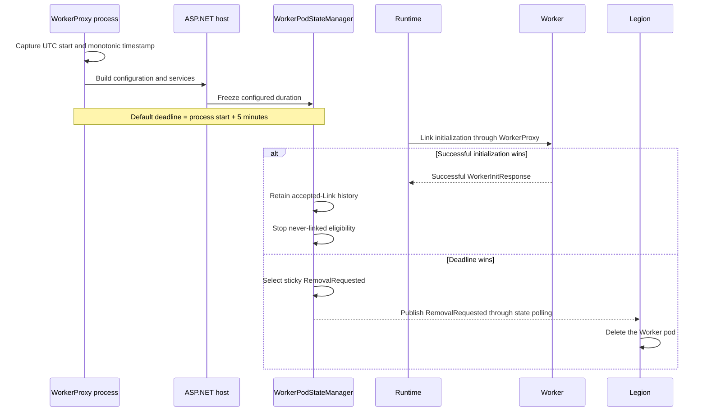
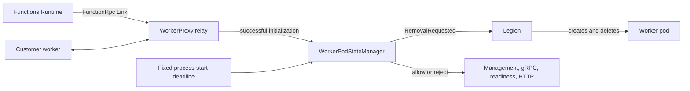
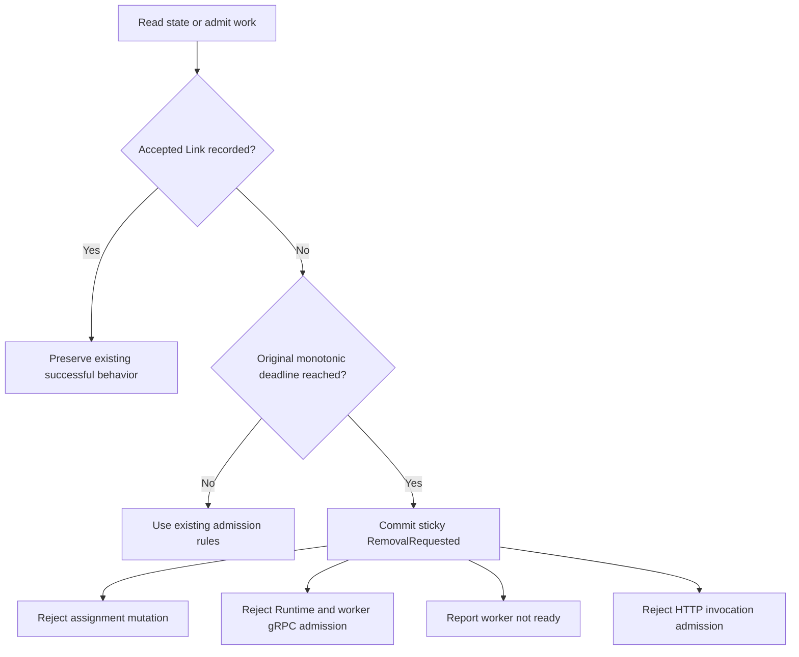
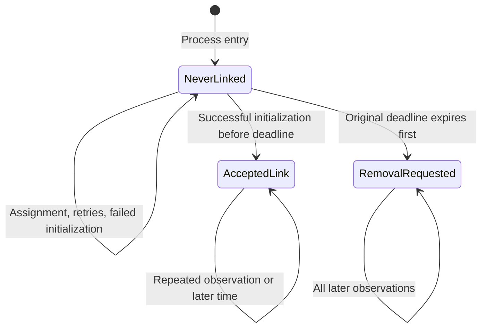

# BYOC WorkerProxy never-linked cleanup

> **Scope:** W1 only: remove a Worker pod that never completes its first accepted Runtime Link.
>
> **Dependency assumption:** [Azure/azure-functions-host#12103](https://github.com/Azure/azure-functions-host/pull/12103)
> is still open. This change does not add or copy that authentication work. Deployed BYOC Link traffic
> still depends on the platform providing equivalent authentication.

## Context

In the split BYOC design, the Functions Runtime connects to a customer worker through WorkerProxy.
WorkerProxy owns the local relay and publishes worker state. Legion creates and deletes the pod.

A pod can be created but never become usable. For example, the assignment response can be lost, the
worker can return a failed initialization response, or no Runtime Link can arrive. Without one fixed
deadline, those pods can remain allocated indefinitely.

## Before and after

| Scenario | Before | With W1 |
| --- | --- | --- |
| WorkerProxy starts but no Link completes | The pod can remain in `Starting`. | The original process-start deadline publishes `RemovalRequested`. |
| Assignment or initialization retries occur | A future timer could accidentally be based on later work. | The original deadline is frozen and never reset. |
| Initialization succeeds before the deadline | No process-local accepted-Link history is retained. | Accepted-Link history is retained and the deadline stops. |
| Work arrives after expiry | Some paths can still observe an otherwise usable worker. | Assignment, relay admission, readiness, and HTTP invocation admission reject new work. |
| Pod needs physical deletion | WorkerProxy has no deletion ownership. | WorkerProxy reports `RemovalRequested`; Legion still deletes the pod. |

## Exact W1 scope

W1 implements one rule:

> A WorkerProxy process has one fixed window, starting at process entry, to complete its first
> successful worker initialization on a live Runtime/worker relay pair.

The default window is five minutes. `WorkerProxy:NeverLinkedTimeout` can configure the duration, but
the value is read and frozen when the state manager is created.

This covers:

- a worker abandoned before assignment;
- a lost create or assignment response followed by assignment replay;
- failed or rejected initialization attempts;
- retries and configuration reloads;
- a successful initialization racing the deadline;
- late management, gRPC, readiness, and HTTP admission after expiry.

Failed initialization and relay retries do not create an immediate second removal path. They keep the
same original deadline.

## Five-minute timeline

Construction time is included. Assignment, token/bootstrap work, initialization progress, retries,
failed responses, and configuration reload do not move the deadline.

## End-to-end ownership

| Component | W1 responsibility | Not owned here |
| --- | --- | --- |
| Process entry | Capture the immutable UTC and monotonic startup origin before host construction. | Platform process-start recovery. |
| `WorkerPodStateManager` | Freeze the duration, serialize Link acceptance versus expiry, and publish sticky state. | Physical deletion. |
| `FunctionRpcRelay` | Record success only from a successful initialization on the current live stream pair; reject new streams after removal. | Runtime drain or established-Link cleanup. |
| Management and HTTP paths | Project removal and close new admission. | Draining an invocation already admitted. |
| Legion | Observe `RemovalRequested` and delete the pod. | WorkerProxy relay state. |

## Decision flow

## State transitions

`AcceptedLink` is process-local history. The public Link projection remains `Unlinked` because this
PR does not publish authoritative Runtime Link identity.

## Public behavior after expiry

| Surface | Result |
| --- | --- |
| `POST /admin/infra/instanceState` | Reports `status: RemovalRequested` with a higher revision. |
| `GET /admin/worker/state` | Reports no ready worker capacity. |
| `GET /admin/worker/ready` | Returns `503 Service Unavailable`. |
| `PUT /admin/worker/assignment` | Returns `409 Conflict` with error code `RemovalRequested`. |
| Runtime or worker `FunctionRpc/EventStream` admission | Returns gRPC `Unavailable`. |
| HTTP invocation forwarding | Returns `503 Service Unavailable` without forwarding. |
| `GET /admin/instance/ready` | Remains `200 OK`; it is process liveness, not worker admission. |

The first terminal decision is sticky. A later assignment, successful response, retry, or
configuration reload cannot reopen the WorkerProxy.

## Implementation map

| File or area | Change |
| --- | --- |
| `Program.cs` and `WorkerProxyStartupTime.cs` | Capture process startup before host/configuration construction. |
| `WorkerProxyOptions*` | Add the default five-minute positive duration and timer-range validation. |
| `NeverLinkedTimeoutService.cs` | Keep one application-lifetime wait for the original deadline. |
| `WorkerPodStateManager.cs` | Serialize expiry, accepted-Link history, sticky state, polling, assignment, and readiness. |
| `FunctionRpcRelay*.cs` | Record successful initialization and reject late gRPC admission. |
| Management state and errors | Project `RemovalRequested` and reject late assignment. |
| HTTP forwarding | Reject new invocation admission after removal. |
| `FunctionRpcRelayTests.NeverLinked.cs` | Exercise W1 through public management, gRPC, readiness, and HTTP surfaces. |

## Assumptions

1. Legion already deletes a split Worker when it observes `FunctionsSplitWorkerStatus.RemovalRequested`.
2. The configured timeout is a process-lifetime setting. Runtime configuration reload does not
   change an existing process deadline.
3. A successful `WorkerInitResponse` on the current live Runtime/worker pair is the local accepted-Link
   signal available to WorkerProxy. It ends W1 even if assignment previously failed, but it does not
   reopen assignment or worker readiness.
4. The foundation branch already contains the management state and `RemovalRequested` status shape
   used by Legion.
5. Authentication is supplied by the platform or by the still-unmerged authentication PR; this PR
   does not introduce an unauthenticated production design. Until that dependency lands, the local
   accepted-Link signal has the same authentication limitation as the existing FunctionRpc relay.

## Known limitations

- If WorkerProxy never starts, crashes before reporting, or cannot publish state, platform
  startup/failure recovery must reclaim the pod.
- This PR does not remove a pod when an already accepted Link later disconnects. That is W2/W3
  established-Link cleanup and is intentionally excluded.
- This PR does not immediately remove an assigned worker after a failed initialization or relay
  outcome. The original never-linked deadline remains the only W1 timer and removal path.
- The public Link field remains `Unlinked`; authoritative Runtime Link identity is not available in
  WorkerProxy yet.
- An HTTP invocation already admitted before removal can finish. W1 closes new admission; it does not
  add invocation drain.
- The timeout is process-local and is not persisted across a WorkerProxy restart.

## Compatibility and rollout

- Removal behavior changes only workers that fail to complete accepted Link within five minutes.
- Successful workers keep their existing relay and replacement behavior.
- The public `StartupTime` now reports the process-entry origin used by the deadline instead of the
  later state-manager construction time.
- Accepted-Link history is process-local and does not create a public state revision by itself.
- No protobuf, Runtime, Legion, image, or dependency change is included.
- The duration can be adjusted through `WorkerProxy:NeverLinkedTimeout` before process startup.
- Rollback is a WorkerProxy code rollback; Legion behavior does not need to change.

## Behavioral test matrix

| Test | Public behavior proved |
| --- | --- |
| `NeverLinkedDeadline_IncludesConstructionTimeAndUsesMonotonicClock` | Host construction counts against the deadline, UTC jumps do not, and management publishes removal. |
| `NeverLinkedDeadline_ClosesPublicAdmissionAndPublishesStickyRemoval` | Abandoned pre-assignment worker, long-poll publication, sticky state, late assignment/gRPC rejection, readiness closure, and HTTP rejection. |
| `NeverLinkedDeadline_AssignmentFailureAndReloadDoNotResetDeadline` | Assignment replay, failed initialization, and configuration reload keep the original deadline; late success is rejected. |
| `NeverLinkedDeadline_SuccessfulInitializationCancelsExpiry` | A completed successful initialization keeps management and relay behavior available after the deadline. |
| `NeverLinkedDeadline_BoundarySelectsOneStickyOutcome` | Successful initialization and expiry serialize so only one outcome wins. |

## Intentionally unchanged

- Runtime Link, Unlink, worker registry, scale-in, and drain behavior.
- Established-Link W2/W3 cleanup.
- Runtime fallback deletion or outbox publication.
- Invocation drain.
- Legion deployment or deletion code.
- Authentication implementation.
- PR #13 and its unrelated R2, R3, R4, W2/W3, P1/P2/P3, Runtime-drain, and fallback changes.
