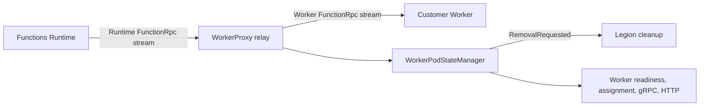
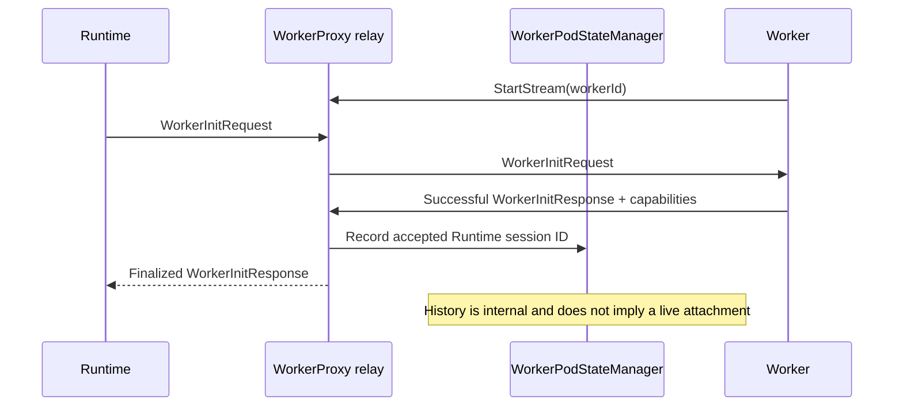
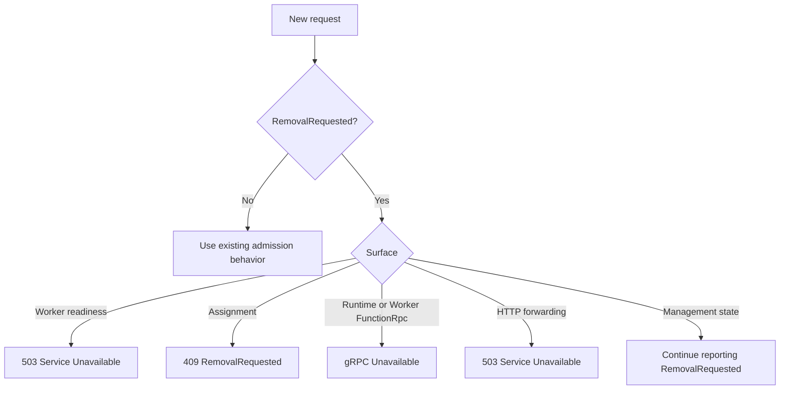

# BYOC W2: established Runtime attachment loss

> **Scope:** WorkerProxy behavior after an established Runtime attachment is terminally lost.
>
> **Review goal:** Verify that WorkerProxy makes one sticky removal decision, closes new work
> admission, and gives a capable customer Worker one best-effort termination notification without
> taking ownership of process or container deletion.

## Context

WorkerProxy relays one Runtime-facing FunctionRpc stream to one customer-Worker-facing FunctionRpc
stream. Once the paired streams complete a successful worker initialization, WorkerProxy treats that
session as the locally accepted Runtime Link.

W2 covers a later terminal outcome on the Runtime-facing stream:

- peer EOF or close;
- call cancellation; or
- a stream fault.

This is not the W1 never-linked timeout. There is no process-start clock, deadline service, or
startup-lifetime policy in this change.

## Ownership and scope



| Component | Owns in W2 | Does not own |
| --- | --- | --- |
| FunctionRpc relay | Runtime terminal classification and best-effort `WorkerTerminate` delivery | Runtime reconnection or invocation replay |
| WorkerPodStateManager | Accepted Runtime session history and sticky `RemovalRequested` | Public Runtime identity publication |
| WorkerProxy admission surfaces | Rejecting new worker readiness, assignment, gRPC, and HTTP admission | Draining already-admitted work |
| Legion | Container deletion and forced stop | FunctionRpc message sequencing |

The change intentionally excludes W1 timers, W3 customer-Worker health policy, W4 intentional
removal, Runtime fallback or outbox work, Docker changes, and Legion changes.

## Accepted-Link boundary

WorkerProxy cannot publish or authenticate the platform's full Runtime identity. The local accepted
Link milestone is the first successful `WorkerInitResponse` on the current live Runtime/Worker pair.
The deployment is expected to authenticate the Runtime-facing connection before this point.



The accepted Runtime session ID, worker ID, and assignment fields remain available as historical
attribution after W2. The state simultaneously sets `IsWorkerAttached` and worker readiness to false,
so retained identity is never presented as a usable live attachment.

## Runtime terminal sequence

Sticky removal is committed before WorkerProxy attempts customer-Worker notification.

```mermaid
sequenceDiagram
    participant Runtime
    participant Relay as WorkerProxy relay
    participant State as WorkerPodStateManager
    participant Worker
    participant Legion

    Runtime--xRelay: EOF, cancellation, or fault
    Relay->>State: End accepted Runtime session
    State->>State: Withdraw readiness and set RemovalRequested
    State-->>Legion: RemovalRequested visible through management polling
    alt Worker advertised HandlesWorkerTerminateMessage
        Relay-->>Worker: WorkerTerminate(gracePeriod = 5 seconds)
        Note over Relay,Worker: Queue before closing; cancel a stuck stream after the grace period
    else Unsupported or broken Worker stream
        Relay->>Relay: Close without notification
    end
```

`WorkerTerminate` is the existing protobuf message and uses the repository-standard five-second
grace period. The Worker-facing stream remains open until the Worker closes it or that grace period
expires. No acknowledgement is required. A failed queue, broken stream, or unresponsive Worker
cannot roll back or delay `RemovalRequested`; a stuck Worker stream is canceled after the grace
period.

WorkerProxy does not kill a process, kill a container, replay an invocation, or accept a replacement
Runtime. It keeps its management listener alive for Legion to observe removal.

## Admission after removal



`/admin/instance/ready` remains available because it represents the WorkerProxy management process,
not customer-Worker admission. `/admin/worker/ready` returns 503 after removal.

Requests admitted before the terminal outcome have no completion guarantee. W2 adds no drain,
retry, or replay semantics.

## Before and after

| Scenario | Before | After |
| --- | --- | --- |
| Accepted Runtime stream closes | Both relay sides terminate, but the pod can appear replaceable | Worker readiness is withdrawn and sticky removal is published |
| Worker supports termination | Relay closes both sides immediately | WorkerProxy queues one `WorkerTerminate` before closing the Worker side |
| Worker does not support termination | Relay closes both sides | Removal proceeds without a new message or acknowledgement |
| Replacement attachment or assignment | Existing relay/assignment rules apply | Runtime/Worker gRPC and assignment admission remain permanently closed |
| Configured HTTP fallback exists | HTTP can still resolve the configured destination | New forwarding returns 503 before using any destination |
| WorkerProxy application stops | Session terminates | Shutdown remains shutdown and does not select W2 removal |

## Assumptions

| Assumption | Reason |
| --- | --- |
| Runtime-facing transport authentication happens before local accepted Link | WorkerProxy does not add or replace the authentication contract |
| Successful worker initialization is the local accepted-Link milestone | It is the shared protocol point visible to both relay sides |
| Terminal Runtime EOF, cancellation, and fault are final for W2 | Broader transient connection policy is outside this PR |
| Legion polls management state and owns deletion | WorkerProxy must remain alive and must not kill the container |
| Five seconds is the standard Worker termination grace period | It matches the existing Functions worker shutdown contract |

## Known limitations

- Public `link.runtime` remains unset and the split link projection remains `Unlinked`. The last
  accepted Runtime session ID is retained only inside WorkerProxy.
- Local loopback tests do not prove deployed Runtime transport authentication or Legion deletion.
- A Worker-side terminal outcome does not become W2. Customer-Worker health policy belongs to W3.
- W2 does not settle, retry, or replay already-admitted invocations.
- WorkerProxy reports the removal request; it cannot prove that Legion deleted the pod.
- No Runtime-side fallback, trailer, outbox, or replacement coordination is added.

## Implementation map

| Area | Files | Reviewer focus |
| --- | --- | --- |
| Accepted history and sticky state | `src/Functions.WorkerProxy/State/WorkerPodStateManager.cs`, `WorkerPodState.cs` | Session validation, retained identity, one-way removal |
| Runtime terminal sequencing | `src/Functions.WorkerProxy/Rpc/FunctionRpcRelay.Session.cs`, `FunctionRpcRelay.cs` | Runtime-only classification, notification before close, bounded stuck stream |
| Management projection | `ManagementApiHandlers.cs`, `WorkerApiErrorCodes.cs`, `SplitWorkerOriginState.cs`, `WorkerAssignmentResult.cs` | Stable 409 error and `RemovalRequested` reporting |
| HTTP admission | `WorkerHttpForwardingMiddleware.cs`, `WorkerHttpForwardingTelemetry.cs` | Configured fallback cannot bypass removal |
| Behavioral coverage | `test/Functions.WorkerProxy.Tests/Rpc/FunctionRpcRelayTests.RuntimeLinkLoss.cs` | Five public-surface lifecycle scenarios |

## Behavioral tests

The PR adds exactly five top-level behavioral test methods. They use real loopback gRPC and
management or forwarding HTTP surfaces rather than isolated method-level unit tests.

| Test | Main behavior |
| --- | --- |
| `RuntimeLinkLoss_CapableWorkerReceivesTerminateAndHistoricalAttributionIsRetained` | One `WorkerTerminate`, five-second payload, removal, and retained non-live identity |
| `RuntimeLinkLoss_UnsupportedWorkerRemovesWithoutTerminate` | Unsupported capability cannot delay removal |
| `RuntimeLinkLoss_CancellationAndFaultPublishRemovalBeforeNotificationConsumption` | Cancellation and fault publish removal before the Worker consumes notification |
| `RemovalRequested_ClosesGrpcAssignmentHttpAndWorkerReadinessAdmission` | Sticky rejection across gRPC, assignment, HTTP, and readiness while management stays alive |
| `NonW2Termination_PreAcceptedRuntimeLossAndApplicationShutdownDoNotRequestRemoval` | W1 boundary, initialization-close race, and application-owned shutdown remain outside W2 |
