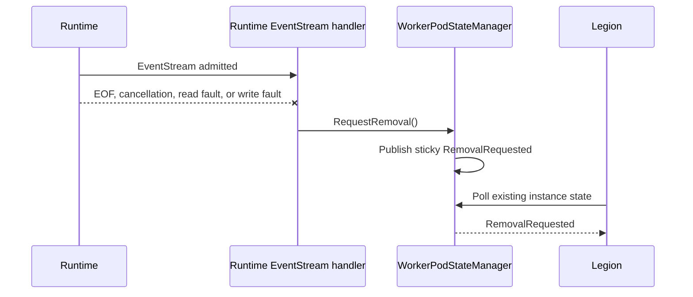
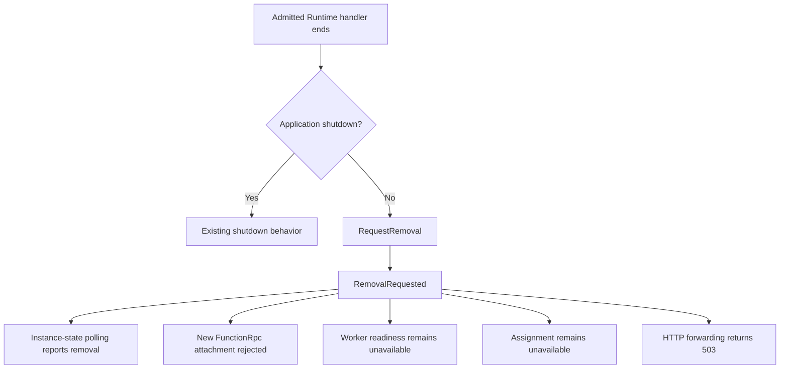

# BYOC W2: Runtime EventStream loss

> **Scope:** An admitted Runtime-facing FunctionRpc EventStream ends unexpectedly.
>
> **Review goal:** Verify that the existing EventStream completion callback publishes one sticky
> removal decision and closes new admission while WorkerProxy remains observable to Legion.

## Context

WorkerProxy already awaits the read and write operations for each admitted FunctionRpc EventStream.
W2 uses that existing handler completion path directly.

This matches the standard non-BYOC shape:

- `FunctionRpcService.EventStream` observes stream EOF, cancellation, and faults through `MoveNext`
  and handler completion.
- Worker process death is a separate concern handled through `Process.Exited`.
- WorkerProxy has no customer process to own, so it reacts only to its admitted Runtime EventStream
  ending unexpectedly and leaves pod deletion to Legion.

## W2 flow

The admitted handler is the boundary. A duplicate or rejected Runtime stream never owns a relay
session and therefore cannot select W2. If the relay cancels the Runtime handler because the Worker
side ended first, or because WorkerProxy is shutting down, that completion is not W2.

## State and admission

`WorkerPodStateManager.RequestRemoval` is the single sticky transition. It clears live Worker and
assignment identity because `RemovalRequested` is the public contract.

The checks use the same `RemovalRequested` state. `/admin/instance/ready` remains available because
it reports the WorkerProxy management process, not customer invocation admission.

## Before and after

| Scenario | Before | After |
| --- | --- | --- |
| Admitted Runtime EventStream ends | Relay session terminates and may be replaced | Sticky `RemovalRequested` is published |
| Runtime ends before Worker initialization | No special lifecycle outcome | W2 still applies because the Runtime handler was admitted |
| Duplicate Runtime EventStream is rejected | Rejected as duplicate | Rejection does not request removal |
| Worker side ends first | Session terminates | Existing replacement behavior remains; no W2 |
| WorkerProxy shuts down | Session terminates | Shutdown remains shutdown; no W2 |
| New gRPC, assignment, readiness, or HTTP work | Existing admission rules apply | Admission remains closed while state polling stays alive |

## Implementation map

| Area | Files | Reviewer focus |
| --- | --- | --- |
| Existing handler completion | `src/Functions.WorkerProxy/Rpc/FunctionRpcRelay.Session.cs`, `FunctionRpcRelay.cs` | Runtime-side terminal classification and shutdown exclusion |
| Sticky state | `src/Functions.WorkerProxy/State/WorkerPodStateManager.cs`, `WorkerPodState.cs` | One-way removal and cleared live identity |
| Legion projection | `src/Functions.WorkerProxy/State/SplitWorkerOriginState.cs` | Existing polling reports `RemovalRequested` |
| HTTP admission | `src/Functions.WorkerProxy/Http/WorkerHttpForwardingMiddleware.cs` | Configured fallback cannot bypass removal |
| Behavioral coverage | `test/Functions.WorkerProxy.Tests/Rpc/FunctionRpcRelayTests.RuntimeLinkLoss.cs` | Five public-surface lifecycle methods |

## Behavioral tests

The five test methods use loopback gRPC, a deterministic Runtime writer failure, and existing HTTP
and management APIs.

| Test | Proves |
| --- | --- |
| `RuntimeEventStream_EofBeforeWorkerInitializationRequestsRemoval` | An admitted Runtime EOF is W2 before customer Worker initialization |
| `RuntimeEventStream_CancellationReadOrWriteFaultRequestsRemoval` | Cancellation and read/write failure paths use the same handler completion transition |
| `RejectedOrRelayCanceledRuntimeHandler_DoesNotRequestRemoval` | Rejected duplicate and relay-owned cancellation do not select W2; replacement still works |
| `ApplicationShutdown_DoesNotRequestRemoval` | Application-owned shutdown is excluded |
| `RemovalRequested_IsStickyPollableAndClosesNewAdmission` | Polling remains alive while gRPC, assignment, readiness, and HTTP admission remain closed |

## Assumptions and limitations

- Runtime-facing transport authentication occurs before WorkerProxy admits the EventStream.
- W1 owns any never-linked deadline and its Link-acceptance outcome; W2 does not duplicate that
  state.
- A terminal outcome on an admitted Runtime handler is final for this pod.
- Worker-side health policy remains W3 and intentional removal remains W4.
- WorkerProxy does not kill a process or container, replay invocations, or drain admitted work.
- Local loopback tests do not prove deployed authentication or Legion deletion.
