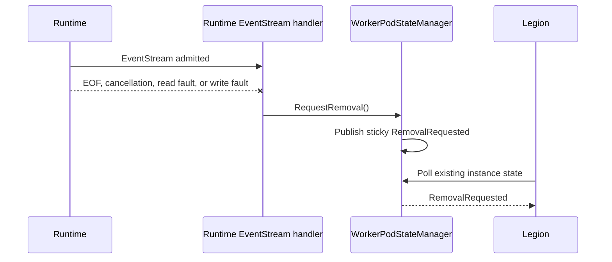
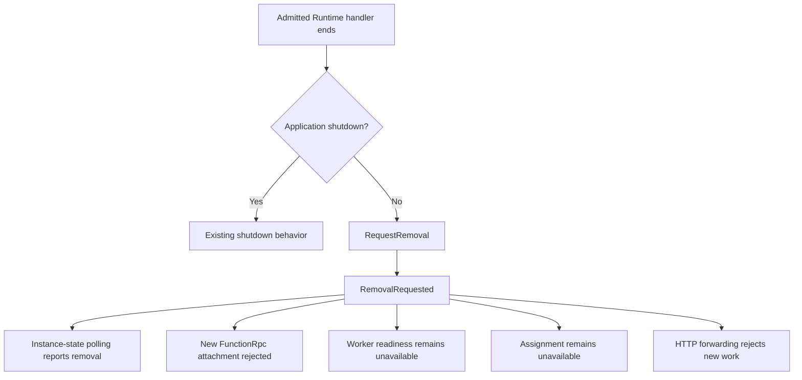

# BYOC W2: Runtime EventStream loss

> **Scope:** An admitted Runtime-facing FunctionRpc EventStream ends unexpectedly.
>
> **Review goal:** Verify that the existing EventStream completion callback publishes one sticky
> removal decision and closes new admission while WorkerProxy remains observable to Legion.

## Context

WorkerProxy already awaits the read and write operations for each admitted FunctionRpc EventStream.
W2 uses that existing handler completion path directly.

This matches the standard non-BYOC shape:

- `FunctionRpcService.EventStream` observes stream EOF, cancellation, and faults through `MoveNext`
  and handler completion.
- Worker process death is a separate concern handled through `Process.Exited`.
- WorkerProxy has no customer process to own, so it reacts only to its admitted Runtime EventStream
  ending unexpectedly and leaves pod deletion to Legion.

## W2 flow

The admitted handler is the boundary. A duplicate or rejected Runtime stream never owns a relay
session and therefore cannot select W2. If the relay cancels the Runtime handler because the Worker
side ended first, or because WorkerProxy is shutting down, that completion is not W2.
Admission alone establishes this boundary: loss before any Runtime protocol input, including
Token Service bootstrap-only traffic, still requests removal. Pre-protocol Runtime retries are
not supported.

## State and admission

`WorkerPodStateManager.RequestRemoval` is the single sticky transition. It clears live Worker and
assignment identity, including the assigned HTTPS origin and HTTP concurrency, because
`RemovalRequested` is the public contract. The pod's startup timestamp and known authentication
configuration health are retained. Non-W2 assigned-session termination preserves the existing
`Terminated` versus `Failed` distinction and assignment-retry contract.

The checks use the same `RemovalRequested` state. Authenticated management assignment and
instance-state polling remain available while customer invocation admission is closed.
Clearing assignment also withdraws Runtime authentication keys, so new HTTP and gRPC calls may
be rejected by authentication before reaching the removal guard. An authenticated HTTP request
that reaches the forwarding guard receives `503`.

Runtime loss also terminates initialization waiting for an assigned function group and, when needed,
an HTTP proxy origin, releases its waiter and queued messages, and leaves no published destination.
Session termination retains worker and session log correlation even though the removal snapshot
clears live identity; rejected
replacement streams still emit the existing admission diagnostic.

## Before and after

| Scenario | Before | After |
| --- | --- | --- |
| Admitted Runtime EventStream ends | Relay session terminates and may be replaced | Sticky `RemovalRequested` is published |
| Runtime ends before any protocol input or Worker initialization | A pre-protocol connection may retain the Worker for retry | W2 applies because the Runtime handler was admitted; replacement is rejected |
| Duplicate Runtime EventStream is rejected | Rejected as duplicate | Rejection does not request removal |
| Worker side ends first | Session terminates | Unassigned-session replacement and terminal assigned-session behavior remain; no W2 |
| WorkerProxy shuts down | Session terminates | Shutdown remains shutdown; no W2 |
| New gRPC, assignment, readiness, or HTTP work | Existing admission rules apply | Admission remains closed while state polling stays alive |

## Implementation map

| Area | Files | Reviewer focus |
| --- | --- | --- |
| Existing handler completion | `src/Functions.WorkerProxy/Rpc/FunctionRpcRelay.Session.cs`, `FunctionRpcRelay.cs` | Runtime-side terminal classification and shutdown exclusion |
| Sticky state | `src/Functions.WorkerProxy/State/WorkerPodStateManager.cs`, `WorkerPodState.cs` | One-way removal and cleared live identity |
| Legion projection | `src/Functions.WorkerProxy/State/WorkerOriginState.cs` | Existing polling reports `RemovalRequested` |
| HTTP admission | `src/Functions.WorkerProxy/Http/WorkerHttpForwardingMiddleware.cs` | Configured fallback cannot bypass removal |
| Behavioral coverage | `test/Functions.WorkerProxy.Tests/Rpc/FunctionRpcRelayTests.RuntimeLinkLoss.cs` | Admission, removal, shutdown, and rejection diagnostics |

## Behavioral tests

Lifecycle tests use loopback gRPC and existing HTTP and management APIs. One focused in-process
theory injects transport read and write failures that loopback gRPC cannot produce deterministically.
An additional in-process theory delays Runtime handler completion while Worker messages continue,
verifying that Runtime write failure is recorded before shared queue cleanup.

| Test | Proves |
| --- | --- |
| `RuntimeEventStream_EofBeforeWorkerInitializationRequestsRemoval` | An admitted Runtime EOF is W2 with or without a Worker attachment and before or after the first Runtime protocol input |
| `RuntimeEventStream_CancellationRequestsRemoval` | Runtime call cancellation uses the same handler completion transition |
| `ApplicationShutdown_DoesNotRequestRemoval` | Application-owned shutdown is excluded |
| `RemovalRequested_IsStickyPollableAndClosesNewAdmission` | Mapped HTTPS origin and default/explicit capacity are advertised before removal and cleared afterward in both startup modes; known authentication health is retained, and an identified Runtime transitions from linked/running to unlinked/removal-requested and wakes a pending infrastructure-state poll while new work remains closed |
| `InstanceState_PreInitRuntimeLossRequestsRemovalAndClearsIdentity` | Pre-protocol loss clears identified or unidentified Runtime state and rejects replacement Runtime and assignment requests |
| `Relay_RuntimeOnlyTerminationBeforeProtocolInputRequestsRemoval` | Runtime-only cancellation before protocol input permanently prevents a later Worker attachment |
| `Relay_CanceledPreInitRuntimeCannotSendLateMessagesAfterRemoval` | A canceled Runtime reader cannot publish late protocol input or restore readiness after removal |
| `Relay_ProxyBootstrapPrecedesCustomerAndRuntimeLossRequestsRemoval` | Infrastructure bootstrap still precedes Worker startup, but Runtime loss fails pending identity requests, withdraws authentication for new Runtime calls, and leaves management polling available |
| `AttachmentRejected_DistinguishesRemovalFromShutdown` | Removal-driven rejection retains a distinct diagnostic reason from application shutdown |
| `Relay_TerminationWhileWaitingForAssignment_ReleasesWaiter` | Runtime EOF/cancellation clears pending assignment initialization for HTTP and non-HTTP workers and requests removal with correlated diagnostics; application shutdown releases the same wait without removal |
| `Relay_RuntimeStreamFailureRequestsRemovalAndPreservesFault` | Runtime read and write faults preserve the terminal error and select W2 |
| `Relay_RuntimeWriteFailureWithContinuingWorkerMessagesRequestsRemoval` | Concurrent Worker queue failures cannot override the originating Runtime write failure or suppress removal, before or after assignment |
| `Relay_LateRuntimeWriteFailurePreservesFirstTermination` | Runtime write failures after shutdown or Worker termination cannot override the first terminal outcome or request removal |
| `InstanceState_InitializationBeforeAssignment_BecomesLinkedAfterAssignment` | Successful initialization waits for authoritative assignment capabilities, then publishes the correlated linked state |
| `InstanceState_UnmatchedInitializationResponses_RemainUnlinkedUntilCurrentRequestMatches` | Unmatched and replayed responses cannot publish linked state; a stale response cannot consume a newer request, while a matching response can complete initialization |

## Assumptions and limitations

- Runtime-facing transport authentication occurs before WorkerProxy admits the EventStream.
- W1 owns any never-linked deadline and its Link-acceptance outcome; W2 does not duplicate that
  state.
- A terminal outcome on an admitted Runtime handler is final for this pod.
- Worker-side health policy remains W3 and intentional removal remains W4.
- WorkerProxy does not kill a process or container, replay invocations, or drain admitted work.
- Local loopback tests do not prove deployed authentication or Legion deletion.
